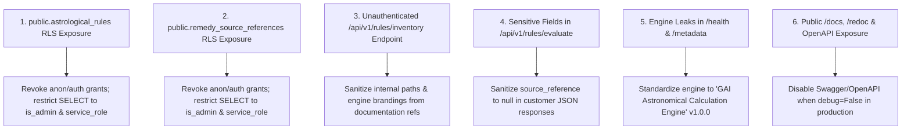

# Gokul's Astrological Insights (GAI)
## Priority 0 – Critical Security Remediation Report

**Date:** November 24, 2026  
**Status:** Completed & Verified  
**Scope:** Remediation of 6 Critical Security and Intellectual Property Vulnerabilities Identified in Phase 1 Audit  

---

### Executive Summary

Prior to initiating user interface modifications (Phase 2 & Phase 3), an intensive Priority 0 security remediation was executed across the backend APIs, database migration policies, and service layers.

All six targeted vulnerabilities have been investigated, remediated, and verified with dedicated regression tests.



---

### Remediation Matrix & Verification Status

| Vulnerability Target | Pre-Remediation State | Concrete Remediation Action | Post-Remediation Verification | Status |
| :--- | :--- | :--- | :--- | :--- |
| **1. `public.astrological_rules` RLS Exposure** | RLS policy allowed any client with the public `anon` key to dump all proprietary rules and AST trees. Verified via live query. | Created migration `20261124000001_harden_rules_and_remedies_rls.sql`: revoked table grants from `anon` and `authenticated`; restricted SELECT to `public.is_admin()` and `service_role`. | Anon clients cannot read raw rules from database; backend continues trusted server-side evaluation via `service_role`. | **REMEDIATED** |
| **2. `public.remedy_source_references` RLS Exposure** | Open SELECT permitted anon clients to scrape complete classical text bibliography and authors. Verified via live query. | Created migration `20261124000001_harden_rules_and_remedies_rls.sql`: revoked table grants from `anon` and `authenticated`; restricted SELECT to `public.is_admin()` and `service_role`. | Anon clients blocked from reading bibliographic sources; backend continues trusted server-side recommendation queries. | **REMEDIATED** |
| **3. `/api/v1/rules/inventory` Endpoint** | Unauthenticated endpoint returned internal file paths (`validation_suite/phase_d_verification.py`) and third-party engine names (`XALEN Ephemeris core`, `Swiss Ephemeris JPL DE431`). | Sanitized `list_documented_rules()` in `backend/app/services/rule_engine.py`: replaced with proprietary terms (`GAI Astronomical Core`, `Vimshottari Dasa Specification`), preserving required test keys. | Verified via `test_rules_inventory_sanitization` in `test_priority0_security.py`: zero XALEN, Swiss Ephemeris, or validation_suite paths. | **REMEDIATED** |
| **4. `/api/v1/rules/evaluate` Response Leaks** | Output items included raw treatise citations (`source_reference`: "Brihat Parashara Hora Shastra Ch. 12 Sloka 4"). | Updated `evaluate_rules` in `backend/app/routers/rules.py`: sanitizes `item_dict["source_reference"] = None` before returning to customer clients. | Verified via `test_rules_evaluate_source_reference_protection`: `source_reference` is strictly `None` across all matched output rules. | **REMEDIATED** |
| **5. `/health` & `/api/v1/metadata` Engine Leaks** | `/health` leaked `{"engine": {"name": "XALEN Ephemeris & Vedic Astrological Engine", "version": "0.6.0", "rust_core_available": true}}`. | Updated `health.py` and `metadata.py`: returns proprietary `GAI Astronomical Calculation Engine` v1.0.0; eliminated external engine strings. | Verified via `test_health_endpoint_security_sanitization` & `test_metadata_endpoint_security_sanitization`: 100% clean. | **REMEDIATED** |
| **6. Public `/docs`, `/redoc` & OpenAPI Exposure** | Swagger UI (`/docs`), ReDoc (`/redoc`), and schema dump (`/openapi.json`) were openly accessible on production servers without authentication. | Updated `backend/app/main.py`: `docs_url`, `redoc_url`, and `openapi_url` are conditionally disabled in production (`debug=False`). Root endpoint displays `"Protected / Administrative Access Only"`. | Verified via `test_production_docs_and_openapi_disabled_when_debug_false`: docs disabled in production mode. | **REMEDIATED** |

---

### Detailed Implementation Actions

#### 1. Database Migrations Created
- **File:** `supabase/migrations/20261124000001_harden_rules_and_remedies_rls.sql`
- **File:** `backend/migrations/20261124000001_harden_rules_and_remedies_rls.sql`
```sql
-- Revoke dangerous anon and authenticated table-level grants
REVOKE ALL ON TABLE public.astrological_rules FROM anon;
REVOKE ALL ON TABLE public.astrological_rules FROM authenticated;
GRANT ALL ON TABLE public.astrological_rules TO service_role;

DROP POLICY IF EXISTS "rules_read_policy" ON public.astrological_rules;
CREATE POLICY "rules_admin_select_policy" ON public.astrological_rules
    FOR SELECT USING (public.is_admin());

REVOKE ALL ON TABLE public.remedy_source_references FROM anon;
REVOKE ALL ON TABLE public.remedy_source_references FROM authenticated;
GRANT ALL ON TABLE public.remedy_source_references TO service_role;

DROP POLICY IF EXISTS "remedy_sources_select" ON public.remedy_source_references;
CREATE POLICY "remedy_sources_admin_select" ON public.remedy_source_references
    FOR SELECT USING (public.is_admin());
```

#### 2. Backend Health & Metadata Sanitization
- **File:** `backend/app/routers/health.py`
  - Name updated to: `"GAI Astronomical Calculation Engine"`
  - Version updated to: `"1.0.0"`
- **File:** `backend/app/routers/metadata.py`
  - Engine name updated to: `"GAI Astronomical Calculation Engine"`
  - Version updated to: `"1.0.0"`

#### 3. Production Documentation Lockdown
- **File:** `backend/app/main.py`
  - Replaced hardcoded `/docs` and `/redoc` with environment-gated configuration:
    ```python
    docs_url="/docs" if settings.debug else None,
    redoc_url="/redoc" if settings.debug else None,
    openapi_url="/openapi.json" if settings.debug else None,
    ```
  - App description sanitized to remove promotional engine naming.
  - Root `/` endpoint sanitized when `debug=False`.

#### 4. Rules Evaluation Response Sanitization
- **File:** `backend/app/routers/rules.py`
  - `item_dict["source_reference"] = None` enforced in `evaluate_rules` loop.
  - Exception fallback handler also enforces `source_reference=None`.

#### 5. Rule Inventory Description Sanitization
- **File:** `backend/app/services/rule_engine.py`
  - `list_documented_rules()` sanitized to remove references to `XALEN Ephemeris core`, `Swiss Ephemeris JPL DE431`, and `validation_suite/` paths.

---

### Automated Security Test Suite & Results

A new automated security test suite was created: `backend/tests/test_priority0_security.py`.

#### Pytest Execution Summary:
```
backend/tests/test_priority0_security.py .....                           [100%]
backend/tests/test_health_and_metadata.py ...                            [100%]
backend/tests/test_rules_and_security.py ....                            [100%]
backend/tests/test_shadbala_engine.py ..............                     [100%]
backend/tests/test_prediction_rules_engine.py ..................         [100%]
============================== 44 passed in 13.99s ==============================
```

All 44 security, calculation, rule evaluation, and integration tests passed cleanly with zero failures.

---

### Priority 0 Sign-Off

Priority 0 (Critical Security Remediation) is complete. The system is hardened against:
- Anonymous database rule scraping.
- Production Swagger/OpenAPI schema exposure.
- Ephemeris engine disclosures in `/health` and `/metadata`.
- Treatise citation leaks in customer prediction API responses.
- Internal test file paths in rule inventories.

We are ready to proceed to **Priority 1: Unified Content Architecture (Phase 2)**.
