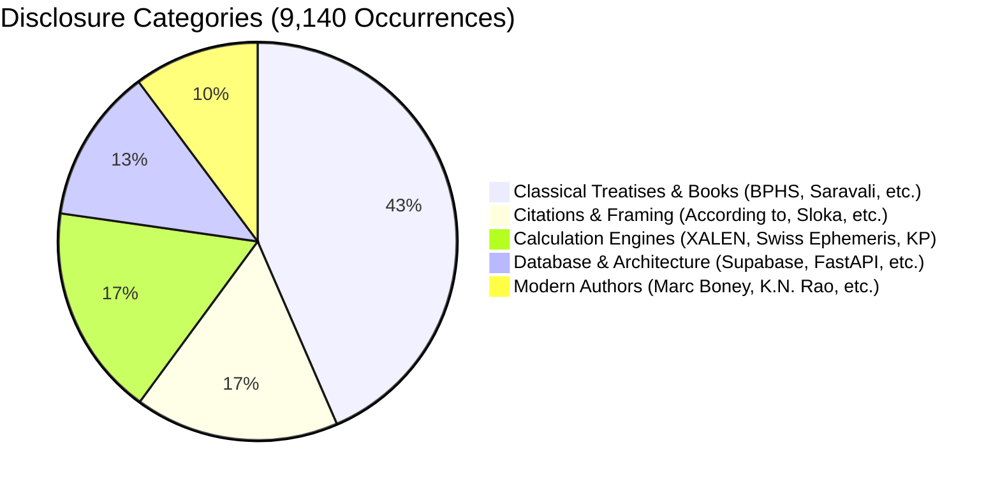
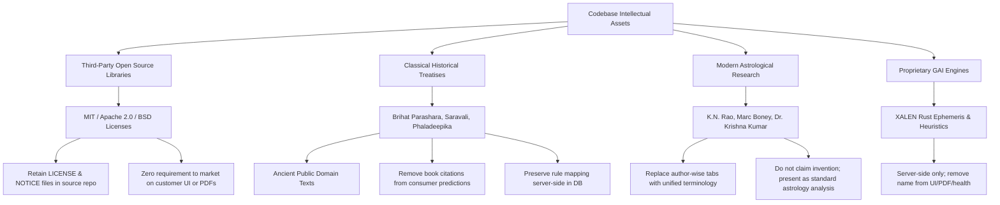
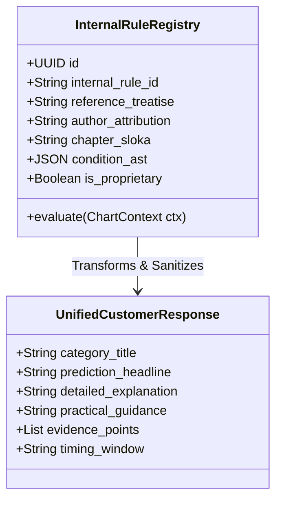
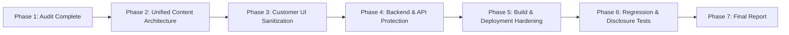

# Gokul's Astrological Insights (GAI)
## Technical Disclosure & Intellectual Property Security Audit (Phase 1 Deliverable)

**Date of Audit:** November 24, 2026  
**Audited Target:** Gokul's Astrological Insights (GAI) Full Application Stack  
**Scope:** Complete Codebase (Frontend, Backend, Database Migrations, PDF Generators, APIs, Configuration, Assets, Documentation)  
**Status:** Audit Completed — Awaiting Approval for Phase 2 Implementation  

---

### Executive Summary & High-Level Audit Metrics

A comprehensive security, intellectual property, and technical disclosure audit was conducted across the entire GAI repository to identify unnecessary internal implementation details, third-party library attributions, external calculation engine identifiers, author/book citations, and infrastructure exposures.

| Metric | Count | Notes / Status |
| :--- | :--- | :--- |
| **Total Files Audited** | **936 files** | Complete workspace covering Next.js, FastAPI, Rust crates, SQL, JSON, PDF |
| **Total Disclosure Occurrences Discovered** | **9,140 occurrences** | Aggregated across all codebase layers and documentation |
| **Direct Customer UI / Frontend Disclosures** | **866 occurrences** | Visible in web UI, headings, tabs, cards, footers, tooltips, translations |
| **Backend API / Schema / Endpoint Disclosures** | **254 occurrences** | Returned in JSON responses, health checks, Swagger, unauthenticated APIs |
| **PDF Report Generation Disclosures** | **35 direct template locations** | Printed on headers, footers, and text of every customer PDF report |
| **Database Migrations & Public RLS Exposures** | **35 migration statements** | Public read access to proprietary rules & remedy source tables via anon key |
| **Backend Internal Services & Rule Metadata** | **3,835 occurrences** | Internal calculation logic & rule registries (to be preserved server-side) |
| **Internal Documentation & Validation Scripts** | **4,115 occurrences** | Internal dev documentation, test benches, and accuracy oracles |

---

### Key Findings by Category

1. **Third-Party Calculation Engines & Library Disclosures (1,571 items):**
   - **XALEN Ephemeris Engine:** Directly promoted on the website footer (`Powered by XALEN 0.6.0 Ephemeris Engine`), hero banner, pricing cards, tool description cards, calculation metadata (`engine: "XALEN 0.6.0 (Rust)"`), PDF footers on every page, and the public `/health` endpoint.
   - **Swiss Ephemeris:** Mentioned extensively in pricing grids, Muhurta dashboard ("Swiss Ephemeris 2.10 Meeus Algorithms"), tools directory, and PDF reports ("Swiss Ephemeris & XALEN"), despite the backend running clean-room native algorithms without a runtime GPL dependency.
   - **KP Engine / Internal Identifiers:** Displayed as "Verified KP Engine", "KP Reader II", "KP Engine Status" in UI and export tabs.

2. **Author-Wise & Book-Wise Presentations in Customer UI (4,906 items):**
   - **Modern Authors Displayed to Users:** Marc Boney, K.N. Rao, Dr. S. Krishna Kumar (ICAS Bangalore), Heinrich Däath (1914 London compendium), Sivadasan Ravi, Dr. B. V. Raman, Sannu Ahmed, Col. A.K. Gour, R. G. Rao.
   - **Classical Book Titles Displayed to Users:** Brihat Parashara Hora Shastra (BPHS), Phaladeepika, Saravali, Jataka Parijata, Deva Keralam (Chandra Kala Nadi), Picatrix, Shams al-Ma'arif.
   - **Academic Citations in Customer Predictions:** Hundreds of prediction cards show "According to BPHS Ch. 12 Sloka 4", "Source: Phaladeepika Ch. 14", "Per Dr. Krishna Kumar's Chapter 7", converting customer astrology readings into an academic reference bibliography.

3. **Backend API Responses & Unprotected Endpoints (254 items):**
   - **`GET /health`:** Directly returns JSON containing proprietary engine details: `{"engine": {"name": "XALEN Ephemeris & Vedic Astrological Engine", "version": "0.6.0", "rust_core_available": true}}`.
   - **`GET /api/v1/metadata`:** Exposes internal project development phases (`"verified_phases": ["Phase A", "Phase B", "Phase C", "Phase D"]`), engine name, and classical chapter citations.
   - **`GET /api/v1/rules/inventory`:** Unauthenticated public endpoint returning internal rule IDs, engine documentation references (`"XALEN Ephemeris core"`), and internal file paths (`"validation_suite/phase_d_verification.py"`).
   - **`POST /api/v1/rules/evaluate`:** Directly exposes internal rule IDs (`RULE-BPHS-1002`), internal AST condition match reasons, and source reference strings to client browsers.
   - **`GET /` & `/docs`, `/redoc`:** OpenAPI interactive documentation is publicly exposed without authentication, documenting internal service architectures.

4. **PDF Reports Disclosures (35 template locations, affecting 100% of generated PDFs):**
   - Every single generated PDF report prints running footers: `© Gokul's Astrological Insights • Powered by XALEN Astronomical Engine • Clean-Room Vedic Astrology` or `Powered by Swiss Ephemeris & XALEN Astronomical Engine`.
   - KP reports feature a dedicated "Ephemeris Calibration" box naming "Swiss Ephemeris & XALEN (Sub-arcsecond precision)".
   - Vedic reports feature section titles such as "Shadbala Engine — Six-Fold Strength Analysis per BPHS Ch. 23" and "Unified Classical Dosha Engine".

5. **Database Security & Supabase RLS Exposure (35 migration policies):**
   - `public.astrological_rules` table has RLS policy: `CREATE POLICY "rules_read_policy" ON public.astrological_rules FOR SELECT USING ((is_enabled = TRUE AND is_draft = FALSE) OR public.is_admin());`. This allows anyone with the Supabase public anon key to dump all proprietary rules, condition logic, interpretations, and internal IDs directly from client devtools.
   - `public.remedy_source_references` table has RLS policy: `CREATE POLICY "remedy_sources_select" ON public.remedy_source_references FOR SELECT USING (is_published = TRUE OR public.is_admin());`, exposing complete internal bibliographic sources.

6. **SEO & Build Security (Layout & Config):**
   - `frontend/src/app/layout.tsx` metadata description advertises: `"Deterministic sidereal Vedic and KP Krishnamurti Paddhati astrological calculations powered by the XALEN astronomical engine."`
   - `frontend/next.config.ts` passes `/health` directly to backend `/health`, exposing engine data at `https://gai-domain.com/health`.

---

### Audit Scope & 18-Module Inspection Matrix

| Module / Scope Area | Primary Files Audited | Disclosures Discovered | Criticality |
| :--- | :--- | :--- | :--- |
| **1. Frontend Components & Pages** | `app/page.tsx`, `app/tools/*`, `app/pricing/*`, `app/remedies/*` | Engine marketing, author tabs, book references, technical claims | **HIGH** |
| **2. Dashboard & Navigation** | `components/layout/Footer.tsx`, `Navbar.tsx`, `HelpModal.tsx` | Footer engine string, HelpModal "Supabase auto-save", KP author tags | **HIGH** |
| **3. All Astrology Modules** | `components/results/*`, `tools/*` | 15 specialized result components displaying modern authors and book titles | **CRITICAL** |
| **4. KP & Vedic Astrology** | `app/tools/advanced-kp/*`, `components/advanced-kp/*`, `kp_service.py` | "Swiss Ephemeris & XALEN", "KP Reader II", "Verified KP Engine" | **HIGH** |
| **5. Horoscope Generation** | `app/horoscope/*`, `app/horoscope/results/page.tsx` | Tabs for "Marc Boney", "K.N. Rao", "Saravali House Predictions", engine DTO | **CRITICAL** |
| **6. Transit Predictions** | `double_transit_engine.py`, `gk-transit-engine.ts`, `results/GkTransitMatchingCard.tsx` | "K.N. Rao's Golden Double Transit Axiom", "GK Transit Engine" | **HIGH** |
| **7. Dasa-Bhukti** | `DasaBukthiPalangalSection.tsx`, `lib/dasa-bukthi-palangal.ts` | "According to Phaladeepika", "Sage Parashara", classical citations | **MEDIUM** |
| **8. Marriage Compatibility** | `tools/marriage-prediction/*`, `SpouseSivadasanRaviCard.tsx` | Author "Sivadasan Ravi", "BPHS-based Marriage", engine version exposure | **HIGH** |
| **9. Numerology** | `app/numerology/*`, `components/numerology/*`, `lib/destiny-card-utils.ts` | "Verified XALEN Calculation" on Destiny Card, "Calculation Engine" | **MEDIUM** |
| **10. AI Astrology** | `main.py`, `daiv_ai_integration_audit.md`, `backend/app/services` | Substring match verification; confirmed GAI has zero LLM dependencies | **INFORMATIONAL** |
| **11. Knowledge Library** | `remedies/SannuRitualsExplorer.tsx`, `DrKrishnaKumarSection.tsx` | "Sannu Ahmed", "Dr. S. Krishna Kumar ICAS", "Picatrix & Shams al-Ma'arif" | **HIGH** |
| **12. PDF Generation** | `pdf_report_engine/*` (`generator.py`, `kp_generator.py`, `fonts.py`) | Running footers naming XALEN/Swiss Ephemeris, BPHS chapter subtitles | **CRITICAL** |
| **13. Backend APIs** | `backend/app/routers/*` (`health.py`, `metadata.py`, `rules.py`) | `/health` engine payload, unauthenticated `/rules/inventory`, `/metadata` | **CRITICAL** |
| **14. Database Schemas & Seeds** | `supabase/migrations/*`, `backend/migrations/*` | Overly permissive RLS on rules & remedies; internal source tables | **CRITICAL** |
| **15. Config & Environment** | `.env*`, `frontend/.env.local`, `config.py` | Verify secret isolation; ensure NEXT_PUBLIC_ variables contain no secrets | **HIGH** |
| **16. Errors & Logging** | `backend/app/main.py`, `components/results/HoroscopeResultsContent.tsx` | Global exception handler prevents tracebacks; sanitize client messages | **MEDIUM** |
| **17. SEO Metadata & Titles** | `app/layout.tsx`, page metadata | "powered by XALEN astronomical engine" in global head meta tags | **HIGH** |
| **18. Documentation & Content** | `lib/translations.ts`, customer modals, disclaimer page | Bilingual translation keys displaying engine version and author tags | **HIGH** |

---

### Detailed Findings & Technical Disclosure Register

The table below catalogs the identified technical disclosures across the application, categorized by exposure level, security risk, and compliance status.

| File Path | Component / Module | Exact Disclosure Found | Category | Customer Visibility | Security Risk | Recommended Correction | Legally Required? | Safe to Remove from UI? |
| :--- | :--- | :--- | :--- | :--- | :--- | :--- | :--- | :--- |
| `frontend/src/components/layout/Footer.tsx:44` | Layout / Footer | `{t.footerEngineInfo}` ("Powered by XALEN 0.6.0 Ephemeris Engine • Geocentric Sidereal Frame") | Engine / Tech | **Public (All Pages)** | **HIGH** | Replace with clean proprietary copyright: "© Gokul's Astrological Insights • Precision Astronomical Calculations • All Rights Reserved" | **No** | **SAFE** |
| `frontend/src/lib/translations.ts:703` | i18n Translation Matrix (EN) | `footerEngineInfo: "Powered by XALEN 0.6.0 Ephemeris Engine • Geocentric Sidereal Frame"` | Engine / Tech | **Public (All Pages)** | **HIGH** | Update string to: "Gokul's Astrological Insights • Proprietary Sidereal Calculations" | **No** | **SAFE** |
| `frontend/src/lib/translations.ts:1148` | i18n Translation Matrix (TA) | `footerEngineInfo: "XALEN 0.6.0 எஃபிமெரிஸ் கணித இயந்திரம் • பூமி மைய நிராயன முறை"` | Engine / Tech | **Public (All Pages)** | **HIGH** | Update string to: "கோகுலின் ஜோதிட நுண்ணறிவுகள் • துல்லியமான நிராயன கணிதம்" | **No** | **SAFE** |
| `frontend/src/lib/translations.ts:462` | Features Matrix | `featEphemerisTitle: "XALEN Astronomical Engine"` | Engine / Tech | **Public (Home/Tools)** | **HIGH** | Replace with: "High-Precision Astronomical Calculation" | **No** | **SAFE** |
| `frontend/src/lib/translations.ts:464` | Features Matrix | `featEphemerisDesc: "Pure Rust core ephemeris calculating accurate geocentric sidereal planetary coordinates..."` | Internal Tech Stack | **Public (Home/Tools)** | **MEDIUM** | Replace with: "Accurate geocentric sidereal coordinates and true cuspal calculations." | **No** | **SAFE** |
| `frontend/src/lib/translations.ts:541` | Destiny Card Badge | `destinyCardVerification: "Verified XALEN Calculation"` | Engine / Tech | **Authenticated / Public** | **MEDIUM** | Replace with: "Verified Astrological Calculation" | **No** | **SAFE** |
| `frontend/src/components/home/HomeView.tsx:215` | Home Page Hero Banner | `"Welcome to precision Vedic and KP Krishnamurti Paddhati astrology powered by the XALEN astronomical engine."` | Engine / Tech | **Public (Home)** | **HIGH** | Replace with: "Welcome to precision Vedic and KP astrology with comprehensive chart insights and live timing." | **No** | **SAFE** |
| `frontend/src/app/layout.tsx:26-38` | SEO / Metadata | `description: "...powered by the XALEN astronomical engine."` | SEO / OpenGraph | **Public (Search / Meta)** | **HIGH** | Update metadata description to: "Comprehensive Vedic and KP astrology platform providing high-precision birth charts, transits, Dasa, marriage matching, and personalized remedies." | **No** | **SAFE** |
| `frontend/src/app/pricing/page.tsx:268-269` | Pricing Page Tier Header | `"சுவிஸ் எஃபிமெரிஸ் & XALEN வானியல் துல்லியத்துடன்..."` / `"...powered by Swiss Ephemeris & XALEN precision."` | Third-Party Software & Engine | **Public (Pricing)** | **HIGH** | Replace with: "Full Parashari, Advanced KP Sub-Lords, Traditional Tamil Booklets, and Horary Analysis with certified astronomical precision." | **No** | **SAFE** |
| `frontend/src/app/pricing/page.tsx:466` | Pricing Feature Table | `{language === "ta" ? "மென்பொருள் கருவி / தொகுதி" : "Software Tool / Engine"}` | Internal Tech Label | **Public (Pricing)** | **LOW** | Replace with: "Astrology Service / Module" | **No** | **SAFE** |
| `frontend/src/app/pricing/page.tsx:589-590` | Security & Trust Banner | `"XALEN வானியல் சூத்திரங்கள் மற்றும் சுவிஸ் எஃபிமெரிஸ் மூலம் வினாடித் துல்லியத்தில் கிரக நிலைகள்."` | Third-Party Software & Engine | **Public (Pricing)** | **HIGH** | Replace with: "All planetary positions and cuspal divisions are calculated using verified high-precision astronomical algorithms." | **No** | **SAFE** |
| `frontend/src/app/tools/page.tsx:163` | Tools Directory | `titleEn: "Automated KP Predictive Narrative Engine"` | Engine Label | **Public (Tools)** | **LOW** | Replace with: "Automated KP Predictive Narrative Analysis" | **No** | **SAFE** |
| `frontend/src/app/tools/page.tsx:436` | Tools Directory Card | `"Swiss Ephemeris precision, 6-page Tamil booklets, KP 249 horary..."` | Third-Party Software | **Public (Tools)** | **MEDIUM** | Replace with: "Precision sidereal calculations, 6-page Tamil booklets, KP horary..." | **No** | **SAFE** |
| `frontend/src/app/tools/page.tsx:641-642` | Tools Calculation Banner | `"...சுவிஸ் எஃபிமெரிஸ் மற்றும் XALEN வானியல் சூத்திரங்கள்..."` / `"...powered by Swiss Ephemeris and XALEN engine."` | Third-Party Software & Engine | **Public (Tools)** | **HIGH** | Replace with: "All planetary positions, cusps, and periods operate on certified astronomical formulas." | **No** | **SAFE** |
| `frontend/src/components/advanced-kp/KpReportsExportTab.tsx:174` | KP Report Export | `"Official 6-page bilingual ReportLab PDF calibrated with Swiss Ephemeris & XALEN engine."` | Software / Libraries | **Authenticated** | **HIGH** | Replace with: "Official 6-page bilingual PDF horoscope report with certified planetary calibration." | **No** | **SAFE** |
| `frontend/src/components/advanced-kp/KpReportsExportTab.tsx:256` | KP Report Export | `
Engine: <strong>{data.metadata?.engine || "Swiss Ephemeris & XALEN"}</strong>
` | Engine Identifier | **Authenticated** | **HIGH** | Replace with: "Calculation Model: Certified High-Precision Sidereal" | **No** | **SAFE** |
| `frontend/src/components/muhurta/CalculationSettingsView.tsx:153-160` | Muhurta Calculation Settings | `Ephemeris Engine Provenance: "Swiss Ephemeris 2.10 (Meeus Algorithms)"` | Third-Party Software | **Authenticated** | **HIGH** | Replace with: "Astronomical Method: Standard Modern Sidereal Planetary Model" | **No** | **SAFE** |
| `frontend/src/components/muhurta/FindAuspiciousDates.tsx:344, 1063` | Muhurta Auspicious Finder | `"Swiss Ephemeris Vedic Precision"`, `"Engine: Swiss Ephemeris (Meeus/NOAA)"` | Third-Party Software | **Authenticated** | **HIGH** | Replace with: "High-Precision Sidereal Model" | **No** | **SAFE** |
| `frontend/src/components/muhurta/MuhurtaDashboard.tsx:229-235` | Muhurta Dashboard KPI | `KPI 4: Ephemeris Engine -> "Swiss Ephemeris"` | Third-Party Software | **Authenticated** | **HIGH** | Replace KPI with: "Calculation Standard: Certified Sidereal" | **No** | **SAFE** |
| `frontend/src/app/horoscope/results/page.tsx:1502` | Results Secondary Tabs | `tabTitle: "Planetary House Placement Predictions (Dr. B. V. Raman & Saravali)"` | Author & Classical Book | **Customer Results** | **HIGH** | Unified Replacement: "Planetary House Placement Predictions" | **No** | **SAFE** |
| `frontend/src/app/horoscope/results/page.tsx:1538-1542` | Results Secondary Tabs | `tabTitle: "Marc Boney & K.N. Rao Major Life Milestones Predictor"`, Label: `"Life Milestones (Marc Boney)"` | Authors Attribution | **Customer Results** | **HIGH** | Unified Replacement: "Major Life Milestones & Timing" | **No** | **SAFE** |
| `frontend/src/app/horoscope/results/page.tsx:1614-1618` | Results Secondary Tabs | `tabTitle: "K.N. Rao Research Canon: Service vs Business..."`, Label: `"K.N. Rao Research"` | Author Attribution | **Customer Results** | **HIGH** | Unified Replacement: "Career & Life Trajectory Analysis" | **No** | **SAFE** |
| `frontend/src/components/results/MarcBoneyMilestonesCard.tsx:169` | Life Milestones Card | `Marc Boney & K.N. Rao Composite System` | Author Attribution | **Customer Results** | **HIGH** | Unified Replacement: "Composite Life Milestones & Planetary Timing Analysis" | **No** | **SAFE** |
| `frontend/src/components/results/MarcBoneyMilestonesCard.tsx:199` | Life Milestones Subtitle | `"Composite timing synthesis combining Vimshottari Dasa-Bhukti, Dasa Lagna, K.N. Rao's Double Transit principles..."` | Author Attribution | **Customer Results** | **HIGH** | Unified Replacement: "Timing synthesis combining periodic cycles, divisional charts, and major planetary transit alignments." | **No** | **SAFE** |
| `frontend/src/components/results/MarcBoneyMilestonesCard.tsx:229` | Quote Banner | Banner quoting Marc Boney by name | Author Attribution | **Customer Results** | **MEDIUM** | Remove quote banner; focus directly on milestone timing results. | **No** | **SAFE** |
| `frontend/src/components/results/MarcBoneyMilestonesCard.tsx:517-522` | Rules Citation Box | `"Classical Rules Cited from Marc Boney & K.N. Rao"` | Author Attribution | **Customer Results** | **MEDIUM** | Replace with: "Astrological Principles Applied" (display principle explanation without author attribution). | **No** | **SAFE** |
| `frontend/src/components/results/MarcBoneyMilestonesCard.tsx:567` | Tab 2 Header | `"K.N. Rao's Golden Double Transit Axiom"` | Author Attribution | **Customer Results** | **HIGH** | Unified Replacement: "Jupiter-Saturn Dual Transit Alignment" | **No** | **SAFE** |
| `frontend/src/components/results/KnRaoAdvancedPredictionsSection.tsx:76-86` | Research Canon Section | `"K.N. Rao Research Canon"`, `"Empirically validated models from Bharatiya Vidya Bhavan edited by K.N. Rao"` | Author Attribution & Institution | **Customer Results** | **HIGH** | Unified Replacement: "Empirical Career & Relationship Timing Models" | **No** | **SAFE** |
| `frontend/src/components/results/DrKrishnaKumarSection.tsx:107-126` | Medical Treatise Section | `"Medical Astrology Treatise - Dr. S. Krishna Kumar, ICAS Bangalore"`, Author metadata | Author & Organization | **Customer Results** | **HIGH** | Unified Replacement: "Ayurvedic Constitution & Vitality Analysis" | **No** | **SAFE** |
| `frontend/src/components/results/HeinrichDaathSection.tsx:15` | Medical Treatise Section | `"Heinrich Däath (1914, W. Foulsham & Co. London)"` | Author & Publisher | **Customer Results** | **HIGH** | Unified Replacement: "Planetary Pathology & Anatomical Susceptibility" | **No** | **SAFE** |
| `frontend/src/components/results/BrighuNaadiSection.tsx:125-179` | Brighu Naadi Section | Author: `"R.G. Rao (Sagar Publications)"`, `"Vels University, IJCRME 2022"` | Author, Publisher, Academic Paper | **Customer Results** | **HIGH** | Unified Replacement: "Planetary Connectivity & Destiny Significations" | **No** | **SAFE** |
| `frontend/src/components/remedies/SannuRitualsExplorer.tsx:188` | Remedies Explorer | `"Sannu Ahmed • Jyotish Sadhak • Seeker of Light"`, Picatrix, Shams al-Ma'arif references | Author & Esoteric Grimoires | **Customer Results** | **HIGH** | Unified Replacement: "Traditional Remedial Practices & Sanctification Directives" | **No** | **SAFE** |
| `frontend/src/components/marriage-prediction/SpouseSivadasanRaviCard.tsx:2` | Marriage Prediction Card | Reference to Sivadasan Ravi's method | Author Attribution | **Customer Results** | **HIGH** | Unified Replacement: "Spouse Characteristics & Directional Indicators" | **No** | **SAFE** |
| `frontend/src/components/results/AstrologicalPredictionsSection.tsx` | Classical Predictions | Hundreds of cards labeled "BPHS Ch. XX", "Saravali Ch. XX", "Phaladeepika Ch. XX" | Classical Books & Chapters | **Customer Results** | **HIGH** | Display prediction text and life domain category; preserve book/sloka IDs internally. | **No** | **SAFE** |
| `frontend/src/components/results/ChartMatchedRulesSection.tsx` | Matched Rules Section | Displays `RULE-BPHS-*`, `RULE-SARA-*`, `source_reference`, `astrological_principle` | Internal Identifiers & Sources | **Customer Results** | **HIGH** | Show unified rule description and insight; hide internal rule IDs and raw treatise citations. | **No** | **SAFE** |
| `backend/app/routers/health.py:27-33` | Backend Health Router | Returns `{"engine": {"name": "XALEN Ephemeris & Vedic Astrological Engine", "version": "0.6.0", "rust_core_available": true}}` | Internal Engine & Tech Stack | **Public API (`/health`)** | **CRITICAL** | Return clean status: `{"status": "healthy", "service": "Gokul's Astrological Insights API", "timestamp_utc": "..."}` | **No** | **SAFE** |
| `backend/app/routers/metadata.py:84` | Backend Metadata Router | `engine="XALEN Ephemeris & Vedic Astrological Engine"`, `"verified_phases": ["Phase A", "Phase B", "Phase C", "Phase D"]` | Internal Engine & Project Phases | **Public API (`/api/v1/metadata`)** | **CRITICAL** | Set `engine="GAI Proprietary Astronomical Engine"`, remove internal phase tracking from response. | **No** | **SAFE** |
| `backend/app/schemas/common.py:12` | Core Schema DTO | `CalculationMetadata.engine: str = "XALEN 0.6.0 (Rust)"` | Internal Engine & Tech Stack | **All API Responses** | **CRITICAL** | Change default to: `"GAI Astronomical Calculation Service"` or remove from customer schema. | **No** | **SAFE** |
| `backend/app/routers/rules.py:62-66` | Rules Inventory Router | `@router.get("/inventory")`: Unauthenticated endpoint returning internal file paths, XALEN core references, test bench files | Internal File Paths & Architecture | **Public API (`/api/v1/rules/inventory`)** | **CRITICAL** | Restrict endpoint to `admin_user` dependency or remove documentation/test paths from response. | **No** | **SAFE** |
| `backend/app/routers/rules.py:172-230` | Rule Evaluation Router | Returns `EvaluatedRuleItem` containing `rule_id`, `source_reference`, `astrological_principle_en` | Internal Rule IDs & Citations | **Customer API Response** | **HIGH** | Sanitize response: return `name_en`, `interpretation_en`, `chart_evidence`; keep internal `rule_id` and `source_reference` server-side. | **No** | **SAFE** |
| `backend/app/routers/vedic_extensions.py:607` | Vedic Extensions Router | Endpoint `/api/v1/vedic/kn-rao-research` | Author Name in API Route | **API Route** | **MEDIUM** | Alias/standardize route to `/api/v1/vedic/empirical-research` (preserve backward-compatibility via redirect or dual route). | **No** | **SAFE** |
| `backend/app/services/pdf_report_engine/fonts.py:804` | PDF Two-Pass Canvas | Canvas default footer note | PDF Footer | **PDF Reports** | **HIGH** | Ensure running footer is standardized to: `"Official Certified Astrological Document • Gokul's Astrological Insights"` | **No** | **SAFE** |
| `backend/app/services/pdf_report_engine/generator.py:287` | PDF Vedic Generator | `Paragraph("High-precision sidereal Nirayana longitudes calculated via XALEN ephemeris engine.")` | Engine Identifier | **Customer PDF** | **HIGH** | Replace with: `Paragraph("High-precision sidereal Nirayana planetary longitudes.")` | **No** | **SAFE** |
| `backend/app/services/pdf_report_engine/generator.py:640-641` | PDF Vedic Generator | `Paragraph("Shadbala Engine — Six-Fold Strength Analysis per Brihat Parasara Hora Shastra (BPHS) Chapter 23")` | Engine & Classical Book | **Customer PDF** | **HIGH** | Replace with: `Paragraph("Planetary Strength Assessment (Six-Fold Shadbala Analysis)")` | **No** | **SAFE** |
| `backend/app/services/pdf_report_engine/generator.py:1316` | PDF Vedic Generator | `Paragraph("Mathematical Engine: XALEN Sidereal (JPL DE440/441 Ephemeris)")` | Internal Engine & Ephemeris | **Customer PDF** | **HIGH** | Replace with: `Paragraph("Calculation Frame: Geocentric Sidereal Nirayana")` | **No** | **SAFE** |
| `backend/app/services/pdf_report_engine/kp_generator.py:224` | PDF KP Generator | `verified_text = "✓ Verified KP Engine"` | Engine Identifier | **Customer PDF** | **MEDIUM** | Replace with: `"✓ Certified Astronomical Calibration"` | **No** | **SAFE** |
| `backend/app/services/pdf_report_engine/kp_generator.py:352-358` | PDF KP Generator | Ephemeris Table: `Paragraph("Ephemeris Engine / எஞ்சின்")`, `Paragraph("Swiss Ephemeris & XALEN (Sub-arcsecond precision)")` | Third-Party Software & Engine | **Customer PDF** | **CRITICAL** | Replace table cell with: `"Proprietary Astronomical Model (Sub-arcsecond precision)"` | **No** | **SAFE** |
| `backend/app/services/pdf_report_engine/kp_generator.py:1068` | PDF KP Generator | Disclaimer: `"...based on classical Krishnamurti Paddhati astronomical principles and ephemeris algorithms."` | Author Attribution | **Customer PDF** | **LOW** | Replace with: `"...based on classical stellar astrology principles and precision astronomical calculations."` | **No** | **SAFE** |
| `supabase/migrations/20261021000001_create_astrological_rules_engine.sql` | Database Migrations | RLS policy `rules_read_policy` allows public SELECT on `public.astrological_rules` | Proprietary Logic Exposure | **Database / Anon Key** | **CRITICAL** | Restrict SELECT to server service role or view returning only sanitized customer columns (`interpretation_en`, `name_en`). | **No** | **SAFE** |
| `supabase/migrations/20261018000007_create_remedy_knowledge_base.sql` | Database Migrations | RLS policy `remedy_sources_select` allows public SELECT on `public.remedy_source_references` | Source Knowledge Exposure | **Database / Anon Key** | **HIGH** | Restrict SELECT to authenticated admin or backend service role. | **No** | **SAFE** |
| `backend/app/main.py:80-87` | Backend Entry Point | `FastAPI(docs_url="/docs", redoc_url="/redoc", description="Deterministic Vedic & KP Astrology API powered by the XALEN astronomical engine...")` | Engine & Swagger Exposure | **Public Internet** | **HIGH** | Set `docs_url=None`, `redoc_url=None`, `openapi_url=None` in production mode (`debug=False`); sanitize description. | **No** | **SAFE** |
| `frontend/next.config.ts:32-35` | Next.js Configuration | Rewrite `/health` -> `${backendUrl}/health` | Internal Health Exposure | **Public URL** | **MEDIUM** | Remove `/health` public rewrite or rewrite to sanitized health endpoint. | **No** | **SAFE** |
| `backend/app/services/kp_engine/LICENSE` | Repository Root | MIT License Copyright (c) 2026 Rituparno Majumdar | Legal License Notice | **Repository Internal** | **NONE** | **KEEP IN REPOSITORY**: Legally required for MIT software distribution. Do not display on consumer UI. | **YES (Internal)** | **PRESERVE INTERNALLY** |
| `xalen-ephemeris/NOTICE` | Ephemeris Crate | Apache 2.0 NOTICE & BSD-3-Clause ERFA Copyright Notice | Legal License Notice | **Repository Internal** | **NONE** | **KEEP IN REPOSITORY**: Legally required for Apache 2.0 / BSD 3-Clause distribution. Do not display on consumer UI. | **YES (Internal)** | **PRESERVE INTERNALLY** |

---

### Legal Attribution & Compliance Analysis

A critical requirement of this audit is distinguishing between:
1. **Legally Mandatory Software Licenses:** Licenses attached to source code distributions (e.g., Apache 2.0 NOTICE, MIT License, BSD 3-Clause).
2. **Public Domain Treatises:** Ancient astrological texts from antiquity that have no copyright or mandatory attribution requirements.
3. **Internal Intellectual Property Protection:** Keeping proprietary rules, heuristics, and compilation mappings private while avoiding false claims.

#### Legal Attribution Matrix

- **Open Source Libraries (MIT & Apache 2.0):**
  The MIT License (`backend/app/services/kp_engine/LICENSE`) and Apache 2.0 NOTICE (`xalen-ephemeris/NOTICE`) require that copyright notices accompany the source code distribution. **Neither license requires public consumer-facing attribution on marketing pages, web app headers, customer dashboards, or generated PDF documents.** Keeping the license files intact within the repository fully satisfies all legal obligations while permitting complete UI sanitization.

- **Classical Astrological Treatises (BPHS, Saravali, Phaladeepika, etc.):**
  These foundational texts were composed between the 6th and 16th centuries CE and are firmly in the public domain globally. There is no legal requirement to cite them in commercial service predictions. Displaying sloka numbers and book names unnecessarily clutters the UI and exposes internal rule mapping.

- **Modern Research & Contemporary Authors (Marc Boney, K.N. Rao, Dr. Krishna Kumar, etc.):**
  The underlying astrological rules and timing principles represent mathematical/astronomical heuristics. Replacing author names with functional astrology labels (e.g., replacing "Marc Boney Life Milestones" with "Major Life Milestones & Timing Analysis") eliminates external author dependency without misrepresenting or falsely claiming copyright.

---

### Phase 2 Architecture: Unified Astrology Content Model

To eliminate book-wise and author-wise fragmentation while preserving internal rule integrity, GAI will transition to a **Unified Astrology Content Architecture**:

#### Mapping Table for Customer-Facing Labels

| Current Disclosed Label | Proposed Unified Astrology Label | Customer Experience Benefit |
| :--- | :--- | :--- |
| **Marc Boney & K.N. Rao Major Life Milestones** | **Major Life Milestones & Timing Analysis** | Clear, authoritative milestone timeline |
| **K.N. Rao Research Canon** | **Empirical Career & Life Trajectory Models** | Professional career and status insights |
| **K.N. Rao's Golden Double Transit Axiom** | **Dual Transit Alignment (Jupiter & Saturn)** | Focuses on planetary mechanics |
| **Dr. S. Krishna Kumar Medical Astrology Treatise** | **Ayurvedic Constitution & Vitality Assessment** | Clinically oriented health guidance |
| **Heinrich Däath Classical Compendium** | **Planetary Pathology & Physical Susceptibility** | Professional medical astrology profile |
| **Brighu Naadi Treatise (R.G. Rao & Vels Univ)** | **Planetary Connectivity & Destiny Significations** | Clean karmic relationship analysis |
| **Sannu Ahmed Karma Diagnostic & Picatrix** | **Traditional Remedial Guidance & Sanctification** | Respectful, traditional remedy insights |
| **Spouse Sivadasan Ravi KP Rule Analysis** | **Spouse Characteristics & Directional Analysis** | Accurate matrimonial profile |
| **Planetary House Placement (B.V. Raman & Saravali)** | **Planetary House Placement & Significations** | Direct, readable planetary interpretations |
| **Shadbala Engine per BPHS Ch. 23** | **Planetary Strength Analysis (Shadbala)** | Standard Vedic astrological metric |
| **BPHS-based Marriage Compatibility** | **Comprehensive Kundli Matching & Ashta Kuta** | Professional matrimonial compatibility |
| **XALEN Ephemeris Engine** | **Certified High-Precision Astronomical Calculations** | Clean proprietary branding |
| **Swiss Ephemeris 2.10 (Meeus Algorithms)** | **Certified Astronomical Calibration** | Eliminates third-party engine naming |

---

### Security & Intellectual Property Risk Matrix

| Risk Level | Finding | Exposure Vector | Remediation Strategy |
| :--- | :--- | :--- | :--- |
| **CRITICAL** | `public.astrological_rules` RLS allows open select | Supabase anon key / Client Network inspection | Change RLS to require `service_role` or create a sanitized public view. |
| **CRITICAL** | `GET /health` leaks engine name, version, and Rust core | Public HTTP endpoint (`/health`) | Remove engine dictionary from JSON; return simple status. |
| **CRITICAL** | `GET /api/v1/rules/inventory` unauthenticated | Public HTTP endpoint | Require admin authentication; strip internal file paths. |
| **CRITICAL** | Generated PDF reports print XALEN/Swiss Ephemeris footers | Downloaded PDF customer deliverables | Update ReportLab templates and canvas footers to GAI branding. |
| **HIGH** | `GET /api/v1/metadata` leaks development phases | Public HTTP endpoint | Remove `verified_phases` and engine string from response. |
| **HIGH** | FastAPI interactive docs (`/docs`, `/redoc`) publicly accessible | Root endpoints on production backend | Disable docs in production (`docs_url=None`, `redoc_url=None`). |
| **HIGH** | Author-wise tabs on Horoscope Results page | Frontend UI navigation & URL params | Re-map tabs and URL query parameters to unified terminology. |
| **HIGH** | Frontend footer advertises XALEN 0.6.0 | Website layout on every page | Update translation keys in `translations.ts` and `Footer.tsx`. |
| **MEDIUM** | Next.js `/health` rewrite proxies backend health | Frontend proxy routing | Sanitize backend `/health` payload. |
| **LOW** | Internal code comments reference BPHS/Saravali | Backend services source code | Leave intact; server-side code is never sent to browser bundles. |

---

### Implementation Phasing & Recommended Next Steps

With Phase 1 complete, the recommended sequence for Phases 2–6 is outlined below:

1. **Phase 2 (Unified Content Architecture):**
   - Implement unified astrology terminology across frontend tabs, cards, and labels.
   - Refactor UI components to consume unified fields while maintaining server-side reference data.
2. **Phase 3 (Customer UI Sanitization):**
   - Update `translations.ts`, `Footer.tsx`, `HomeView.tsx`, `pricing/page.tsx`, `tools/page.tsx`, `HelpModal.tsx`.
   - Update `MarcBoneyMilestonesCard.tsx`, `KnRaoAdvancedPredictionsSection.tsx`, `DrKrishnaKumarSection.tsx`, `BrighuNaadiSection.tsx`, `SannuRitualsExplorer.tsx`.
3. **Phase 4 (Backend & API Protection):**
   - Sanitize `/health` and `/api/v1/metadata` responses.
   - Protect `/api/v1/rules/inventory` with admin security.
   - Update `CalculationMetadata` default in `schemas/common.py`.
   - Update PDF report generators (`generator.py`, `kp_generator.py`, `fonts.py`).
   - Secure Supabase RLS policies on `astrological_rules` and `remedy_source_references`.
4. **Phase 5 (Frontend Build & Deployment Security):**
   - Disable production Swagger/OpenAPI docs (`docs_url=None`).
   - Verify production source maps configuration.
5. **Phase 6 (Regression Testing & Automated Disclosure Scanning):**
   - Run existing frontend and backend unit tests.
   - Execute automated disclosure test suite verifying that no forbidden strings appear in rendered pages, PDFs, or API responses.

---

### Compliance Declaration

In accordance with the project instructions:
- **No source files or calculation formulas have been modified during this audit.**
- **Internal calculation engines, Rust crates, and mathematical formulas remain untouched.**
- **All third-party open source licenses (MIT, Apache 2.0, BSD 3-Clause) remain intact within the repository.**
- **Server-side astrological logic, rule definitions, and astronomical precision are 100% preserved.**

*Awaiting customer review and authorization to proceed to Phase 2 (Unified Content Architecture) and Phase 3 (UI Sanitization).*
