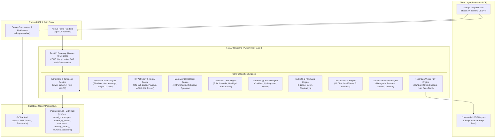

# Gokul's Astrological Insights (GAI)

> **Enterprise-Grade, Deterministic Vedic & KP Astrology Platform Powered by the XALEN Astronomical Engine**  
> *Zero AI / Zero LLM Dependencies — 100% Mathematically Rigorous, Rule-Based Computations adhering strictly to Classical Shastras.*

---

## Table of Contents

1. [What is this Application?](#1-what-is-this-application)
   - [Core Philosophy: Deterministic & Clean-Room](#core-philosophy-deterministic--clean-room)
   - [Key Highlights & Capabilities](#key-highlights--capabilities)
2. [How the Whole System Works (Architecture)](#2-how-the-whole-system-works-architecture)
   - [High-Level Architecture Diagram](#high-level-architecture-diagram)
   - [Data & Calculation Flow](#data--calculation-flow)
   - [Technology Stack Breakdown](#technology-stack-breakdown)
3. [Deep-Dive into Core Computational Engines](#3-deep-dive-into-core-computational-engines)
   - [3.1 Ephemeris & Astronomical Foundation](#31-ephemeris--astronomical-foundation)
   - [3.2 Parashari Vedic Astrology Engine](#32-parashari-vedic-astrology-engine)
   - [3.3 Krishnamurti Paddhati (KP) Engine](#33-krishnamurti-paddhati-kp-engine)
   - [3.4 Marriage Compatibility & Porutham Engine](#34-marriage-compatibility--porutham-engine)
   - [3.5 Traditional Tamil Horoscope Writing Engine](#35-traditional-tamil-horoscope-writing-engine)
   - [3.6 Numerology Studio Suite](#36-numerology-studio-suite)
   - [3.7 Muhurta & Panchang Engine](#37-muhurta--panchang-engine)
   - [3.8 Vastu Shastra Assessment Engine](#38-vastu-shastra-assessment-engine)
   - [3.9 Shastric Remedies & Navagraha Temples](#39-shastric-remedies--navagraha-temples)
   - [3.10 Astrologer CRM & Customer Relationship Management](#310-astrologer-crm--customer-relationship-management)
   - [3.11 Bilingual Publication-Quality PDF Engine](#311-bilingual-publication-quality-pdf-engine)
4. [Repository & Directory Structure](#4-repository--directory-structure)
5. [Prerequisites & System Requirements](#5-prerequisites--system-requirements)
6. [Step-by-Step Setup & Installation Guide](#6-step-by-step-setup--installation-guide)
   - [Step 1: Clone the Repository](#step-1-clone-the-repository)
   - [Step 2: Environment Variables Configuration](#step-2-environment-variables-configuration)
   - [Step 3: Database Provisioning & Supabase Migrations](#step-3-database-provisioning--supabase-migrations)
   - [Step 4: Backend Setup & Python Virtual Environment](#step-4-backend-setup--python-virtual-environment)
   - [Step 5: Compiling the Native Rust XALEN Ephemeris](#step-5-compiling-the-native-rust-xalen-ephemeris)
   - [Step 6: Frontend Setup (Next.js 16)](#step-6-frontend-setup-nextjs-16)
   - [Step 7: Initial Administrator Bootstrapping](#step-7-initial-administrator-bootstrapping)
7. [How to Run the Application](#7-how-to-run-the-application)
   - [Option A: One-Click Launch (Windows Batch Script)](#option-a-one-click-launch-windows-batch-script)
   - [Option B: Manual Multi-Terminal Startup](#option-b-manual-multi-terminal-startup)
   - [Option C: Production Build & Startup](#option-c-production-build--startup)
   - [Default Service Ports & Endpoints](#default-service-ports--endpoints)
8. [Comprehensive API Reference](#8-comprehensive-api-reference)
9. [Automated Testing & Verification Suite](#9-automated-testing--verification-suite)
10. [Security, Authentication & Data Isolation](#10-security-authentication--data-isolation)
11. [Troubleshooting & Frequently Asked Questions](#11-troubleshooting--frequently-asked-questions)
12. [Licensing & Attribution](#12-licensing--attribution)

---

## 1. What is this Application?

**Gokul's Astrological Insights (GAI)** is an enterprise-grade, full-stack astrological software suite built for professional Vedic astrologers, KP practitioners, numerologists, and astrological researchers. It unifies classical Indian astrological disciplines into a single high-performance web platform and automated PDF generation pipeline.

### Core Philosophy: Deterministic & Clean-Room
Unlike contemporary astrology apps that rely on Large Language Models (LLMs) or generative chat bots that suffer from mathematical hallucinations, **GAI is 100% deterministic and rule-based**:
- **Zero Generative AI**: Every planetary coordinate, house cusp, dasha balance, yoga evaluation, and dosha classification is derived from pure mathematical formulas and canonical Sanskrit/Tamil shastric algorithms.
- **Authoritative Classical Foundations**: Adheres strictly to foundational treatises including *Brihat Parasara Hora Sastra (BPHS)*, *Jataka Parijata*, *Phaladeepika*, *Saravali*, and the late Prof. K.S. Krishnamurti's 6 KP Readers.
- **Sub-Arcsecond Astronomical Accuracy**: Powered by high-precision ephemerides (Swiss Ephemeris and the native Rust `XALEN` engine) with precise IANA timezone handling and historical Daylight Saving / War Time conversions.

### Key Highlights & Capabilities
- **Dual Astrological Paradigm**: Full, uncompromised support for both **Classical Parashari Vedic Astrology** (Whole Sign, Lahiri Chitrapaksha ayanamsa, Vimshottari dasha) and **Krishnamurti Paddhati (KP)** (Placidus unequal cusps, KP ayanamsa, 249 sub-lords, 2,193 sub-sub-lords, ABCD significators, Horary 1–249).
- **Comprehensive Vedic Deep Scan**: Computes complete **Shadbala** (6-fold strength), **Ashtakavarga** (BAV, SAV 337-bindu invariant, Shodhana, Kaksha transits), all **16 Shodashvarga divisional charts** (D1 to D60), 60+ classical **Yogas** with comprehensive cancellation logic (NBRY, Kemadruma Bhanga, Arishta Bhanga), and unified **Dosha diagnostics** (Kuja/Manglik from Lagna/Moon/Venus, Kaal Sarp, Sadesati, Pitru, Shrapit).
- **Marriage Compatibility (Porutham & Ashtakoota)**: Automated matching engine evaluating South Indian 10/12 Poruthams, North Indian 8-Koota (36-point Guna Milan), planetary synastry, mutual Kuja dosha balance, and composite marital longevity scores.
- **Traditional Tamil Horoscope Writing (ஜாதகம் எழுதுதல்)**: Generates traditional 6-page printable horoscope booklets featuring Tamil solar months (சித்திரை முதல் பங்குனி வரை), Nazhigai/Vinazhigai (Ghati/Vighati) sunrise offsets, Graha Pada Saram, and balance of Dasa at birth.
- **Complete Numerology Studio**: Chaldean, Pythagorean, and Cheiro calculations covering Radical, Destiny, and Name numbers, Lo Shu Grid, Destiny Matrix, and specialized studios for Name Correction, Business Branding, Marriage Harmony, Mobile Numbers, Vehicle Plates, and Property Units.
- **Auspicious Muhurta & Real-time Panchangam**: Continuous calculation of the 5 limbs of Panchang (Tithi, Vara, Nakshatra, Yoga, Karana), Rahu Kalam, Yamagandam, Gulika, Abhijit, Choghadiya, Gowri Panchangam, and automated date finders for weddings, housewarming, and business openings.
- **Astrologer CRM & Customer Relationship Management**: Multi-tenant customer directory, linked chart repositories, automated birthday reminders, wish dispatch templates, and client notes.
- **Publication-Quality Vector PDF Engine**: ReportLab-powered generator producing 9-page comprehensive Vedic horoscope reports and 6-page traditional Tamil booklets with vector South Indian/North Indian charts and Unicode Tamil font rendering (Noto Sans Tamil, Lohit Tamil).

---

## 2. How the Whole System Works (Architecture)

The platform is engineered as a modern, decoupled three-tier system: Next.js 16 frontend, FastAPI backend ASGI service, and Supabase PostgreSQL with Row-Level Security (RLS).

### High-Level Architecture Diagram



### Data & Calculation Flow

1. **User Input**: The user inputs birth details (Date of Birth, Time of Birth, City/Coordinates, and Ayanamsa preference) via localized English or Tamil forms.
2. **Geocoding & Timezone Resolution**: City selection resolves exact latitude, longitude, and IANA timezone name (e.g. `Asia/Kolkata`, `America/New_York`).
3. **Frontend Request Forwarding**: The Next.js frontend sends requests to `/api/v1/...`. The Next.js rewrite engine proxies this directly to the FastAPI service running at `http://127.0.0.1:8000`.
4. **Ephemeris Calculation**:
   - Timestamps are converted into UTC and astronomical Julian Day Numbers (`swe_julday`).
   - Planetary positions (Sun, Moon, Mars, Mercury, Jupiter, Venus, Saturn, Rahu, Ketu, and outer planets) are calculated using Swiss Ephemeris / Rust XALEN with Lahiri or KP Ayanamsa.
   - House cusps are projected: **Whole Sign** for classical Parashari, and **Placidus Semi-Arc** for KP.
5. **Rule Execution & Synthesis**:
   - The appropriate engine processes the coordinates (e.g., Shadbala computes 6 planetary strengths; KP assigns 249 sub-lords and ABCD significator levels; Ashtakavarga constructs the $12 \times 8$ Prastara grid).
6. **Persistence & Authorization**:
   - The user's authenticated Supabase JWT Bearer token is verified.
   - Saved horoscopes, customers, and compatibility records are securely stored in Supabase with user-scoped Row-Level Security (`user_id = auth.uid()`).
7. **Rendering & Export**:
   - The client renders dynamic SVG chart grids (South Indian 4x4 squares and North Indian diamonds) and interactive tables.
   - For PDF downloads, FastAPI streams a generated PDF binary formatted with exact page budgeting and Noto Sans Tamil typography.

### Technology Stack Breakdown

| Layer | Technologies Used | Primary Responsibilities |
|---|---|---|
| **Frontend Framework** | **Next.js 16.4.2**, **React 19.3.0**, **TypeScript 5** | App router, Server-Side Rendering (SSR), bilingual state management, dynamic SVG chart rendering. |
| **Styling & Icons** | **Tailwind CSS v4**, **Lucide React 1.59.0** | Responsive mobile/desktop layout, warm ivory/cream palette, antique-gold accents, deep navy typography. |
| **Authentication & Session** | **@supabase/ssr 0.12.7**, **@supabase/supabase-js 2.118.0** | Cookie-based session storage, password resets, role-based admin access control, RLS token propagation. |
| **Backend Framework** | **FastAPI 0.143.3**, **Python 3.12 / 3.13**, **Pydantic v2** | High-concurrency ASGI REST API, schema validation, rate limiting, CORS management, error handling. |
| **High-Precision Ephemeris** | **xalen 0.6.0** (Rust PyO3), **pyswisseph 2.10.3.2** | Planetary longitudes, speeds, retrograde motions, Julian day numbers, house cusp bisection, ayanamsas. |
| **PDF Generation Engine** | **ReportLab 5.0.1**, **Pillow 13.0**, **pypdf 6.21**, **uharfbuzz** | Fixed-layout 9-page and 6-page vector PDFs, Tamil glyph shaping, custom canvas headers/footers. |
| **Database & Persistence** | **Supabase (PostgreSQL 15+)** | Relational schemas, Row-Level Security (RLS), trigger-based timestamp updates, foreign keys. |
| **Testing & Quality Assurance** | **pytest 9.1**, **pytest-asyncio**, **Playwright 1.64**, Node.js test runners | 400+ backend automated tests, live browser validation, ephemeris precision verification. |

---

## 3. Deep-Dive into Core Computational Engines

### 3.1 Ephemeris & Astronomical Foundation
- **Supported Ayanamsas**:
  - `0`: **Lahiri (Chitrapaksha)** — Standard Indian government Calendar Reform Committee epoch.
  - `1`: **KP (Krishnamurti Paddhati)** — Krishnamurti VP291 / modern standard ayanamsa.
  - `2`: **Dr. B.V. Raman** — Traditional Raman ayanamsa.
  - `3`: **Fagan-Bradley** — Western sidereal anchor.
  - `4`: **True Chitra** — Anchored to Spica ($\alpha$ Virginis) at exactly $180^\circ$.
  - `5`: **True Revati** — Anchored to $\zeta$ Piscium at $359^\circ 50'$.
  - `6`: **Surya Siddhanta** — Traditional mean motion epoch.
- **House Systems**:
  - `WholeSign` (0): Sign = House (default for classical Vedic).
  - `Equal` (1): $30^\circ$ equal houses from Ascendant degree.
  - `Placidus` (2): Unequal semi-arc time-division cusps (standard for KP).
  - `Koch` (3), `Regiomontanus` (5), `Sripati / Porphyry` (10).
- **Nakshatras & Padas**: 27 Nakshatras ($13^\circ 20'$ or $800'$ each) split into 4 Padas ($3^\circ 20'$ or $200'$ each) totaling 108 Padas. Handles the $0^\circ$ Aries boundary wraparound.
- **Vimshottari Dasa Engine**: 120-year cycle (Ketu 7, Venus 20, Sun 6, Moon 10, Mars 7, Rahu 18, Jupiter 16, Saturn 19, Mercury 17). Balance at birth calculated from Moon's elapsed longitudinal fraction in its natal nakshatra. Computes 5 nested tiers: *Mahadasha $\rightarrow$ Antardasha $\rightarrow$ Pratyantardasha $\rightarrow$ Sookshmadasha $\rightarrow$ Pranadasha*.

### 3.2 Parashari Vedic Astrology Engine
- **Shadbala (6-Fold Planetary Strength)**:
  1. *Sthana Bala* (Positional): Uccha Bala (linear distance from debilitation), Saptavargaja Bala (dignities across 7 vargas), Ojayugmarasyamsa, Kendra Bala (60-30-15 virupas), Drekkana Bala.
  2. *Dig Bala* (Directional): Angular distance from zero-strength points (Sun/Mars in 4th, Moon/Venus in 10th, Mercury/Jupiter in 7th, Saturn in 1st; max 60 virupas).
  3. *Kala Bala* (Temporal): Nathonnatha (day/night), Paksha (Moon phase), Tribhaga, Varsha/Masa/Dina/Hora rulers, Ayana Bala.
  4. *Cheshta Bala* (Motional): Astronomical planetary speed ratio relative to mean motion.
  5. *Drik Bala* (Aspectual): Aspect virupas across planetary pairs with special full aspects for Mars (4th/8th), Jupiter (5th/9th), and Saturn (3rd/10th).
  6. *Naisargika Bala* (Natural): Fixed classical values (Sun 60, Moon 51.43, Venus 42.86, Jupiter 34.29, Mercury 25.71, Mars 17.14, Saturn 8.57).
  - Outputs required strengths, ratios (Bala ratio), and relative planetary ranks.
- **Ashtakavarga System**:
  - Full $12 \times 8$ Prastara matrix for 7 classical planets and Lagna across 12 signs.
  - Bhinna Ashtakavarga (BAV) and Samudaya Ashtakavarga (SAV) strictly enforcing the mathematical invariant:
    $$\sum \text{SAV Bindus} = 337$$
  - Shodhana reductions: *Trikona Shodhana* (triplicity reduction) and *Ekadhipatya Shodhana* (single-lordship reduction).
  - *Kaksha Transit Engine*: Divides each $30^\circ$ sign into eight $3^\circ 45'$ subdivisions ruled by Saturn, Jupiter, Mars, Sun, Venus, Mercury, Moon, and Lagna to pinpoint exact transit transit results.
- **Shodashvarga (16 Parashari Divisional Charts)**:
  - D1 (Rasi), D2 (Hora), D3 (Drekkana), D4 (Chaturthamsa), D7 (Saptamsa), D9 (Navamsa), D10 (Dasamsa), D12 (Dwadasamsa), D16 (Shodasamsa), D20 (Vimsamsa), D24 (Chaturvimsamsa), D27 (Saptavimsamsa), D30 (Trimsamsa), D40 (Khavedamsa), D45 (Akshavedamsa), D60 (Shashtyamsa).
  - Strict odd/even sign polarity rules and all 60 classical Shashtyamsa deity assignments.
- **Classical Yoga Engine & Cancellations**:
  - Detects Raja Yogas, Dhana Yogas, Pancha Mahapurusha Yogas (Ruchaka, Bhadra, Hamsa, Malavya, Sasa), Vipareeta Raja Yogas, Nabhasha Yogas, and Chandra Yogas.
  - **Cancellation Rules**: 5 classical Neecha Bhanga Raja Yoga (NBRY) cancellation conditions, Kemadruma Bhanga (Kendra checks from Lagna/Moon), and Arishta Bhanga protections.
- **Unified Dosha Diagnostics**:
  - **Kuja / Manglik Dosha**: Evaluates Mars in 1st, 2nd, 4th, 7th, 8th, 12th from Lagna, Moon, and Venus independently with classical cancellation rules (own/exaltation signs, Jupiter aspects, Leo/Aquarius exceptions).
  - **Kaal Sarp Dosha**: Checks if all 7 planets are hemmed inside the Rahu-Ketu nodal axis (Full, Partial/Chhidra, or Absent).
  - **Sadesati Engine**: Detects Saturn's 7.5-year transit through 12th, 1st, and 2nd houses from natal Moon, identifying Rising, Peak, and Setting phases without fatalistic predictions.
  - **Additional Doshas**: Pitru Dosha, Guru Chandal Yoga, Shrapit Yoga, Grahan Yoga.

### 3.3 Krishnamurti Paddhati (KP) Engine
- **Sub-Lord & Sub-Sub-Lord Hierarchy**:
  - Complete 249 Sub-Lord table and 2,193 Sub-Sub-Lord refinement.
  - Proportional arc allocation:
    $$\text{Arc}_{\text{sub}} = 13^\circ 20' \times \frac{\text{Vimshottari Years}_{\text{planet}}}{120}$$
- **Placidus House Cusps**: Accurate to sub-arcseconds using iterative bracketed semi-arc bisection (`swe_houses_ex` Placidus algorithm).
- **ABCD Significator Hierarchy**:
  - **Level A**: Planets in the star of house occupants (Strongest).
  - **Level B**: Planets occupying the house.
  - **Level C**: Planets in the star of the house lord.
  - **Level D**: House lord itself.
- **Cuspal Sub-Lord (CSL) Evaluation**: Evaluates cuspal promises for all 12 bhavas against favorable and unfavorable house matrices.
- **KP Horary (Prashna 1–249)**: Calculates exact Ascendant longitude from horary query number (1 to 249) using true obliquity and ARMC bisection.
- **KP Event Prediction Engine**: 110 pre-configured life event rules spanning Career, Marriage, Finance, Real Estate, Health, and Foreign Travel with DBA filtering and transit Moon verification.

### 3.4 Marriage Compatibility & Porutham Engine
- **South Indian 10/12 Poruthams**:
  - *Dina* (Health & Longevity), *Gana* (Temperament), *Mahendra* (Progeny & Wealth), *Stree Deerkha* (Prosperity), *Yoni* (Physical Compatibility), *Rasi* (Family Growth), *Rasiyadhipathi* (Mental Harmony), *Vasiya* (Mutual Attraction), *Rajju* (Marital Longevity — vital test), *Vedha* (Affliction check).
- **North Indian Ashtakoota (36 Points)**:
  - Varna (1), Vashya (2), Tara (3), Yoni (4), Graha Maitri (5), Gana (6), Bhakoot (7), Nadi (8). Minimum threshold $\ge 18$ points.
- **Vedic Synastry & Mutual Dosha Check**: Compares Mars placements, 7th/8th house lords, Jupiter benefic aspects, and generates a composite compatibility score (0–100%) with actionable recommendations.

### 3.5 Traditional Tamil Horoscope Writing Engine
- **Tamil Solar Calendar (தமிழ் சூரிய பஞ்சாங்கம்)**: Maps gregorian dates to Tamil years (60-year Jovian cycle, e.g., குரோதி, விசுவாசு), Tamil months (சித்திரை முதல் பங்குனி வரை), and day dates.
- **Nazhigai & Vinazhigai (நாழிகை / விநாழிகை)**: Converts birth time relative to local sunrise:
  $$1 \text{ Nazhigai} = 24 \text{ Minutes}, \quad 1 \text{ Vinazhigai} = 24 \text{ Seconds}$$
- **Graha Pada Saram (கிரக பாத சாரம்)**: Tabulates every planet's star lord, sub-lord, and specific Pada.
- **Dasa Iruppu (தசா இருப்பு)**: Exact balance of the birth dasa remaining in Years, Months, and Days.

### 3.6 Numerology Studio Suite
- **Multi-System Calculation**: Supports Chaldean (Hebrew sound frequencies), Pythagorean (1-9 western alphabet cipher), and Cheiro methods.
- **Core Numbers**: Radical/Birth Number (Day of birth), Destiny/Life Path Number (Full date sum), and Name/Expression Number.
- **Destiny Matrix & Lo Shu Grid**: Evaluates 3x3 plane distributions (Mental, Emotional, Practical, Thought, Will, Action).
- **Dedicated Business & Personal Studios**:
  - *Name Correction Studio*: Analyzes current spelling vibrations and suggests balanced vowel/consonant modifications.
  - *Business Studio*: Brand names, partnership compatibility, incorporation date selection.
  - *Marriage Studio*: Bride and groom birth/name number harmony.
  - *Phone, Vehicle, and Property Studios*: Evaluates mobile numbers, vehicle license plates, and flat/house numbers against owner's destiny numbers.

### 3.7 Muhurta & Panchang Engine
- **5 Limbs of Panchang**:
  - *Tithi* (Lunar Day, $12^\circ$ Moon-Sun separation, Shukla/Krishna paksha).
  - *Vara* (Day of week ruled by planetary hora lord).
  - *Nakshatra* (Moon's asterism).
  - *Yoga* (Sun + Moon longitude sum in $13^\circ 20'$ increments, Vishkambha to Vaidhriti).
  - *Karana* (Half-tithi, 11 karanas: 4 fixed, 7 movable).
- **Auspicious & Inauspicious Timings**:
  - Rahu Kalam, Yamagandam, Gulika Kalam, Durmuhurtam, Varjyam.
  - Abhijit Muhurta (8th muhurta of the day).
  - Day & Night Gowri Panchangam and Choghadiya windows.
- **Occasion Finder**: Automated date range scanner for Vivaha (Marriage), Griha Pravesh (Housewarming), Upanayana, and Vyapar (Business Start).

### 3.8 Vastu Shastra Assessment Engine
- **16-Zone Directional Analysis**: N, NNE, NE, ENE, E, ESE, SE, SSE, S, SSW, SW, WSW, W, WNW, NW, NNW.
- **Pancha Bhoota (5 Elements)**: Water (Jal), Air (Vayu), Fire (Agni), Earth (Prithvi), Space (Akash) balance evaluation.
- **Room Placement Audit**: Scores entrance orientations, kitchen (Agni corner), master bedroom (Nairuthi/SW), pooja room (Ishanya/NE), toilets, and overhead water tanks with non-destructive metallic/color remedies.

### 3.9 Shastric Remedies & Navagraha Temples
- **Kaveri Delta Navagraha Pilgrimage**: Curated details for Suryanar Kovil (Sun), Thingaloor (Moon), Vaitheeswaran Kovil (Mars), Thiruvenkadu (Mercury), Alangudi (Jupiter), Kanjanur (Venus), Thirunallar (Saturn), Thirunageswaram (Rahu), and Keezhperumpallam (Ketu). Includes temple timings, deity particulars, and traditional offerings.
- **Classical Remedial Catalog**: Shastra-validated Stotras, Mantras with japa counts, gemstone recommendations with weight and metal settings, and sattvic charitable donations (daana).

### 3.10 Astrologer CRM & Customer Relationship Management
- **Customer Directory**: Add, search, and manage clients with phone, email, place of birth, and notes.
- **Linked Horoscopes**: Seamlessly link one or more horoscopes to a single customer profile.
- **Automated Birthday Notifications**: Displays clients celebrating birthdays in the current week with pre-filled WhatsApp/Email astrological greetings.

### 3.11 Bilingual Publication-Quality PDF Engine
- **Dual-Engine Output**:
  - **9-Page Comprehensive Vedic Report**: Cover, Birth Panchang, D1 Rasi & D9 Navamsa vector charts, Shodashvarga table, Vimshottari Dasa timeline, Shadbala bar charts, Ashtakavarga tables, Yogas & Cancellations, Doshas & Remedies.
  - **6-Page Traditional Tamil Booklet**: Jathagam Ezhuthudhal booklet in traditional format.
- **Typography & Font Shaping**: Integrated with licensed open-source **Google Noto Sans Tamil** and **Lohit Tamil** fonts under the SIL Open Font License (OFL). HarfBuzz-backed text shaping guarantees zero missing characters or overlapping glyphs.

---

## 4. Repository & Directory Structure

```
GAI-Astrology-Website/
├── .gitignore                          # Git ignore rules for node_modules, .venv, .env
├── .env.example                        # Root master environment variable template
├── package.json                        # Root workspace scripts (delegates to frontend)
├── pytest.ini                          # Backend pytest test paths and configuration
├── run_servers.bat                     # Windows batch launcher (starts FastAPI + Next.js)
├── sample_horoscope_report_9pages.pdf  # Sample generated 9-page English Vedic PDF
├── sample_horoscope_report_tamil_9pages.pdf # Sample generated 9-page Tamil Vedic PDF
├── sample_traditional_tamil_horoscope_6pages.pdf # Sample generated 6-page Tamil booklet
│
├── backend/                            # FastAPI Python ASGI Application
│   ├── .env.example                    # Backend environment template
│   ├── requirements.txt                # Python backend dependencies
│   ├── migrations/                     # Authoritative SQL migrations for Supabase
│   ├── app/
│   │   ├── main.py                     # FastAPI application factory & middleware
│   │   ├── config.py                   # Pydantic configuration & env loader
│   │   ├── bootstrap_admin.py          # Automatic admin user provisioning hook
│   │   ├── assets/
│   │   │   └── fonts/                  # NotoSansTamil, Lohit-Tamil TTF fonts & OFL license
│   │   ├── routers/                    # 18 REST API Routers (Horoscope, KP, Dasa, etc.)
│   │   ├── schemas/                    # Pydantic v2 request & response schemas
│   │   └── services/                   # Core Astrological & Astronomical Business Logic
│   │       ├── ephemeris.py            # Swiss Ephemeris / XALEN ephemeris bridge
│   │       ├── ashtakavarga_engine/    # BAV, SAV 337 invariant, Kaksha transits
│   │       ├── dosha_engine/           # Kuja, Kaal Sarp, Sadesati, Pitru doshas
│   │       ├── horoscope_writing/      # Traditional Tamil horoscope generator
│   │       ├── kp_engine/              # 249 sub-lords, Placidus cusps, significators
│   │       ├── kp_event_engine/        # 110-event life prediction rules
│   │       ├── marriage_engine/        # Poruthams, Ashtakoota, Synastry
│   │       ├── medical_astrology_engine/# Planetary medical indicators
│   │       ├── muhurta_engine/         # 5 limbs of panchang, muhurta finders
│   │       ├── numerology/             # Chaldean, Pythagorean, Name/Business studios
│   │       ├── pdf_report_engine/      # ReportLab 9-page bilingual PDF generator
│   │       ├── remedy_engine/          # Navagraha temples, stotras, remedies
│   │       ├── shadbala_engine/        # 6-fold planetary strength calculators
│   │       ├── unified_prediction/     # Integrated KP + Vedic event synthesis
│   │       ├── vastu_service.py        # 16-zone Vastu directional engine
│   │       └── yoga_engine/            # Classical Yogas and cancellation evaluator
│   └── tests/                          # 400+ automated pytest test cases
│
├── frontend/                           # Next.js 16 App Router Frontend
│   ├── .env.example                    # Frontend environment template
│   ├── package.json                    # Dependencies (React 19, Next 16, Tailwind 4)
│   ├── next.config.ts                  # API proxy rewrites (/api/v1/* -> :8000)
│   ├── tsconfig.json                   # TypeScript configuration
│   ├── scripts/                        # Node.js automated test and verification scripts
│   ├── public/                         # Static assets, favicon, SVGs
│   └── src/
│       ├── middleware.ts               # Supabase session check & protected routes
│       ├── app/                        # 50+ App Router routes (login, admin, tools, etc.)
│       │   ├── page.tsx                # Authenticated landing page (HomeView)
│       │   ├── horoscope/              # Vedic Horoscope input and results
│       │   ├── tools/                  # Dedicated tools (advanced-kp, marriage, etc.)
│       │   ├── numerology/             # 8 Numerology studio pages
│       │   ├── vastu/                  # Vastu assessment tool and report viewer
│       │   ├── muhurta/                # Panchang and muhurta finder
│       │   ├── remedies/               # Remedies directory and temple finder
│       │   ├── dashboard/              # Astrologer CRM, Customer management
│       │   └── api/                    # Route handlers (auth, admin, customer CRUD)
│       ├── components/                 # Modular UI components (charts, forms, dialogs)
│       └── lib/                        # Client libraries, API clients, i18n, helpers
│           ├── api.ts                  # Unified API client talking to FastAPI backend
│           ├── auth-context.tsx        # React authentication context provider
│           ├── customer-service.ts     # Astrologer CRM client library
│           ├── translations.ts         # Bilingual English & Tamil dictionary
│           └── types.ts                # TypeScript domain models and interfaces
│
├── supabase/                           # Supabase Database Schemas
│   └── migrations/                     # 13 Versioned PostgreSQL SQL migrations
│
├── xalen-ephemeris/                    # High-Performance Rust Ephemeris Workspace
│   ├── Cargo.toml                      # Cargo workspace manifest (xalen crates)
│   └── crates/
│       ├── xalen-ephem/                # Core ephemeris math
│       ├── xalen-vedic/                # Vedic nakshatra, ayanamsa, dasa primitives
│       └── xalen-python/               # PyO3 Python bindings (compiled to xalen module)
│
├── docs/                               # Architecture, Migration & Audit Documentation
│   ├── marriage-compatibility/         # Marriage engine specifications and rule register
│   └── migrations/                     # Consolidated staging database SQL packages
└── scripts/                            # Standalone administrative and audit scripts
```

---

## 5. Prerequisites & System Requirements

### Hardware Requirements
- **Processor**: Intel Core i5 / AMD Ryzen 5 or higher (Apple Silicon M1/M2/M3 fully supported).
- **RAM**: Minimum 8 GB (16 GB recommended for running tests and building Rust crates).
- **Disk Space**: At least 5 GB free disk space.

### Operating System
- **Windows**: Windows 10 / 11 (64-bit) with PowerShell 5.1+ or PowerShell 7.
- **macOS**: macOS 12 Monterey or higher.
- **Linux**: Ubuntu 22.04 LTS+, Debian 12, Fedora, or equivalent.

### Software Prerequisites
1. **Node.js**: Version **v18.17.0+** or **v20.x+** (Node v20 LTS recommended). Includes `npm`.
2. **Python**: Version **3.11**, **3.12**, or **3.13** (Python 3.12 recommended).
3. **Rust Toolchain**: `rustc` and `cargo` (Required to compile the high-performance native `xalen` ephemeris module). Install via [rustup.rs](https://rustup.rs/).
4. **C/C++ Build Tools**:
   - *Windows*: Visual Studio Build Tools (with "Desktop development with C++" workload installed) for compiling `pyswisseph`.
   - *Linux*: `sudo apt install build-essential python3-dev`
   - *macOS*: `xcode-select --install`
5. **Supabase PostgreSQL Account**: A free cloud instance at [supabase.com](https://supabase.com) or a local instance running via the Supabase CLI.

---

## 6. Step-by-Step Setup & Installation Guide

### Step 1: Clone the Repository
```bash
git clone <your-repository-url> "GAI-Astrology-Website"
cd "GAI-Astrology-Website"
```

### Step 2: Environment Variables Configuration
The platform requires environment configurations for both the Next.js frontend and the FastAPI backend.

1. **Frontend Environment File**:
   Copy `.env.example` (or `frontend/.env.example`) to `frontend/.env.local`:
   ```bash
   cp frontend/.env.example frontend/.env.local
   ```
2. **Backend Environment File**:
   Copy `.env.example` (or `backend/.env.example`) to `backend/.env`:
   ```bash
   cp backend/.env.example backend/.env
   ```

#### Populating Required Keys
Open both `frontend/.env.local` and `backend/.env` in your text editor and fill in your Supabase credentials:

```ini
# Supabase Project Credentials
NEXT_PUBLIC_SUPABASE_URL=https://<your-project-id>.supabase.co
NEXT_PUBLIC_SUPABASE_ANON_KEY=<your-anon-publishable-key>
SUPABASE_URL=https://<your-project-id>.supabase.co
SUPABASE_SERVICE_ROLE_KEY=<your-service-role-secret-key>

# Initial Administrator Provisioning Credentials
ADMIN_USERNAME=gokul_admin
ADMIN_EMAIL=admin@your-astrology-domain.com
ADMIN_INITIAL_PASSWORD=YourSecureInitialPassword#2026

# API Endpoints & Security
NEXT_PUBLIC_API_BASE_URL=http://127.0.0.1:8000
ALLOWED_ORIGINS=http://localhost:3000,http://127.0.0.1:3000,http://localhost:3001,http://127.0.0.1:3001
DEBUG=false
```

> [!CAUTION]
> Never commit `frontend/.env.local` or `backend/.env` to source control. The `SUPABASE_SERVICE_ROLE_KEY` bypasses all Row-Level Security policies and must remain strictly server-side.

---

### Step 3: Database Provisioning & Supabase Migrations
The database requires 13 versioned SQL migration scripts to create tables, indexes, functions, triggers, and Row-Level Security policies.

#### Option A: Single Consolidated Script (Recommended)
1. Log in to your [Supabase Dashboard](https://supabase.com/dashboard).
2. Select your project and navigate to the **SQL Editor** tab.
3. Open [`docs/migrations/consolidated_staging_migration_package.sql`](file:///e:/GAI/Astrology%20Website/docs/migrations/consolidated_staging_migration_package.sql).
4. Copy the entire file content, paste it into the Supabase SQL Editor, and click **Run**.
5. Ensure the execution completes with `Success. No rows returned`.

#### Option B: Step-by-Step Migrations (Supabase CLI or Sequential Execution)
If using the Supabase CLI:
```bash
supabase db push
```
Or execute the SQL scripts located in `supabase/migrations/` in numerical order:
1. `20261017000001_init_auth_profiles_saved_horoscopes.sql`
2. `20261018000001_create_saved_numerology_reports.sql`
3. `20261018000002_create_muhurta_tables.sql`
4. `20261018000003_create_saved_kp_charts.sql`
5. `20261018000004_create_kp_event_analyses.sql`
6. `20261018000005_create_saved_vastu_reports.sql`
7. `20261018000006_create_customers_and_link_horoscopes.sql`
8. `20261018000007_create_remedy_knowledge_base.sql`
9. `20261018000008_make_customer_phone_optional.sql`
10. `20261018000009_create_remedy_reports.sql`
11. `20261019000001_create_saved_marriage_compatibility_reports.sql`
12. `20261019000002_create_saved_horoscope_writings.sql`
13. `20261019000003_upgrade_saved_numerology_reports_methods.sql`

---

### Step 4: Backend Setup & Python Virtual Environment

1. **Create the Python Virtual Environment**:
   From the repository root:
   ```bash
   python -m venv .venv
   ```
2. **Activate the Virtual Environment**:
   - **Windows (PowerShell)**:
     ```powershell
     .\.venv\Scripts\Activate.ps1
     ```
   - **Windows (Command Prompt)**:
     ```cmd
     .\.venv\Scripts\activate.bat
     ```
   - **macOS / Linux**:
     ```bash
     source .venv/bin/activate
     ```
3. **Upgrade Pip and Install Dependencies**:
   ```bash
   python -m pip install --upgrade pip
   pip install -r backend/requirements.txt
   ```

---

### Step 5: Compiling the Native Rust XALEN Ephemeris
The backend relies on `xalen`, a high-performance native Python extension module built in Rust via PyO3 and Maturin.

1. Ensure your virtual environment is active.
2. Navigate to the `xalen-python` crate directory:
   ```bash
   cd xalen-ephemeris/crates/xalen-python
   ```
3. Compile and develop the wheel into your active virtual environment:
   ```bash
   maturin develop --release
   ```
4. Verify the installation:
   ```bash
   python -c "import xalen; print('XALEN Version:', xalen.__doc__ if hasattr(xalen, '__doc__') else 'Loaded successfully')"
   ```
5. Return to the root directory:
   ```bash
   cd ../../..
   ```

---

### Step 6: Frontend Setup (Next.js 16)

1. Navigate to the `frontend/` directory:
   ```bash
   cd frontend
   ```
2. Install npm dependencies:
   ```bash
   npm install
   ```
3. Verify TypeScript types:
   ```bash
   npm run type-check
   ```
4. Return to the root directory:
   ```bash
   cd ..
   ```

---

### Step 7: Initial Administrator Bootstrapping
To create your first admin account with the credentials specified in your `.env`:

```bash
cd frontend
npm run bootstrap:admin
cd ..
```
*Note: The backend also contains an automated idempotent startup hook in `backend/app/bootstrap_admin.py` that provisions the initial administrator when the backend server launches.*

---

## 7. How to Run the Application

### Option A: One-Click Launch (Windows Batch Script)
For Windows users, a convenient launcher is provided at the repository root:

Double-click `run_servers.bat` or execute in PowerShell:
```powershell
.\run_servers.bat
```
This batch script will:
1. Start the FastAPI backend on `http://127.0.0.1:8000` with hot-reloading.
2. Start the Next.js frontend on `http://127.0.0.1:3001` with Turbopack.
3. Automatically launch your default browser to `http://127.0.0.1:3001`.

---

### Option B: Manual Multi-Terminal Startup

#### Terminal 1 — FastAPI Backend:
```bash
# Activate virtual environment
# Windows: .\.venv\Scripts\Activate.ps1 | macOS/Linux: source .venv/bin/activate

cd backend
python -m uvicorn app.main:app --host 127.0.0.1 --port 8000 --reload
```
You should see:
```text
INFO:     Uvicorn running on http://127.0.0.1:8000 (Press CTRL+C to quit)
INFO:     Started reloader process
INFO:     Application startup complete.
```

#### Terminal 2 — Next.js Frontend:
```bash
cd frontend
npm run dev
```
You should see:
```text
▲ Next.js 16.4.2
- Local:        http://127.0.0.1:3001
- Network:      http://[::1]:3001
✓ Ready in 1200ms
```

---

### Option C: Production Build & Startup

1. **Build the Next.js Production Bundle**:
   ```bash
   cd frontend
   npm run build
   npm run start
   ```
2. **Run the FastAPI Backend with Production Workers**:
   ```bash
   cd backend
   python -m uvicorn app.main:app --host 0.0.0.0 --port 0.0.0.0 --port 8000 --workers 4
   ```

---

### Option D: Docker & Cloud Deployment

For deploying to cloud platforms (**Vercel + Render + Supabase** or a single **Linux VPS with Docker Compose**), see the complete step-by-step guide in [docs/DEPLOYMENT_GUIDE.md](docs/DEPLOYMENT_GUIDE.md).

Quick Docker launch on any server:
```bash
docker compose up -d
```
- Frontend: `http://<your-server-ip>:3000`
- Backend API: `http://<your-server-ip>:8000`

---

### Default Service Ports & Endpoints

| Service | Address | Description |
|---|---|---|
| **Frontend Web App** | `http://127.0.0.1:3001` (or `:3000`) | Main application UI, charts, and astrologer portal |
| **Backend REST API** | `http://127.0.0.1:8000` | FastAPI calculation and report service |
| **Interactive API Docs** | `http://127.0.0.1:8000/docs` | Swagger UI documentation and live testing |
| **Alternative API Docs** | `http://127.0.0.1:8000/redoc` | ReDoc API specification viewer |
| **Health Check Endpoint** | `http://127.0.0.1:8000/health` | Service uptime and ephemeris status |

---

## 8. Comprehensive API Reference

The backend exposes 18 modular routers under the `/api/v1` namespace:

### 1. System Health & Metadata
- `GET /health`: Service status, memory state, and ephemeris engine readiness.
- `GET /api/v1/metadata`: Enumerates supported Ayanamsas, House Systems, Nakshatras, and Signs.

### 2. Core Vedic Horoscope & Vargas
- `POST /api/v1/horoscope/calculate`: Core birth chart computation (Planets, Bhavas, Ascendant, Panchang, Vimshottari Dasa balance).
- `POST /api/v1/horoscope/varga/d1-d9`: Computes paired D1 (Rasi) and D9 (Navamsa) charts.
- `GET /api/v1/horoscope/varga/d1-d9/{horoscope_id}`: Retrieves D1/D9 for a saved horoscope.
- `POST /api/v1/horoscope/varga/shodashvarga`: Computes all 16 Parashari divisional charts (D1 to D60).
- `GET /api/v1/horoscope/varga/shodashvarga/{horoscope_id}`: Shodashvarga for saved chart.
- `GET /api/v1/horoscope/live-transits`: Real-time planetary positions for current moment.
- `POST /api/v1/horoscope/live-transits`: Calculates planetary transits over natal chart positions.

### 3. Vimshottari Dasa Subsystem
- `POST /api/v1/dasa`: Full 5-level nested Dasa-Bhukti-Antara-Sookshma-Prana hierarchy from birth details.
- `POST /api/v1/dasa/direct`: Computes Dasa hierarchy directly from Moon's sidereal longitude.

### 4. Krishnamurti Paddhati (KP) System
- `POST /api/v1/kp`: Generates complete KP chart (Placidus cusps, 249 sub-lords, ABCD significators, Cuspal Sub-Lords).
- `POST /api/v1/kp/horary`: Computes KP Prashna chart from horary seed number (1 to 249).
- `POST /api/v1/kp/charts`: Persists a KP chart to Supabase.
- `GET /api/v1/kp/charts`: Lists user's saved KP charts.
- `GET /api/v1/kp/charts/{chart_id}`: Retrieves a saved KP chart by UUID.
- `DELETE /api/v1/kp/charts/{chart_id}`: Deletes a saved KP chart.

### 5. KP Event & Timeline Prediction
- `GET /api/v1/kp-prediction/events`: Catalog of 110 pre-configured KP life events.
- `POST /api/v1/kp-prediction/scan`: Scans transit timelines and identifies high-probability event execution windows.
- `POST /api/v1/kp-events/analyze`: Detailed cuspal promise and DBA analysis for specific events.

### 6. Parashari Vedic Extensions
- `POST /api/v1/vedic/shadbala`: Comprehensive 6-fold planetary strength analysis.
- `POST /api/v1/vedic/ashtakavarga`: Bhinna and Samudaya Ashtakavarga with 337-bindu balance.
- `POST /api/v1/vedic/ashtakavarga/prastara`: $12 \times 8$ Prastara Ashtakavarga matrix.
- `POST /api/v1/vedic/ashtakavarga/kaksha`: Sign $3^\circ 45'$ Kaksha divisions and lords.
- `POST /api/v1/vedic/ashtakavarga/kaksha/transit`: Analyzes real-time transits across natal Kakshas.
- `POST /api/v1/vedic/yogas`: Detects Raja, Dhana, Mahapurusha, and cancellation yogas.
- `POST /api/v1/vedic/doshas`: Unified evaluation of Kuja, Kaal Sarp, and Sadesati.
- `POST /api/v1/vedic/medical-astrology`: Ayurvedic Dosha balance (Vata/Pitta/Kapha) and anatomical vulnerability indicators.

### 7. Marriage Compatibility & Matchmaking
- `POST /api/v1/marriage-compatibility/analyze`: Full compatibility analysis (10 Poruthams, 36 Kootas, Synastry, Mutual Kuja Dosha, Composite Score).
- `GET /api/v1/marriage-compatibility/rules`: Explains all compatibility rules and point weightings.
- `POST /api/v1/marriage-compatibility/reports`: Saves a compatibility report.
- `GET /api/v1/marriage-compatibility/reports`: Lists saved compatibility reports.
- `GET /api/v1/marriage-compatibility/reports/{id}`: Retrieves report details.
- `DELETE /api/v1/marriage-compatibility/reports/{id}`: Deletes a report.

### 8. Traditional Tamil Horoscope Writing (ஜாதகம் எழுதுதல்)
- `POST /api/v1/tools/horoscope-writing/calculate`: Tamil solar panchangam, Nazhigai/Vinazhigai offsets, Graha Pada Saram.
- `POST /api/v1/tools/horoscope-writing/pdf`: Generates traditional 6-page printable Tamil booklet PDF.
- `POST /api/v1/tools/horoscope-writing/save`: Saves traditional horoscope writing.
- `GET /api/v1/tools/horoscope-writing/saved`: Lists saved traditional writings.
- `GET /api/v1/tools/horoscope-writing/saved/{id}`: Retrieves writing by ID.
- `DELETE /api/v1/tools/horoscope-writing/saved/{id}`: Deletes writing.

### 9. Numerology Studios
- `POST /api/v1/numerology/traditional`: Radical, Destiny, and Name numbers with Chaldean/Pythagorean comparisons.
- `POST /api/v1/numerology/destiny-matrix`: 22-Arcana Destiny Matrix and Lo Shu energy grid.
- `POST /api/v1/numerology/name/analyze`: Analyzes vowel/consonant vibrations of personal names.
- `POST /api/v1/numerology/name/suggest-corrections`: Recommends balanced spelling modifications.
- `POST /api/v1/numerology/business/analyze`: Evaluates corporate brand names and incorporation dates.
- `POST /api/v1/numerology/marriage/analyze`: Bride and groom numerological harmony.
- `POST /api/v1/numerology/phone/analyze`: Phone number digit vibration evaluation.
- `POST /api/v1/numerology/vehicle/analyze`: Vehicle registration number assessment.
- `POST /api/v1/numerology/property/analyze`: Door/flat/plot number analysis.
- `POST /api/v1/numerology/reports`: Saves a numerology report.
- `GET /api/v1/numerology/reports/{report_id}/pdf`: Downloads a branded Numerology PDF report.

### 10. Muhurta & Panchangam
- `POST /api/v1/muhurta/panchang`: Full 5-limb Panchang calculation for any date and location.
- `POST /api/v1/muhurta/find`: Searches for auspicious time windows matching specific occasions.
- `GET /api/v1/muhurta/occasions`: Lists supported occasions (Vivaha, Griha Pravesh, etc.).
- `GET /api/v1/muhurta/saved`: Manages saved muhurta records.

### 11. Vastu Shastra Audit
- `GET /api/v1/vastu/directions`: Returns 16 directional zones and Pancha Bhoota element mapping.
- `POST /api/v1/vastu/evaluate`: Evaluates layout defects and assigns directional energy scores.
- `POST /api/v1/vastu/reports`: Saves a Vastu audit report.
- `GET /api/v1/vastu/reports/{id}`: Retrieves a saved Vastu report.

### 12. Shastric Remedies & Navagraha Temples
- `GET /api/v1/remedies/catalog`: Comprehensive catalog of planetary remedies.
- `GET /api/v1/remedies/temples`: Directory of Kaveri Delta Navagraha temples with historical pilgrimage details.
- `POST /api/v1/remedies/eligibility-check`: Checks remedial suitability based on planetary functional benefic/malefic status.

### 13. PDF Report Generation
- `POST /api/v1/reports/horoscope/pdf`: Generates and streams 9-page bilingual (English or Tamil) Vedic Horoscope PDF.
- `GET /api/v1/reports/horoscope/pdf/{horoscope_id}`: Authenticated PDF download for a saved horoscope.

### 14. Administration & User Management
- `GET /api/v1/admin/users`: Lists registered profiles (Requires `admin` role).
- `POST /api/v1/admin/bootstrap`: Idempotent administrator provisioning endpoint.

---

## 9. Automated Testing & Verification Suite

The repository contains an exhaustive automated test suite validating ephemeris calculations, astronomical accuracy, API contracts, security policies, and browser user experiences.

### Running Backend Tests (pytest)
Make sure your Python virtual environment is active, then run:

```bash
# Run the entire backend test suite
pytest

# Run tests with detailed verbosity
pytest -v

# Run specific functional test suites
pytest backend/tests/test_shadbala_engine.py
pytest backend/tests/test_ashtakavarga_engine.py
pytest backend/tests/test_kp_event_engine.py
pytest backend/tests/test_marriage_compatibility_api.py
pytest backend/tests/test_pdf_report_engine.py
```

### Running Frontend Tests (Node.js Test Runners)
From the `frontend/` directory:

```bash
cd frontend

# Run the primary test suite
npm test

# Run individual test modules
npm run test:auth
npm run test:d1-d9
npm run test:transit-watch
npm run test:dosha
npm run test:marriage-prediction
npm run test:medical-astrology
npm run test:destiny-card
```

### Running Astronomical & Time-Oracle Validation
To verify Swiss Ephemeris and XALEN against standard astronomical test fixtures:

```bash
python validation_suite/run_validation.py
```

---

## 10. Security, Authentication & Data Isolation

### 1. Supabase GoTrue Authentication
- Client authentication uses Supabase Auth with secure, `httpOnly`, `SameSite=Lax` cookies managed by `@supabase/ssr`.
- Secure password resets, email verification, and temporary password expiry flows are supported.

### 2. Multi-Tenant Row-Level Security (RLS)
Every database table in Supabase enforces strict PostgreSQL Row-Level Security:
- `public.profiles`: Users can select and update only their own profile (`auth.uid() = id`).
- `public.saved_horoscopes`: Scoped strictly by `user_id = auth.uid()`.
- `public.saved_kp_charts`: Scoped strictly by `user_id = auth.uid()`.
- `public.customers`: Astrologers can access only their own CRM client records (`user_id = auth.uid()`).
- `public.remedy_reports`, `public.saved_vastu_reports`, `public.saved_marriage_compatibility_reports`: Scoped to owner.

### 3. Backend Dependency Injection & JWT Verification
The FastAPI backend validates incoming Bearer JWT tokens in `backend/app/services/auth_service.py`:
- Extracts and cryptographically verifies the Supabase JWT.
- Enforces user ownership checks before serving or deleting records.
- Protects administrative endpoints by verifying `user.role == 'admin'`.

---

## 11. Troubleshooting & Frequently Asked Questions

### Q1: The backend fails to start with `ModuleNotFoundError: No module named 'xalen'`
**Cause**: The native Rust `xalen` extension module has not been compiled into your active virtual environment.  
**Solution**:
```bash
# Ensure your virtual environment is active
cd xalen-ephemeris/crates/xalen-python
maturin develop --release
cd ../../..
```

### Q2: `pyswisseph` fails to install with C++ compiler errors
**Cause**: Missing C/C++ compiler required to build Python native extensions.  
**Solution**:
- **Windows**: Install the [Visual Studio Build Tools](https://visualstudio.microsoft.com/visual-cpp-build-tools/) and select the "Desktop development with C++" workload.
- **Linux**: Run `sudo apt-get install build-essential python3-dev`.
- **macOS**: Run `xcode-select --install`.

### Q3: Next.js frontend shows `CORS Error` or `Failed to fetch` when talking to backend
**Cause**: The backend's `ALLOWED_ORIGINS` setting does not include the frontend's origin URL.  
**Solution**:
Check `backend/.env` and ensure `ALLOWED_ORIGINS` includes your frontend URL:
```ini
ALLOWED_ORIGINS=http://localhost:3000,http://127.0.0.1:3000,http://localhost:3001,http://127.0.0.1:3001
```

### Q4: Port 3000 or 3001 is already in use
**Cause**: Another Node.js or development server is bound to the port.  
**Solution**:
You can pass a custom port to Next.js:
```bash
npm run dev -- --port 3005
```
Remember to add `http://127.0.0.1:3005` to `ALLOWED_ORIGINS` in `backend/.env`.

### Q5: PDF generation displays squares or boxes (tofu) for Tamil characters
**Cause**: Missing or unreadable Tamil TrueType fonts in `backend/app/assets/fonts/`.  
**Solution**:
Ensure `NotoSansTamil-Regular.ttf` and `NotoSansTamil-Bold.ttf` are present in `backend/app/assets/fonts/`. These fonts are registered at runtime using ReportLab's `TTFont` and HarfBuzz text shaping.

### Q6: Supabase queries fail with `Permission Denied / RLS Violation`
**Cause**: Either no user is logged in, or the auth token is missing from the request header.  
**Solution**:
Log in via `/login`. When calling the backend directly from external tools (e.g. Postman), pass the access token as an `Authorization: Bearer <token>` header.

---

## 12. Licensing & Attribution

- **Gokul's Astrological Insights**: Proprietary Software. All rights reserved.
- **Swiss Ephemeris**: The Swiss Ephemeris (`pyswisseph`) is licensed under the GNU AGPL v3 (or commercial license from Astrodienst AG). Projects using the Swiss Ephemeris module must comply with AGPL v3 terms or acquire a commercial license.
- **XALEN Astronomical Engine**: Clean-room native Rust ephemeris engine licensed under the Apache 2.0 / MIT license.
- **Noto Sans Tamil Font**: Copyright Google LLC. Licensed under the [SIL Open Font License, Version 1.1](http://scripts.sil.org/OFL).
- **Lohit Tamil Font**: Licensed under the SIL Open Font License, Version 1.1.
