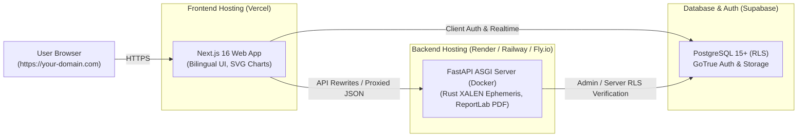

# Gokul's Astrological Insights — Cloud Deployment Guide

This guide provides end-to-end instructions for deploying the full-stack **Gokul's Astrological Insights (GAI)** platform to the cloud and running it as a production web application accessible in any web browser.

---

## 1. Cloud Architecture Overview

In a cloud environment, the 3 components of the application communicate over HTTPS:



---

## 2. Path A: Modern Managed Cloud (Recommended)

This is the fastest, most scalable, and maintenance-free setup. It can be run on **free / low-cost tiers**:
- **Database & Auth**: [Supabase Cloud](https://supabase.com) (Free Tier)
- **Backend API**: [Render](https://render.com) or [Railway](https://railway.app) (Docker Web Service)
- **Frontend App**: [Vercel](https://vercel.com) (Native Next.js Hosting)

---

### Step 1: Set Up Supabase Cloud (Database & Auth)

1. Create an account at [supabase.com](https://supabase.com) and create a new project.
2. Under **Project Settings $\rightarrow$ API**, note down:
   - **Project URL**: `https://<project-ref>.supabase.co`
   - **anon / public key**: `eyJhbG...`
   - **service_role key**: `eyJhbG...` (Keep strictly secret!)
3. Under **Authentication $\rightarrow$ URL Configuration**:
   - Set **Site URL** to your future frontend domain: `https://your-app.vercel.app` (or custom domain).
   - In **Redirect URLs**, add: `https://your-app.vercel.app/**`.
4. Apply the database migrations:
   - In your Supabase dashboard, go to the **SQL Editor**.
   - Copy the entire contents of [`docs/migrations/consolidated_staging_migration_package.sql`](file:///e:/GAI/Astrology%20Website/docs/migrations/consolidated_staging_migration_package.sql) and click **Run**.
   - Verify that tables (`profiles`, `saved_horoscopes`, `saved_kp_charts`, `customers`, etc.) are created.

---

### Step 2: Deploy the Backend to Render (via Dockerfile.backend)

1. Push your repository to GitHub (or GitLab).
2. Create an account on [Render.com](https://render.com).
3. Click **New + $\rightarrow$ Web Service** and connect your GitHub repository.
4. Configure the service:
   - **Name**: `gai-backend-api`
   - **Region**: Choose closest to your target audience (e.g., *Singapore / Frankfurt / Ohio*).
   - **Language**: `Docker`
   - **Dockerfile Path**: `Dockerfile.backend`
   - **Docker Context**: `.` *(Root directory)*
   - **Instance Type**: Starter ($7/mo) or Free tier (Note: Free tier spins down after inactivity).
5. Add the following **Environment Variables** in Render:

| Key | Value | Description |
|---|---|---|
| `PORT` | `8000` | Port uvicorn listens on inside container |
| `SUPABASE_URL` | `https://<your-project-id>.supabase.co` | Supabase Cloud API URL |
| `SUPABASE_SERVICE_ROLE_KEY` | `eyJhbG...` | Supabase secret service role key |
| `NEXT_PUBLIC_SUPABASE_URL` | `https://<your-project-id>.supabase.co` | Supabase URL |
| `NEXT_PUBLIC_SUPABASE_ANON_KEY` | `eyJhbG...` | Supabase public anon key |
| `ADMIN_USERNAME` | `gokul_admin` | Admin initial username |
| `ADMIN_EMAIL` | `admin@your-domain.com` | Admin email |
| `ADMIN_INITIAL_PASSWORD` | `YourSecurePassword#2026` | Admin initial bootstrap password |
| `ALLOWED_ORIGINS` | `https://your-app.vercel.app,https://your-custom-domain.com` | Frontend domain(s) for CORS |
| `DEBUG` | `false` | Disable debug logs in production |

6. Click **Create Web Service**.
7. Once deployment completes, copy your live backend URL (e.g. `https://gai-backend-api.onrender.com`).
8. Test the live health endpoint in your browser:  
   `https://gai-backend-api.onrender.com/health` $\rightarrow$ should return `{"status": "healthy"}`.

---

### Step 3: Deploy the Frontend to Vercel

1. Log in to [Vercel](https://vercel.com) and click **Add New $\rightarrow$ Project**.
2. Import the same GitHub repository.
3. In the project configuration:
   - **Framework Preset**: `Next.js`
   - **Root Directory**: Click *Edit* and select **`frontend`**.
4. Expand **Environment Variables** and add:

| Key | Value | Description |
|---|---|---|
| `NEXT_PUBLIC_SUPABASE_URL` | `https://<your-project-id>.supabase.co` | Supabase public URL |
| `NEXT_PUBLIC_SUPABASE_ANON_KEY` | `eyJhbG...` | Supabase public key |
| `SUPABASE_URL` | `https://<your-project-id>.supabase.co` | Server-side Supabase URL |
| `SUPABASE_SERVICE_ROLE_KEY` | `eyJhbG...` | Server-side secret key |
| `NEXT_PUBLIC_API_BASE_URL` | `https://gai-backend-api.onrender.com` | Render backend URL from Step 2 |
| `BACKEND_INTERNAL_URL` | `https://gai-backend-api.onrender.com` | Used by server route handlers |
| `ADMIN_USERNAME` | `gokul_admin` | Admin username |
| `ADMIN_EMAIL` | `admin@your-domain.com` | Admin email |
| `ADMIN_INITIAL_PASSWORD` | `YourSecurePassword#2026` | Admin password |

5. Click **Deploy**.
6. When deployment finishes, Vercel will give you a live URL (e.g., `https://gai-astrology.vercel.app`).
7. **Important**: Go back to your Render backend dashboard and make sure `ALLOWED_ORIGINS` includes your live Vercel URL (e.g., `https://gai-astrology.vercel.app`).

---

## 3. Path B: Single-Server VPS Deployment (Docker Compose)

If you prefer self-hosting everything on a single Linux server (DigitalOcean Droplet, Hetzner, AWS EC2, Linode) for \$5–\$10/month:

### Step 1: Provision your Linux VPS
1. Create an Ubuntu 22.04 LTS or Debian 12 VPS.
2. SSH into your server:
   ```bash
   ssh root@<your-server-ip>
   ```
3. Install Docker and Docker Compose:
   ```bash
   apt-get update && apt-get install -y curl git
   curl -fsSL https://get.docker.com | sh
   ```

### Step 2: Clone and Configure
1. Clone the repository on the server:
   ```bash
   git clone <your-repo-url> /opt/gai
   cd /opt/gai
   ```
2. Create your production `.env` file:
   ```bash
   cp .env.example .env
   nano .env
   ```
   Fill in your production Supabase keys and domains:
   ```ini
   ALLOWED_ORIGINS=https://astrology.yourdomain.com,http://localhost:3000
   NEXT_PUBLIC_SUPABASE_URL=https://<your-id>.supabase.co
   NEXT_PUBLIC_SUPABASE_ANON_KEY=<your-key>
   SUPABASE_URL=https://<your-id>.supabase.co
   SUPABASE_SERVICE_ROLE_KEY=<your-service-key>
   NEXT_PUBLIC_API_BASE_URL=https://api.yourdomain.com
   ```

### Step 3: Launch with Docker Compose
```bash
docker compose build
docker compose up -d
```
Verify both containers are running healthy:
```bash
docker compose ps
```

### Step 4: Reverse Proxy & Free Automatic SSL (Caddy)
To securely expose your app over HTTPS on your domain (e.g., `astrology.yourdomain.com`):

1. Install Caddy on your VPS:
   ```bash
   apt-get install -y debian-keyring debian-archive-keyring apt-transport-https curl
   curl -1sLf 'https://dl.cloudsmith.io/public/caddy/stable/gpg.key' | gpg --dearmor -o /usr/share/keyrings/caddy-stable-archive-keyring.gpg
   curl -1sLf 'https://dl.cloudsmith.io/public/caddy/stable/debian.deb.txt' | tee /etc/apt/sources.list.d/caddy-stable.list
   apt-get update && apt-get install caddy
   ```
2. Edit `/etc/caddy/Caddyfile`:
   ```caddy
   astrology.yourdomain.com {
       reverse_proxy 127.0.0.1:3000
   }

   api.yourdomain.com {
       reverse_proxy 127.0.0.1:8000
   }
   ```
3. Restart Caddy:
   ```bash
   systemctl restart caddy
   ```
Caddy will automatically obtain free Let's Encrypt SSL certificates and renew them automatically.

---

## 4. Production Pre-Flight Checklist

Before public launch, verify the following:

- [ ] **Database RLS Verified**: Ensure all Supabase tables have Row-Level Security enabled.
- [ ] **Admin Bootstrapped**: First login works at `/login` with initial admin credentials.
- [ ] **CORS Configured**: Visiting `/horoscope` or `/tools/advanced-kp` loads chart calculations without CORS errors in the browser developer console.
- [ ] **PDF Generation Working**: Generating a 9-page horoscope PDF downloads cleanly without byte corruption.
- [ ] **Tamil Typography Clean**: Downloaded PDF renders proper Tamil letters (not squares/tofu).
- [ ] **Service Role Key Protected**: Confirm `SUPABASE_SERVICE_ROLE_KEY` is never exposed in browser network inspection tabs.
