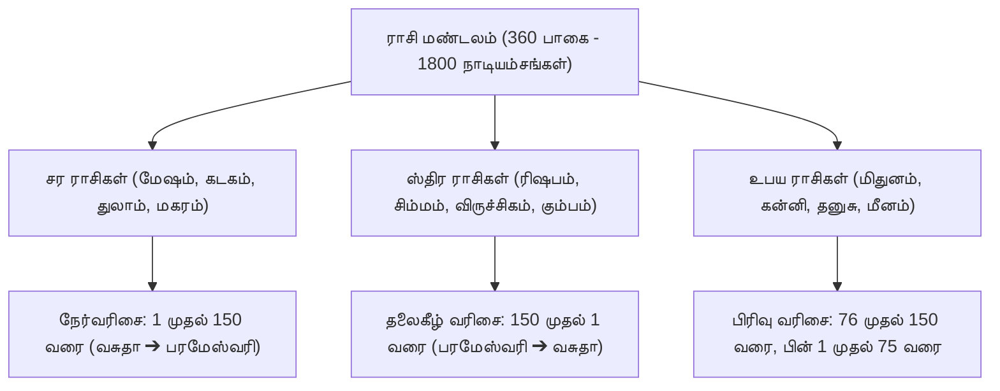

# தேவ கேரளம் (சந்திர கலா நாடி) - முதல் பாகம் (சுலோகங்கள் 1 - 361)
## தேவ கேரளம் மூல நூல் தமிழ் மொழிபெயர்ப்பு, நாடியம்ச கணித அட்டவணை மற்றும் ஜோதிட விளக்க உரை

---

## 1. நூலின் வரலாறு மற்றும் மூல நூலாசிரியர் அறிமுகம் (Historical & Scriptural Lineage)

- **மூல நூல்**: *தேவ கேரளம்* (Deva Keralam) - மாற்றுப் பெயர்: *சந்திர கலா நாடி* (Chandra Kala Nadi) - முதல் பாகம் (சுலோகங்கள் 1 முதல் 2718 வரை; இப்பகுதியில் சுலோகங்கள் 1 முதல் 361 வரை).
- **மூல நூலாசிரியர்**: கேரள தேசத்து மாமுனிவர் **அச்சுதர்** (Achyuta of Kerala). இவர் நாடி ஜோதிட சாஸ்திரத்தில் இணையற்ற மேதையாக விளங்கியவர்.
- **ஆராய்ச்சி மற்றும் மொழிபெயர்ப்பு**: மறைந்த தலைசிறந்த ஜோதிட அறிஞர் **ஆர். சந்தானம்** (R. Santhanam, Sagar Publications, New Delhi, 1992).
- **நூலில் உள்ள மொத்த சுலோகங்கள்**: 8,200-க்கும் மேற்பட்ட சமஸ்கிருத சுலோகங்கள் (முதல், இரண்டாம், மூன்றாம் பாகங்கள் சேர்த்து).
- **ஆசிரியர் பயன்படுத்திய மூல நாடி நூல்கள்**:
  சூரிய நாடி, சந்திர நாடி, குஜ நாடி (செவ்வாய்), புத நாடி, குரு நாடி, சுக்கிர நாடி, சனி நாடி, லக்ன நாடி, லக்னாதிபதி நாடி, சர்வ நாடி, யோக நாடி.
- **மேற்கோள் காட்டப்பட்ட பண்டைய முனிவர்கள்**: கார்க்கிய முனிவர் (Sage Garga), வசிஷ்டர் (Sage Vasishta), பராசரர் (Sage Parasara), யவனாச்சாரியார் (Yavanacharya), வியாசர் (Sage Vyasa), பார்கவர் (Bhargava).
- **சாஸ்திர முக்கியத்துவம்**: சப்தரிஷி நாடி போன்ற நூல்களில் ஜாதகங்களின் உதாரணங்கள் மட்டுமே இருக்கும்; ஆனால் தேவ கேரளம் நூலில் மனித வாழ்வின் ஒவ்வொரு சம்பவத்தையும் துல்லியமாகக் கணிக்கக்கூடிய பராசர மற்றும் நாடி விதிகள், நவாம்ச கோசார சூத்திரங்கள், காலச்சக்கர தசா தேக/ஜீவ ராசி ரகசியங்கள், மற்றும் முற்பிறவி சாப பரிகாரங்கள் (கர்ம விபாக பரிகாரங்கள்) வரிசையாக விளக்கப்பட்டுள்ளன.

---

## 2. 150 நாடியம்சங்களின் கணிதக் கட்டமைப்பு (Mathematical Architecture of 150 Nadiamsas)

### 2.1 நாடியம்ச அளவு மற்றும் கணிதம்
- ஜோதிட சக்கரத்தின் மொத்த பாகை $360^\circ$ ஆகும்.
- ஒரு ராசி என்பது $30^\circ$ (பாகை) அல்லது $1800'$ (கலை) ஆகும்.
- ஒவ்வொரு ராசியும் **150 சம நுண்-பிரிவுகளாகப்** பிரிக்கப்படுகின்றது. இதற்கு **நாடியம்சம்** (Nadiamsa) என்று பெயர்.
- **1 நாடியம்சத்தின் அளவு**:
  $$\text{ஒரு நாடியம்சம்} = \frac{30^\circ}{150} = 0^\circ 12' 00'' \text{ (12 கலைகள் அல்லது 720 விகலைகள்)}$$
- **360 பாகை ராசி சக்கரத்தில் மொத்த நாடியம்சங்கள்**:
  $$150 \times 12 \text{ ராசிகள்} = 1800 \text{ நாடியம்சங்கள்}$$
- **நாடியம்ச அர்த்தங்கள் (இரு பிரிவுகள்)**:
  - **பூர்வார்த்தம் (முற்பகுதி)**: $0^\circ 00' 00'' \text{ முதல் } 0^\circ 06' 00''$ (6 கலைகள்).
  - **உத்தரார்த்தம் (பிற்பகுதி)**: $0^\circ 06' 00'' \text{ முதல் } 0^\circ 12' 00''$ (6 கலைகள்).
- **நான்கு கலைகள் (Kalas)**:
  ஒவ்வொரு நாடியம்சமும் விப்ரா (பிராமண), க்ஷத்ரிய, வைசிய, சூத்ர ஆகிய 4 கலைகளாகப் பிரிக்கப்படுகிறது.
  $$\text{1 கலை அளவு} = \frac{12'}{4} = 3' \text{ (3 கலைகள்)}$$
  ராசி மண்டலம் முழுவதும் $1800 \times 4 = 7200$ மைக்ரோ பிரிவுகளாகப் பரிணமிக்கிறது.

### 2.2 சர, ஸ்திர, உபய ராசிகளில் நாடியம்சங்களின் வரிசை முறை
1. **சர ராசிகள் (மேஷம், கடகம், துலாம், மகரம் - Movable Signs)**:
   - நாடியம்சங்களின் வரிசை **நேர்வரிசையில் 1 முதல் 150 வரை** செல்லும் (வசுதா முதல் பரமேஸ்வரி வரை).
2. **ஸ்திர ராசிகள் (ரிஷபம், சிம்மம், விருச்சிகம், கும்பம் - Fixed Signs)**:
   - நாடியம்சங்களின் வரிசை **தலைகீழ் வரிசையில் 150 முதல் 1 வரை** செல்லும் (பரமேஸ்வரி முதல் வசுதா வரை).
3. **உபய ராசிகள் (மிதுனம், கன்னி, தனுசு, மீனம் - Dual / Common Signs)**:
   - நாடியம்சங்களின் வரிசை **இரண்டாகப் பிரிக்கப்பட்டு**: முதலில் 76 முதல் 150 வரை செல்லும் (மகாமாயா முதல் பரமேஸ்வரி வரை), பின்னர் 1 முதல் 75 வரை செல்லும் (வசுதா முதல் த்ரைலோக்யமோகனகரி வரை).

---

## 3. அட்டவணை 1: அனைத்து 150 நாடியம்சங்களின் தமிழ் மாஸ்டர் பட்டியல் (Table 1: 150 Nadiamsas)

| சர ராசி எண் (Movable) | ஸ்திர ராசி எண் (Fixed) | உபய ராசி எண் (Dual) | நாடியம்சம் பெயர் (C.G. ராஜன் பதிப்பு) | தேவ கேரளம் மூல நூல் பெயர் |
| :---: | :---: | :---: | :--- | :--- |
| **1** | 150 | 76 | வசுதா (Vasudha) | வசுதா (Vasudha) |
| **2** | 149 | 77 | வைஷ்ணவீ (Vaishnavi) | வைஷ்ணவீ (Vaishnavi) |
| **3** | 148 | 78 | பிராம்மீ (Brahmi) | பிராஹீ / பிராம்மீ (Braahi) |
| **4** | 147 | 79 | காளகூடம் (Kalakoota) | காளகூடம் (Kalakoota) |
| **5** | 146 | 80 | சங்கரீ (Sankari) | சங்கரீ (Sankari) |
| **6** | 145 | 81 | சதாகாரீ (Sadaakari) | சுதாகரஸமா (Sudhakarasama) |
| **7** | 144 | 82 | ஸமா (Samaa) | ஸௌம்யா (Saumya) |
| **8** | 143 | 83 | ஸௌம்யா (Saumya) | ஸுரா (Suraa) |
| **9** | 142 | 84 | ஸுரா (Suraa) | மாயா (Maaya) |
| **10** | 141 | 85 | மாயா (Maaya) | மனோஹரா (Manoharaa) |
| **11** | 140 | 86 | மனோஹரா (Manoharaa) | மாதவீ (Maadhavi) |
| **12** | 139 | 87 | மாதவீ (Maadhavi) | மஞ்சுஸ்வனா (Manjuswana) |
| **13** | 138 | 88 | மஞ்சுஸ்வனா (Manjuswana) | கோரா (Ghoraa) |
| **14** | 137 | 89 | கோரா (Ghoraa) | கும்பினீ (Kumbhini) |
| **15** | 136 | 90 | கும்பினீ (Kumbhini) | குடிலா (Kutilaa) |
| **16** | 135 | 91 | குடிலா (Kutilaa) | பிரபா (Prabhaa) |
| **17** | 134 | 92 | பிரபா (Prabhaa) | பரா (Paraa) |
| **18** | 133 | 93 | பரா (Paraa) | பயஸ்வினீ (Payaswini) |
| **19** | 132 | 94 | பயஸ்வினீ (Payaswini) | மாலா (Maala) |
| **20** | 131 | 95 | மாலா (Maala) | ஜகதீ (Jagathi) |
| **21** | 130 | 96 | ஜகதீ (Jagathi) | ஜர்ஜரீ (Jarjhari) |
| **22** | 129 | 97 | ஜர்ஜரா (Jarjharaa) | துருவா (Dhruvaa) |
| **23** | 128 | 98 | துருவா (Dhruva) | முஸலா (Musalaa) |
| **24** | 127 | 99 | முஸலா (Musalaa) | முத்வல / முத்ரகர (Mudgala) |
| **25** | 126 | 100 | முத்ரகரா (Mudgara) | பாசா (Pasaa) |
| **26** | 125 | 101 | பாசா (Pasaa) | சம்பக (Champaka) |
| **27** | 124 | 102 | சம்பகா (Champaka) | தாமினீ (Daamini) |
| **28** | 123 | 103 | தாமினீ (Daamini) | மஹீ (Mahi) |
| **29** | 122 | 104 | மஹீ (Mahi) | கலுஷா (Kalushaa) |
| **30** | 121 | 105 | கலுஷா (Kalushaa) | கமலா (Kamalaa) |
| **31** | 120 | 106 | கமலா (Kamalaa) | காந்தா (Kanthaa) |
| **32** | 119 | 107 | காந்தா (Kantha) | காலா (Kaalaa) |
| **33** | 118 | 108 | காலா (Kaalaa) | கரிகரா (Karikaraa) |
| **34** | 117 | 109 | கரிகரா (Karikaraa) | க்ஷமா (Kshamaa) |
| **35** | 116 | 110 | க்ஷமா (Kshamaa) | துர்தரா (Durdharaa) |
| **36** | 115 | 111 | துர்தரா (Durdhuraa) | துர்பகா (Durbhagaa) |
| **37** | 114 | 112 | துர்பகா (Durbhagaa) | விஸ்வா (Viswa) |
| **38** | 113 | 113 | விஸ்வா (Viswa) | விசீர்ணா (Visirnaa) |
| **39** | 112 | 114 | விசீர்ணா (Visirnaa) | விஹ்வலா (Vihwala) |
| **40** | 111 | 115 | விகடா (Vikata) | விஸ்வலா அனிலா (Viswala Anilaa) |
| **41** | 110 | 116 | ஆவிலா (Aavilaa) | பீமா (Bhima) |
| **42** | 109 | 117 | வித்ருமா (Vidrumaa) | ஸுகப்ரதா (Sukhaprada) |
| **43** | 108 | 118 | ஸுகதா (Sukhada) | ஸ்னிக்தா (Snigdha) |
| **44** | 107 | 119 | ஸ்னிக்தா (Snigdha) | ஸோதரா (Sodaraa) |
| **45** | 106 | 120 | ஸோதரா (Sodaraa) | ஸுரஸுந்தரீ (Surasundari) |
| **46** | 105 | 121 | ஸுரஸுந்தரீ (Surasundari) | அம்ருதப்ராசினீ (Amrutaprasini) |
| **47** | 104 | 122 | அம்ருதப்லாவினீ (Amrithaplavini) | காலா / கராளா (Karalaa) |
| **48** | 103 | 123 | கராளா (Karalaa) | காமதுக்கரா வீரினீ (Kamadruk-Veerini) |
| **49** | 102 | 124 | காமதுக் (Kaamadhuk) | கஹ்வரா (Gahwaraa) |
| **50** | 101 | 125 | கரவீரணீ (Karaveerani) | குண்டினீ (Kundini) |
| **51** | 100 | 126 | கஹ்வரா (Gahvaraa) | காந்தா (Kanthaa) |
| **52** | 99 | 127 | குண்டினீ (Kundini) | விஷாக்யா / விஷா (Vishakhya) |
| **53** | 98 | 128 | ரௌத்ரீ / காந்தா (Raudra/Kaantha) | விஷநாசினீ (Vishanaasini) |
| **54** | 97 | 129 | விஷா (Vishaa) | நிர்மதா (Nirmada) |
| **55** | 96 | 130 | விஷவிநாசினீ (Vishavinaasini) | சீதளா (Seethala) |
| **56** | 95 | 131 | நிர்மதா (Nirmadaa) | நிம்னா (Nimnaa) |
| **57** | 94 | 132 | சீதளா (Seethalaa) | ப்ரீதா (Preeta) |
| **58** | 93 | 133 | நிம்னா (Nimnaa) | ப்ரியவிவர்தனீ (Priyavivardhani) |
| **59** | 92 | 134 | ப்ரீதா (Preeta) | மானக்னா (Maanaghna) |
| **60** | 91 | 135 | பவித்ரா (Pavitra) | துர்பகா (Durbhagaa) |
| **61** | 90 | 136 | மானக்னா (Maanaghna) | சித்ரா (Chitraa) |
| **62** | 89 | 137 | துர்பகா (Durbhagaa) | விசித்ரா (Vichitra) |
| **63** | 88 | 138 | சித்ரா (Chitraa) | சிரஞ்சீவினீ (Chirajivini) |
| **64** | 87 | 139 | சித்ரிணீ (Chitrini) | பூபா (Bhoopa) |
| **65** | 86 | 140 | சிரஞ்சீவினீ (Chiranjeevani) | கதாஹரா (Gadaaharaa) |
| **66** | 85 | 141 | பூபா (Bhoopa) | நாலா (Naala) |
| **67** | 84 | 142 | கதாஹரா (Gadaaharaa) | விஹ்வலா (Vihwala) |
| **68** | 83 | 143 | நாலா (Naala) | நிர்மலா (Nirmalaa) |
| **69** | 82 | 144 | நளினீ (Nalini) | நதீ - நதி (Nadi river) |
| **70** | 81 | 145 | நிர்மலா (Nirmala) | சுதா (Sudha) |
| **71** | 80 | 146 | நதீ (Nadi) | அம்ருதாம்சுகலா (Amritamsukala) |
| **72** | 79 | 147 | சதாஅம்ருதாம்சுகலா (Sadamritamsukala) | காளீ (Kaali) |
| **73** | 78 | 148 | சபலா (Chapalaa) | காளிகா (Kaalika) |
| **74** | 77 | 149 | சாங்குரா (Saankuraa) | கலுஷாங்குரா (Kalushankura) |
| **75** | 76 | 150 | த்ரைலோக்யமோகனகரீ (Trailokyamohanakan) | த்ரைலோக்யமோகனகரீ |
| **76** | 75 | 01 | மகாமாரீ (Mahaamaari) | மகாமாயா (Mahaamaayaa) |
| **77** | 74 | 02 | சுசீதளா (Suseethala) | சுசீதளா (Suseethala) |
| **78** | 73 | 03 | சுமதா / சுபகா (Sumatha/Subhaga) | சுகதா (Sukhadaa) |
| **79** | 72 | 04 | சுப்ரபா (Suprabhaa) | சுப்ரபா (Suprabhaa) |
| **80** | 71 | 05 | சோபா (Sobhaa) | சோபா (Sobhaa) |
| **81** | 70 | 06 | சோபனா (Sobhana) | சோபனா (Sobhana) |
| **82** | 69 | 07 | சிவதா (Sivadaa) | சிவதா (Sivadaa) |
| **83** | 68 | 08 | சிவா (Siva) | சிவா (Siva) |
| **84** | 67 | 09 | பலா (Balaa) | பலா (Balaa) |
| **85** | 66 | 10 | ஜ்வாலா (Jwaala) | ஜ்வாலா (Jwaala) |
| **86** | 65 | 11 | கதா (Gada) | கதா (Gada) |
| **87** | 64 | 12 | காதா (Gaadha) | ஹ்லாதினீ (Hlaadaa) |
| **88** | 63 | 13 | நூதனா (Nootanaa) | நூதனா (Nootana) |
| **89** | 62 | 14 | சுமனோஹரா (Sumanoharaa) | சுமனோஹரா (Sumanoharaa) |
| **90** | 61 | 15 | சோமவல்லீ (Somavalli) | சோமவல்லீ (Somavalli) |
| **91** | 60 | 16 | மோக்ஷாபவர்க்கா (Mokshapavarga) | அபவர்க்கா (Apavargaa) |
| **92** | 59 | 17 | வலய (Valayaa) | பஸ்யதா (Pasyathaa) |
| **93** | 58 | 18 | நவநீதா (Navaneetha) | நவநீதா (Navaneetha) |
| **94** | 57 | 19 | நிசாகரீ (Nisakari) | நிசாசரீ (Nisachari) |
| **95** | 56 | 20 | நிர்விருத்தி (Nirvrithi) | நிவிருத்தி (Nivrithi) |
| **96** | 55 | 21 | நிகதா (Nigadaa) | நிர்கதா (Nirgathaa) |
| **97** | 54 | 22 | சாரா / ஸௌரா (Saara/Sauraa) | சாரா (Saaraa) |
| **98** | 53 | 23 | சங்கீதா (Sangeetha) | ஸாமகா (Samagaa) |
| **99** | 52 | 24 | சுதா (Sumathaa) | ஸமதா (Samadaa) |
| **100** | 51 | 25 | விஸ்வம்பரா (Viswambhara) | ஸமா (Samaa) |
| **101** | 50 | 26 | குமாரீ (Kumari) | விஸ்வம்பரா (Viswambharaa) |
| **102** | 49 | 27 | கோகிலா (Kokila) | குமாரீ (Kumari) |
| **103** | 48 | 28 | குஞ்சராக்ருதி (Kunjarakrithi) | கோகிலா (Kokila) |
| **104** | 47 | 29 | ஐந்திரா (Aindira) | குஞ்சராக்ருதி (Kunjarakrithi) |
| **105** | 46 | 30 | ஸ்வாஹா (Swaahaa) | இந்த்ரா (Indra) |
| **106** | 45 | 31 | ஸ்வரா (Swaraa) | ஸ்வாஹா (Swaahaa) |
| **107** | 44 | 32 | வஹ்னி (Vahni) | ஸ்வதா (Swadha) |
| **108** | 43 | 33 | ப்ரீதி (Preethi) | வஹ்னி (Vahni) |
| **109** | 42 | 34 | ரக்ஷோஜலா (Rakshajala) | பீதா (Peethaa) |
| **110** | 41 | 35 | ப்லவா (Plava) | யக்ஷிணீ (Yakshi) |
| **111** | 40 | 36 | வாருணீ (Vaaruni) | அசலப்ரபா (Achalaprabha) |
| **112** | 39 | 37 | மதிரா (Madiraa) | சாரிணீ (Saarini) |
| **113** | 38 | 38 | மைத்ரீ (Maitri) | மதுரா (Madhuraa) |
| **114** | 37 | 39 | ஹாரிணீ (Haarini) | மைத்ரீ (Maittri) |
| **115** | 36 | 40 | ஹரிணீ (Harini) | ஹரிணீ (Harini) |
| **116** | 35 | 41 | மருத் (Maruth) | மருத்தா (Maruthaa) |
| **117** | 34 | 42 | சோமலதா (Somalatha) | தனஞ்சயா (Dhananjaya) |
| **118** | 33 | 43 | மங்களா (Mangala) | தனகரீ (Dhanakari) |
| **119** | 32 | 44 | முத்ரிகா (Mudrika) | தனதா (Dhanada) |
| **120** | 31 | 45 | சுதா (Sudha) | கச்சபா (Kachchapa) |
| **121** | 30 | 46 | மேளா (Melaa) | அம்புஜா (Ambuja) |
| **122** | 29 | 47 | தனஞ்சயா (Dhananjaya) | ஈசானீ (Isaani) |
| **123** | 28 | 48 | தனகரீ (Dhanakari) | சூலினீ (Soolini) |
| **124** | 27 | 49 | தனதா (Dhanadaa) | ரௌத்ரீ (Raudri) |
| **125** | 26 | 50 | ம்ருச்சாயா (Mricchaya) | சிவா / சிவகரீ (Sivaasivakari) |
| **126** | 25 | 51 | அம்புஜா (Ambuja) | கலா (Kalaa) |
| **127** | 24 | 52 | ஈசானீ (Isaani) | முகுந்தா (Mukunda) |
| **128** | 23 | 53 | சூலினீ (Thoolini / Soolini) | குந்தா (Kundaa) |
| **129** | 22 | 54 | ரௌத்ரீ (Raudri) | முகுந்தா (Mukundaa) |
| **130** | 21 | 55 | சிவா (Sivaa) | பரதா / பரதா (Paratha/Bharata) |
| **131** | 20 | 56 | சிவகரீ (Sivakari) | கதலீ (Kadali) |
| **132** | 19 | 57 | கலா (Kalaa) | ஸ்மரா (Smaraa) |
| **133** | 18 | 58 | குந்தா (Kunda) | பசிதா (Basitha) |
| **134** | 17 | 59 | முகுந்தா (Mukunda) | கோடலா (Kodala) |
| **135** | 16 | 60 | பரதா (Bharatha) | கோகிலாம்சம் (Kokilamsa) |
| **136** | 15 | 61 | பசிதா (Pasithaa) | காமினீ (Kaamini) |
| **137** | 14 | 62 | கண்டினீ (Kandini) | கலசோத்பவா (Kalasodbhava) |
| **138** | 13 | 63 | ஸ்மரா (Smaraa) | வீரப்ரஸூ (Viraprasoo) |
| **139** | 12 | 64 | குந்தலா (Kunthala) | சங்கரா (Sangaraa) |
| **140** | 11 | 65 | கோகிலா (Kokila) | சதயக்னா (Sathayagna) |
| **141** | 10 | 66 | பாபா (Paapa) | சதாவரீ (Sataavari) |
| **142** | 09 | 67 | காமினீ (Kaamini) | ஸ்ரக்வீ (Sragvi) |
| **143** | 08 | 68 | கலசோத்பவா (Kalasodhbhava) | பாடலினீ (Paatalini) |
| **144** | 07 | 69 | வீரப்ரஸூ (Viraprasoo) | நாகபங்கஜா (Naagapankaja) |
| **145** | 06 | 70 | சங்கரா (Sankara) | பரமேஸ்வரி (Parameswari) |
| **146** | 05 | 71 | சதயக்னா (Sathayaghna) | சுப்ரா (Subhra) |
| **147** | 04 | 72 | சதாவரீ (Sadaavari) | சோபனா (Sobhana) |
| **148** | 03 | 73 | பிரஹ்வீ (Brahvi) | விஸ்வா (Viswa) |
| **149** | 02 | 74 | பாடலினீ (Paatalini) | சுசித்ரா (Suchitra) |
| **150** | 01 | 75 | பரமேஸ்வரி (Parameswari) | சித்ரா (Chitra) |

---

## 4. அட்டவணை 2: அனைத்து 150 நாடியம்சங்களின் பாகை & கலை அளவுகள் (Table 2: Exact Degrees & Minutes)

| நாடியம்சம் எண் | ஆரம்ப பாகை (From Deg Min) | முடிவு பாகை (To Deg Min) | நாடியம்சம் எண் | ஆரம்ப பாகை (From Deg Min) | முடிவு பாகை (To Deg Min) |
| :---: | :---: | :---: | :---: | :---: | :---: |
| **01** | $00^\circ 00'$ | $00^\circ 12'$ | **76** | $15^\circ 00'$ | $15^\circ 12'$ |
| **02** | $00^\circ 12'$ | $00^\circ 24'$ | **77** | $15^\circ 12'$ | $15^\circ 24'$ |
| **03** | $00^\circ 24'$ | $00^\circ 36'$ | **78** | $15^\circ 24'$ | $15^\circ 36'$ |
| **04** | $00^\circ 36'$ | $00^\circ 48'$ | **79** | $15^\circ 36'$ | $15^\circ 48'$ |
| **05** | $00^\circ 48'$ | $01^\circ 00'$ | **80** | $15^\circ 48'$ | $16^\circ 00'$ |
| **06** | $01^\circ 00'$ | $01^\circ 12'$ | **81** | $16^\circ 00'$ | $16^\circ 12'$ |
| **07** | $01^\circ 12'$ | $01^\circ 24'$ | **82** | $16^\circ 12'$ | $16^\circ 24'$ |
| **08** | $01^\circ 24'$ | $01^\circ 36'$ | **83** | $16^\circ 24'$ | $16^\circ 36'$ |
| **09** | $01^\circ 36'$ | $01^\circ 48'$ | **84** | $16^\circ 36'$ | $16^\circ 48'$ |
| **10** | $01^\circ 48'$ | $02^\circ 00'$ | **85** | $16^\circ 48'$ | $17^\circ 00'$ |
| **11** | $02^\circ 00'$ | $02^\circ 12'$ | **86** | $17^\circ 00'$ | $17^\circ 12'$ |
| **12** | $02^\circ 12'$ | $02^\circ 24'$ | **87** | $17^\circ 12'$ | $17^\circ 24'$ |
| **13** | $02^\circ 24'$ | $02^\circ 36'$ | **88** | $17^\circ 24'$ | $17^\circ 36'$ |
| **14** | $02^\circ 36'$ | $02^\circ 48'$ | **89** | $17^\circ 36'$ | $17^\circ 48'$ |
| **15** | $02^\circ 48'$ | $03^\circ 00'$ | **90** | $17^\circ 48'$ | $18^\circ 00'$ |
| **16** | $03^\circ 00'$ | $03^\circ 12'$ | **91** | $18^\circ 00'$ | $18^\circ 12'$ |
| **17** | $03^\circ 12'$ | $03^\circ 24'$ | **92** | $18^\circ 12'$ | $18^\circ 24'$ |
| **18** | $03^\circ 24'$ | $03^\circ 36'$ | **93** | $18^\circ 24'$ | $18^\circ 36'$ |
| **19** | $03^\circ 36'$ | $03^\circ 48'$ | **94** | $18^\circ 36'$ | $18^\circ 48'$ |
| **20** | $03^\circ 48'$ | $04^\circ 00'$ | **95** | $18^\circ 48'$ | $19^\circ 00'$ |
| **21** | $04^\circ 00'$ | $04^\circ 12'$ | **96** | $19^\circ 00'$ | $19^\circ 12'$ |
| **22** | $04^\circ 12'$ | $04^\circ 24'$ | **97** | $19^\circ 12'$ | $19^\circ 24'$ |
| **23** | $04^\circ 24'$ | $04^\circ 36'$ | **98** | $19^\circ 24'$ | $19^\circ 36'$ |
| **24** | $04^\circ 36'$ | $04^\circ 48'$ | **99** | $19^\circ 36'$ | $19^\circ 48'$ |
| **25** | $04^\circ 48'$ | $05^\circ 00'$ | **100** | $19^\circ 48'$ | $20^\circ 00'$ |
| **26** | $05^\circ 00'$ | $05^\circ 12'$ | **101** | $20^\circ 00'$ | $20^\circ 12'$ |
| **27** | $05^\circ 12'$ | $05^\circ 24'$ | **102** | $20^\circ 12'$ | $20^\circ 24'$ |
| **28** | $05^\circ 24'$ | $05^\circ 36'$ | **103** | $20^\circ 24'$ | $20^\circ 36'$ |
| **29** | $05^\circ 36'$ | $05^\circ 48'$ | **104** | $20^\circ 36'$ | $20^\circ 48'$ |
| **30** | $05^\circ 48'$ | $06^\circ 00'$ | **105** | $20^\circ 48'$ | $21^\circ 00'$ |
| **31** | $06^\circ 00'$ | $06^\circ 12'$ | **106** | $21^\circ 00'$ | $21^\circ 12'$ |
| **32** | $06^\circ 12'$ | $06^\circ 24'$ | **107** | $21^\circ 12'$ | $21^\circ 24'$ |
| **33** | $06^\circ 24'$ | $06^\circ 36'$ | **108** | $21^\circ 24'$ | $21^\circ 36'$ |
| **34** | $06^\circ 36'$ | $06^\circ 48'$ | **109** | $21^\circ 36'$ | $21^\circ 48'$ |
| **35** | $06^\circ 48'$ | $07^\circ 00'$ | **110** | $21^\circ 48'$ | $22^\circ 00'$ |
| **36** | $07^\circ 00'$ | $07^\circ 12'$ | **111** | $22^\circ 00'$ | $22^\circ 12'$ |
| **37** | $07^\circ 12'$ | $07^\circ 24'$ | **112** | $22^\circ 12'$ | $22^\circ 24'$ |
| **38** | $07^\circ 24'$ | $07^\circ 36'$ | **113** | $22^\circ 24'$ | $22^\circ 36'$ |
| **39** | $07^\circ 36'$ | $07^\circ 48'$ | **114** | $22^\circ 36'$ | $22^\circ 48'$ |
| **40** | $07^\circ 48'$ | $08^\circ 00'$ | **115** | $22^\circ 48'$ | $23^\circ 00'$ |
| **41** | $08^\circ 00'$ | $08^\circ 12'$ | **116** | $23^\circ 00'$ | $23^\circ 12'$ |
| **42** | $08^\circ 12'$ | $08^\circ 24'$ | **117** | $23^\circ 12'$ | $23^\circ 24'$ |
| **43** | $08^\circ 24'$ | $08^\circ 36'$ | **118** | $23^\circ 24'$ | $23^\circ 36'$ |
| **44** | $08^\circ 36'$ | $08^\circ 48'$ | **119** | $23^\circ 36'$ | $23^\circ 48'$ |
| **45** | $08^\circ 48'$ | $09^\circ 00'$ | **120** | $23^\circ 48'$ | $24^\circ 00'$ |
| **46** | $09^\circ 00'$ | $09^\circ 12'$ | **121** | $24^\circ 00'$ | $24^\circ 12'$ |
| **47** | $09^\circ 12'$ | $09^\circ 24'$ | **122** | $24^\circ 12'$ | $24^\circ 24'$ |
| **48** | $09^\circ 24'$ | $09^\circ 36'$ | **123** | $24^\circ 24'$ | $24^\circ 36'$ |
| **49** | $09^\circ 36'$ | $09^\circ 48'$ | **124** | $24^\circ 36'$ | $24^\circ 48'$ |
| **50** | $09^\circ 48'$ | $10^\circ 00'$ | **125** | $24^\circ 48'$ | $25^\circ 00'$ |
| **51** | $10^\circ 00'$ | $10^\circ 12'$ | **126** | $25^\circ 00'$ | $25^\circ 12'$ |
| **52** | $10^\circ 12'$ | $10^\circ 24'$ | **127** | $25^\circ 12'$ | $25^\circ 24'$ |
| **53** | $10^\circ 24'$ | $10^\circ 36'$ | **128** | $25^\circ 24'$ | $25^\circ 36'$ |
| **54** | $10^\circ 36'$ | $10^\circ 48'$ | **129** | $25^\circ 36'$ | $25^\circ 48'$ |
| **55** | $10^\circ 48'$ | $11^\circ 00'$ | **130** | $25^\circ 48'$ | $26^\circ 00'$ |
| **56** | $11^\circ 00'$ | $11^\circ 12'$ | **131** | $26^\circ 00'$ | $26^\circ 12'$ |
| **57** | $11^\circ 12'$ | $11^\circ 24'$ | **132** | $26^\circ 12'$ | $26^\circ 24'$ |
| **58** | $11^\circ 24'$ | $11^\circ 36'$ | **133** | $26^\circ 24'$ | $26^\circ 36'$ |
| **59** | $11^\circ 36'$ | $11^\circ 48'$ | **134** | $26^\circ 36'$ | $26^\circ 48'$ |
| **60** | $11^\circ 48'$ | $12^\circ 00'$ | **135** | $26^\circ 48'$ | $27^\circ 00'$ |
| **61** | $12^\circ 00'$ | $12^\circ 12'$ | **136** | $27^\circ 00'$ | $27^\circ 12'$ |
| **62** | $12^\circ 12'$ | $12^\circ 24'$ | **137** | $27^\circ 12'$ | $27^\circ 24'$ |
| **63** | $12^\circ 24'$ | $12^\circ 36'$ | **138** | $27^\circ 24'$ | $27^\circ 36'$ |
| **64** | $12^\circ 36'$ | $12^\circ 48'$ | **139** | $27^\circ 36'$ | $27^\circ 48'$ |
| **65** | $12^\circ 48'$ | $13^\circ 00'$ | **140** | $27^\circ 48'$ | $28^\circ 00'$ |
| **66** | $13^\circ 00'$ | $13^\circ 12'$ | **141** | $28^\circ 00'$ | $28^\circ 12'$ |
| **67** | $13^\circ 12'$ | $13^\circ 24'$ | **142** | $28^\circ 12'$ | $28^\circ 24'$ |
| **68** | $13^\circ 24'$ | $13^\circ 36'$ | **143** | $28^\circ 24'$ | $28^\circ 36'$ |
| **69** | $13^\circ 36'$ | $13^\circ 48'$ | **144** | $28^\circ 36'$ | $28^\circ 48'$ |
| **70** | $13^\circ 48'$ | $14^\circ 00'$ | **145** | $28^\circ 48'$ | $29^\circ 00'$ |
| **71** | $14^\circ 00'$ | $14^\circ 12'$ | **146** | $29^\circ 00'$ | $29^\circ 12'$ |
| **72** | $14^\circ 12'$ | $14^\circ 24'$ | **147** | $29^\circ 12'$ | $29^\circ 24'$ |
| **73** | $14^\circ 24'$ | $14^\circ 36'$ | **148** | $29^\circ 24'$ | $29^\circ 36'$ |
| **74** | $14^\circ 36'$ | $14^\circ 48'$ | **149** | $29^\circ 36'$ | $29^\circ 48'$ |
| **75** | $14^\circ 48'$ | $15^\circ 00'$ | **150** | $29^\circ 48'$ | $30^\circ 00'$ |

---

## 5. தேவ கேரளம் முதல் பாக சுலோகங்கள் 1 - 361: விரிவான தமிழ் மொழிபெயர்ப்பு மற்றும் ஜோதிட விளக்கவுரை

### பகுதி 1: வசுதா & மாலினி நாடியம்சம், மாதங்க யோகம் (சுலோகங்கள் 1 - 18)

#### சுலோகம் 1 - 2: மாதங்க யோகம் (Maatanga Yoga)
> **சுலோகம்**:
> *மாதங்கயோகஜாதஸ்ய ரக்தவர்ணசுபாக்ருதிஃ।*
> *ஸுரேஜ்யே கடகே பார்கவஸமன்விதே।*
> *மாதங்கயோகோ பவதி ஸ்வரக்ஷே நவாம்சகே வதேத்॥*
- **தமிழ் உரை**: குரு பகவான் கடக ராசியின் கடைசி நவாம்சமான மீன நவாம்சத்தில் ($26^\circ 40' - 30^\circ 00'$) இருந்து சுக்கிரனுடன் கூடி, சந்திரன் தனது சொந்த ராசியான கடகத்திலும், நவாம்சத்திலும் (வர்கோத்தமம்) அமைந்தால் **மாதங்க யோகம்** உண்டாகிறது.
- **பலன்**: இந்த யோகத்தில் பிறந்த ஜாதகர் செவ்வந்த நிறமும் (blood-red complexion), கம்பீரமான வசீகர முகத் தோற்றமும் உடையவராகத் திகழ்வார்.

#### சுலோகம் 3 - 5: காளகூட / மாலினி நாடியம்சத்தில் இழிகுலப் பிறவி
- சந்திரனுக்குத் திரிகோணங்களில் பாப கிரகங்கள் இருந்து, சனியுடன் ராகு இணைந்திருக்க மாலினி நாடியம்சத்தில் பிறந்தால், ஜாதகர் குலப்பெருமை அற்ற கீழான குடும்பத்தில் பிறப்பார்.
- ஜாதகருக்கு உடன் பிறந்த நேரடி சகோதரர்கள் இருக்க மாட்டார்கள்; ஒன்றுவிட்ட மாற்றாந்தாய் சகோதரர்களே அமைவர். தந்தைக்கு மூன்று மனைவிகள் அமைவர். தாயார் கற்புள்ள புண்ணியவதியாக நெடுங்காலம் வாழ்வார். தாயின் சகோதரர் (மாமன்) நாசமடைவதால் தாயார் துயருறுவார்.

#### சுலோகம் 8 - 13: துர்பகா மற்றும் ஸ்ரீகார நாடியம்சம் - சகோதரர் மற்றும் தந்தை பாக்கியம்
- 4-ஆம் அதிபதியான சந்திரன் ஸ்ரீகார நாடியம்சத்தில் (கரிகரா நாடியம்சம்) இருந்து, விருச்சிகம் அல்லது மகர நவாம்சம் பெற்று 9-ஆம் அதிபதி குருவால் பார்க்கப்பட்டால், ஜாதகருக்குப் பின் பிறந்த சகோதரர்கள் இருக்க மாட்டார்கள்; ஒரு சகோதரி மட்டும் தீர்க்காயுளுடன் வாழ்வார்.
- சந்திரன் துர்பகா நாடியம்சத்தில் இருந்தால் ஒரு சகோதரி துரதிர்ஷ்டசாலியாக வாழ்வார். மாற்றாந்தாய் சகோதரர்கள் நாசமடைவர். ஜாதகரின் தந்தை பல்வேறு தேசங்களுக்குச் சென்று ரத்தினங்கள், நவதானியங்கள், வஸ்திர வியாபாரம் செய்து அளவற்ற தனமும் செல்வமும் சேர்ப்பார்; புத்திசாலியாக விளங்குவார்.

#### சுலோகம் 14 - 16: தந்தை மற்றும் தாயார் மரணக் காலத்தைக் கணக்கிடும் நாடி சூத்திரம்
> **நாடி ரகசிய சூத்திரம்**:
> - **தந்தை மரண பாகை**: சூரியனின் ஸ்புடத்தையும் (பாகை), 4-ஆம் அதிபதியின் ஸ்புடத்தையும் கூட்டினால் வரும் பாகை. கோசார சனி இந்த பாகைக்கோ அல்லது அதன் திரிகோண ராசிக்கோ வரும்போது தந்தைக்கு மரணம் சம்பவிக்கும்.
> - **தாய் மரண பாகை**: சந்திரனின் ஸ்புடத்தையும், 5-ஆம் அதிபதியின் ஸ்புடத்தையும் கூட்டினால் வரும் பாகை. கோசார சனி அப்பாகைக்கு வரும்போது தாய்க்கு கண்டம் ஏற்படும்.
- மாலினி நாடியம்சத்தில் பிறந்தவருக்கு ஜன்ம தசாவின் முதல் புக்தியில் தந்தைக்குக் கடுமையான நோய்களும் விபத்துகளும் நேரிடும்.

#### சுலோகம் 17 - 18: விபத்து தசா மற்றும் விவாக காலம்
- விபத்து தசா (3-ஆம் தசா) நடக்கும் காலத்தில் 10-ஆம் அதிபதியின் புக்தியில் அல்லது 22 அல்லது 25-ஆம் வயதில் திருமணம் இனிதே நடைபெறும்.

---

### பகுதி 2: காளகூட நாடியம்சம், ரேகா யோகம், கூர்ம யோகம், மேஷ & கடக லக்னங்கள் (சுலோகங்கள் 19 - 53)

#### சுலோகம் 19 - 22: கடகத்தில் காளகூட நாடியம்சம்
- கடக ராசியில் $0^\circ 36' - 0^\circ 48'$ பகுதியில் குரு இருக்கும்போது காளகூட நாடியம்சத்தில் பிறந்தவர், தன் சொந்த உழைப்பால் செல்வம் திரட்டுவார். மரங்கள், மூலிகைகள், வாசனைத் திரவியங்கள் வர்த்தகம் செய்து சகோதரி மற்றும் உறவினர்கள் மூலம் அளப்பரிய தன லாபங்களை ஈட்டுவார்.

#### சுலோகம் 23 - 26: 10-ஆம் அதிபதி தசா பலன் & தாயாரின் முடிவு
- 10-ஆம் அதிபதியான சனியின் தசாவில் நண்பர்கள் பகையாவர். சகோதரிக்குக் கஷ்டமும், தாயாருக்குக் கண்டமும் உண்டாகும். மாலினி நாடியம்சத்தில் பிறந்தவர் முதுமைப் பருவத்தில் சித்தப்பிரமை (மன அமைதியின்மை) அடைவார்.

#### சுலோகம் 34 - 35: ரேகா யோகம் மற்றும் கேமத்ரும யோகம்
- சனியானவர் காளிகா நாடியம்சத்தில் ராகுவுடன் கூடி சுபரின் பார்வையைப் பெற்றால், அது விசித்திரமான ரேகா யோகத்தையும், கேமத்ரும யோகத்தையும் தோற்றுவிக்கும்; இதனால் ஜாதகர் செல்வத்தை இழந்து பின்னர் மீண்டும் அடைவார்.

#### சுலோகம் 41 - 46: கூர்ம யோகம் (Koorma Yoga)
> **கூர்ம யோக லட்சணம்**:
> லக்னம், 3-ஆம் இடம் மற்றும் 11-ஆம் இடங்களில் சுப மற்றும் பாப கிரகங்கள் சுப பலத்துடன் அமையும்போது **கூர்ம யோகம்** உண்டாகிறது.
- **பலன்**: ஜாதகர் 5-ஆம் தசாவில் (பிரத்யக் தசா) பெருத்த பாக்கியங்களையும், வணிகத் துறையில் ஆழமான ஞானத்தையும் அடைவார். நாளுக்கு நாள் தன விருத்தி உண்டாகும். லக்னாதிபதியின் அனுகூலத்தால் அரச யோக சுகங்களை அனுபவிப்பார்.

#### சுலோகம் 47 - 48: கடக லக்ன விசேஷ விதி
- கடக லக்னத்திற்கு 5 மற்றும் 10-ஆம் அதிபதியான யோககாரகன் செவ்வாய் தசாவில், 6 மற்றும் 9-ஆம் அதிபதியான குருவின் அந்தர தசா (புக்தி) நடக்கும்போது, பெரும் சோதனைகளும், குடும்பப் பெண்களுக்குக் கண்டமும், தன சேதாரமும் உண்டாகும். ஏனெனில் கடகத்திற்கு குரு 6-ஆம் அதிபதியாகவும் அமைகிறார்.

#### சுலோகம் 49 - 52: மேஷ லக்னம் & 63-ஆம் வயது அபமிருத்யு
- மேஷ லக்னம் கடக நவாம்சத்தில் பிறந்தவருக்கு செவ்வாய் தசையும் ராகு தசையும் நன்மைகளையும் தன லாபத்தையும் புத்திர விவாக விசேஷங்களையும் தரும். ஆனால் 63-ஆம் வயதில் குரு அந்தரத்தில் அபமிருத்யு கண்டம் நேரிடும். அதற்கு சாந்தி பரிகாரங்கள் செய்து ஆயுள் பலம் பெற வேண்டும்.

---

### பகுதி 3: ரிஷப லக்னம் - அபலா (பிரபா) நாடியம்சம் (சுலோகங்கள் 54 - 96)

#### சுலோகம் 54 - 60: அபலா நாடியம்சம் ($26^\circ 48' - 27^\circ 00'$)
- ரிஷப லக்னம் ஸ்திர ராசியில் அபலா நாடியம்சத்தில் பூர்வார்த்தத்தில் ($26^\circ 48' - 26^\circ 54'$) பிறந்தவர்: பிராமண குலத்தில் தோன்றி, மெலிந்த உடலமைப்பும், மூத்த சகோதரரிடம் பிரியமும் கொண்டிருப்பார். மைத்துனரின் (சகோதரி கணவர்) உதவியால் மேற்கு நதிக்கரை அல்லது கோகர்ண க்ஷேத்திரத்திற்குச் சென்று வாழ்வார். இளமையில் வறுமை வாட்டும்.
- உத்தரார்த்தத்தில் ($26^\circ 54' - 27^\circ 00'$) பிறந்தவர்: பிறந்த தேசத்திலேயே பெரும் யோகங்களையும் பாக்கியங்களையும் பெற்று வாழ்வார். பெற்றோர்கள் நீண்ட ஆயுள் பெறுவர்.

#### சுலோகம் 63 - 72: ரிஷப லக்ன புத்திர தோஷ பிரம்ம சாபமும் சேது ஸ்நான பரிகாரமும்
> **பிரம்ம சாப புத்திர தோஷ அமைப்பு**:
> ரிஷப லக்னத்திற்கு 8-ஆம் அதிபதியான குரு பகவான் 5-ஆம் இடத்தில் அமர்ந்து, இரண்டு பாப கிரகங்களால் பார்க்கப்பட்டால் முற்பிறவியில் பிராமணரை அவமதித்த சாபத்தால் (பிரம்ம சாபம்) புத்திர தோஷம் உண்டாகும். பிறக்கும் குழந்தைகள் தங்காது.
- **சாஸ்திர பரிகாரம்**:
  1. தென்திசையில் உள்ள **ராமேஸ்வரம் சேது தீர்த்தத்தில் நீராடுதல்** (Setu Snana).
  2. **நாகேஸ்வர சிவலிங்க வழிபாடு** மற்றும் பிரதோஷ விரதம் அனுஷ்டித்தல்.
  3. திங்கட்கிழமைகளில் விரதமிருந்து சோமவார பிரதோஷ தானங்கள் செய்தல்.
  4. இதனால் ஈசனின் திருவருளால் ஜாதகருக்குத் தீர்க்காயுள் உள்ள புத்திர பாக்கியம் கைகூடும்.

#### சுலோகம் 79 - 80: நிர்மலா நாடியம்சத்தில் 3-ஆம் அதிபதி
- 3-ஆம் அதிபதி நிர்மலா நாடியம்சத்தில் ($16^\circ 24' - 16^\circ 36'$) இருந்தால் ஜாதகருக்கு 5 சகோதரர்கள் அமைவர்; அவர்களில் இருவர் தீர்க்காயுளுடன் விளங்குவர்.

#### சுலோகம் 88 - 96: கும்ப லக்னத்தில் 6-ஆம் அதிபதி சந்திரன் நிர்மலா நாடியம்சத்தில் - வேதாந்த ஞானம்
- கும்ப லக்னத்திற்கு 6-ஆம் அதிபதியான சந்திரன் நிர்மலா நாடியம்சத்தில் இருக்க, 10-ஆம் அதிபதியான செவ்வாய் சொந்த வீடு அல்லது நவாம்சம் பெற்றால்:
  - ஜாதகர் **வேதாந்த சாஸ்திரங்களிலும், தத்துவங்களிலும் நிகரற்ற பாண்டித்தியம்** பெறுவார்.
  - வேத நெறிப்படி கர்மாக்களைச் செய்வார்; சிவ-விஷ்ணு பேதமற்ற பக்தி பூண்டிருப்பார்.
  - 3-ஆம் தசாவின் தொடக்கத்திலும் முடிவிலும் யோகமும், 4-ஆம் தசாவில் மகத்தான தன லாபங்களும் உண்டாகும்.

---

### பகுதி 4: கும்ப லக்னம் - அகதா மற்றும் விஸ்வம்பரா நாடியம்சங்கள் (சுலோகங்கள் 97 - 187)

#### சுலோகம் 97 - 103: விருச்சிக குரு கன்னி நவாம்சத்தில் - நூலாசிரியர் மற்றும் கிரந்தகர்த்தா யோகம்
- விருச்சிக ராசியில் குரு பகவான் கன்னி நவாம்சம் பெற்று விஸ்வம்பரா நாடியம்சத்தில் ($8^\circ 48' - 9^\circ 00'$) அமையப் பிறந்தவர்:
  - விப்ரா கலையில் பிறந்தால் பிறவிச் செல்வந்தர்; க்ஷத்ரிய கலையில் பிறந்தால் ஆட்சியாளர்; வைசிய கலையில் வணிகர்; சூத்ர கலையில் தொழிலாளி.
  - **விசேஷ பலன்**: ஜாதகர் மகா புத்திசாலி, பிறர் உள்ளத்தை அறியும் திறனுடையவர், உண்மையானவர். எழுத்தாற்றலில் தன்னிகரற்ற விளங்கி **நூலாசிரியராகவும் (Grantha-karta), சாஸ்திர உரையாசிரியராகவும்** திகழ்ந்து அரச கௌரவம் அடைவார்.

#### சுலோகம் 104 - 107: லக்னத்தில் ராகு - சூரிய பார்வை
- கும்ப லக்னத்தில் ராகு இருந்து சூரியனால் பார்க்கப்பட்டால், ஜாதகருக்கு வாத உபாதைகளும், பந்துக்களுடன் பகையும் உண்டாகும்.

#### சுலோகம் 115 - 118: மாற்றாந்தாய் சகோதர புத்திர தோஷம் & சந்தான கோபால தான பரிகாரம்
- அகதா நாடியம்சத்தின் பூர்வார்த்தத்தில் பிறந்தவருக்கு, ஒன்றுவிட்ட மாற்றாந்தாய் சகோதரருக்கு முற்பிறவிப் பாவத்தால் புத்திரர்கள் பிறந்து இறந்து போகும் தோஷம் உண்டாகும்.
- **பரிகாரம்**:
  - சேது தீர்த்த ஸ்நானம் மற்றும் சிவ அர்ச்சனை.
  - சஷ்டி விரதம் இருத்தல்.
  - மகரிஷி வியாசரின் வாக்குப் படி, **சந்தான கோபால கிருஷ்ணரின் விக்கிரகத்தை** ஆசாரியருக்குத் தானமாக அளித்தால் புத்திர தோஷம் நிவர்த்தியாகி நீண்ட ஆயுள் உள்ள குழந்தைகள் பிறப்பர்.

#### சுலோகம் 125 - 128: மஞ்சுஸ்வன நாடியம்சத்தில் சூரியன் - தந்தை மரண ரகசியம்
- 9-ஆம் அதிபதி பாபருடன் இருக்க, செவ்வாய் 5-ல் அமைய, சூரியன் மஞ்சுஸ்வன நாடியம்சத்தில் ($27^\circ 36' - 27^\circ 48'$) கேதுவுடன் கூடி நின்றால்:
  - ஜாதகரின் தந்தை வெளியூரில் ஒரு சிறிய கிராமத்தில் அஜீரணக் கோளாறு மற்றும் வயிற்றுப்போக்கு நோயினால் காலமாவார். அச்சமயத்தில் ஜாதகர் தந்தையின் அருகில் இருப்பார்.

#### சுலோகம் 130 - 135: சந்திர நாடி மேற்கோள் - குடில நாடியம்சத்தில் 6-ஆம் அதிபதி சந்திரன்
- கும்ப லக்னத்திற்கு 6-ஆம் அதிபதியான சந்திரன் குடில நாடியம்சத்தில் இருந்து புதனால் பார்க்கப்பட்டால், தாய்வழி உறவினர்களுக்கு நீண்ட ஆயுள் உண்டாகும். தாய்வழிச் சொத்துக்கள் வந்து சேரும்.

---

### பகுதி 5: தனுசு லக்னம் - வருண (வருணி) நாடியம்சம் (சுலோகங்கள் 188 - 233)

#### சுலோகம் 188 - 192: வருண நாடியம்சம் ($7^\circ 48' - 8^\circ 00'$) & அம்மை நோயில் தப்பித்தல்
- தனுசு லக்னத்தில் குருவும் சந்திரனும் கூடி வருண நாடியம்சத்தில் அமர்ந்து செவ்வாயால் பார்க்கப்பட்டால்:
  - குழந்தை பருவத்தில் தீவிரமான அம்மை நோய் (small-pox) தாக்கி, மரணத்தின் விளிம்பு வரை சென்று உயிர் தப்புவார்.

#### சுலோகம் 201 - 204: தனுசு லக்ன மகாராஜ யோக ஜாதகம் (Specific Royal Horoscope)
> **மகா ராஜயோக கிரக அமைப்பு**:
> - **தனுசு லக்னம்**: குரு பகவான் சந்திரனுடன் கூடி வருண நாடியம்சத்தில் அமர்வு.
> - **3-ஆம் வீடு (கும்பம்)**: சனி பகவான் மூலதிரிகோணத்தில் ஆட்சி.
> - **4-ஆம் வீடு (மீனம்)**: சுக்கிரன் உச்சம் பெற்று கேதுவுடன் கூடி நிற்றல்.
> - **6-ஆம் வீடு (ரிஷபம்)**: சூரியன், செவ்வாய், புதன் சேர்க்கை.
> - **10-ஆம் வீடு (கன்னி)**: ராகு பகவான் அமர்வு.
- **பலன்**:
  - ஜாதகர் அரசருக்கு இணையான பெரும் பதவியையும், மாட மாளிகைகளையும், பல்லக்கு வாகனங்களையும் பெறுவார்.
  - 16, 20, 32-ஆம் வயதுகளுக்குப் பிறகு தன வரவு பன்மடங்கு பெருகும்.
  - 5-ஆம் வீட்டை லக்ன குரு பார்ப்பதால் குறைந்த எண்ணிக்கையிலான குழந்தைகளே அமைவர்; ஆனால் அவர்கள் சிறந்த அறிஞர்களாக விளங்குவர்.

#### சுலோகம் 220 - 223: விவாக தடையும் 3-ஆம் அதிபதி சுப பலமும்
- 3-ஆம் வீட்டில் சனி இருந்தால் முற்பிறவி வினையால் திருமண முயற்சிகளில் இரண்டு மூன்று முறை தோல்விகளும் தடைகளும் உண்டாகும். 3-ஆம் அதிபதி சுப வர்க்கத்திலும் நவாம்சத்திலும் சுபரின் பார்வையைப் பெற்றால் மாமனார் மேன்மையடைவார்; திருமணம் இனிதே நிறைவேறும்.

---

### பகுதி 6: தனுசு லக்னம் - பிரபா & குமார நாடியம்சங்கள், சக்ர யோகம் (சுலோகங்கள் 234 - 290)

#### சுலோகம் 244 - 256: சக்ர யோகம், கங்கா ஸ்நானம் மற்றும் அக்ரஹார தானம்
- தனுசு லக்னத்தில் சக்ர யோகம் அமையப் பெற்று, லக்னாதிபதி குரு வருண நாடியம்சத்திலும், 9-ஆம் அதிபதி சூரியன் குமார நாடியம்சத்திலும் ($6^\circ 12' - 6^\circ 24'$) அமைந்தால்:
  - ஜாதகர் பேரரசரின் அன்பையும் நன்மதிப்பையும் பெறுவார். 3-ஆம் தசாவில் நால்வகை வாகன யோகங்களும், ஆடை ஆபரண சேர்க்கையும் உண்டாகும்.
  - **10-ல் ராகு பலன்**: ஜாதகர் கங்கை நதியில் நீராடும் பாக்கியம் பெறுவார் அல்லது தென் திசையில் 3 வார கால சேது யாத்திரை மேற்கொள்வார்.
  - 9 மற்றும் 10-ஆம் அதிபதிகள் இணைவு பெற்றிருப்பதால், வேத வித்தகர்களுக்கு அக்ரஹார பூமி தானங்களை வழங்கி அழியாப் புகழ் பெறுவார்.

#### சுலோகம் 265 - 270: விருச்சிகத்தில் சூரியன் - ஹரி-ஹர பக்தி
- தனுசு லக்னத்திற்கு 9-ஆம் அதிபதியான சூரியன் 12-ஆம் இடமான விருச்சிகத்தில் குமார நாடியம்சத்தில் ராகுவுடன் அமையப் பிறந்தால்:
  - ஜாதகர் வைதீக நெறிகளைப் பின்பற்றி, மகாவிஷ்ணு மற்றும் பரமேஸ்வரனை அனுதினமும் பூஜிக்கும் உத்தம பக்தராகத் திகழ்வார். தர்ம நெறியில் நின்று முன்னோர்களின் கௌரவத்தைக் காப்பார்.

#### சுலோகம் 285 - 286: 2-ஆம் அதிபதியின் நவாம்ச அதிபதி மீது சனியின் கோசாரம்
- 2-ஆம் அதிபதி நின்ற நவாம்ச ராசிக்கோ அல்லது அதன் திரிகோண ராசிக்கோ கோசார சனி வரும் காலத்தில் ஜாதகரின் செல்வ நிலைமையில் திடீர் பின்னடைவும் தன நஷ்டமும் உண்டாகும்.

---

### பகுதி 7: நவாம்ச கோசார விதிகள், காலச்சக்கர தசா தேக/ஜீவ ராசிகள் (சுலோகங்கள் 291 - 361)

#### சுலோகம் 298 - 304: கோசார சனியால் தந்தைக்கும் தாய்க்கும் கண்டம் வரும் காலங்கள்
- 11-ஆம் அதிபதியின் நவாம்ச ராசியிலோ அல்லது 11-ஆம் அதிபதி பார்த்த ராசியிலோ கோசார சனி சஞ்சரிக்கும் காலத்தில் தாயாருக்கு உடல் நலிவும் பீடையும் உண்டாகும்.
- விபத்து தசாவின் முடிவிலும், க்ஷேம தசாவின் (4-ஆம் தசா) தொடக்கத்திலும் தாய்க்கு கண்டம் ஏற்படும்.
- கோசார சனி விருச்சிக ராசியைப் பார்க்கும் காலங்களில் (கும்பம், ரிஷபம் அல்லது கன்னியில் சனி சஞ்சரிக்கும் போது), ஜாதகரின் தந்தைக்குத் தீவிர மனக்கலக்கமும் மரண பயமும் நேரிடும். சாந்தி பரிகாரங்களால் இந்நோய் நிவர்த்தியாகும்.

#### சுலோகம் 324 - 327: சக்ர யந்திர தானம் மற்றும் ஆயுள் பலம்
- 19, 20, 21-ஆம் வயதுகளில் அல்லது காலச்சக்கர தசையின் சந்திப்பு காலங்களில் அபமிருத்யு கண்டம் வந்தால், சோதிட அறிஞருக்கு **வெள்ளி சக்ர யந்திர தானம்** செய்ய வேண்டும். அதனால் அகால மரண பயம் நீங்கி பூரண ஆயுள் கிட்டும்.

#### சுலோகம் 329 - 330: காலச்சக்கர தசா தேக மற்றும் ஜீவ ராசி ரகசியம்
> **காலச்சக்கர தசா விதி**:
> ஜாதகரின் **தேக ராசியிலோ** அல்லது **ஜீவ ராசியிலோ** பாப கிரகங்கள் அமைந்திருந்தால், அந்த ராசி தசைகள் நடக்கும்போது அல்லது மாரகாதிபதிகளின் புக்திகளில் கடுமையான சரீர உபாதைகளும், மரண கண்டங்களும் சம்பவிக்கும்.

#### சுலோகம் 357 - 359: கும்பத்தில் ராகு மற்றும் சூரியன் - நவாம்ச நுட்பம்
- கும்ப ராசியில் ராகுவும் சூரியனும் இணைந்து நின்று புதனின் நவாம்சம் பெற்றால்:
  - ஜாதகர் பிறர் பெண்களை நாடி, சிறுநீரக மற்றும் பால்வினை வியாதிகளால் துன்புறுவார்.
- மாறாக, அதே ராகுவும் சூரியனும் **சுக்கிரனின் நவாம்சம்** பெற்றால்:
  - எந்தவித நோயுமின்றி ஆரோக்கியத்துடனும், உத்தம மனைவியுடனும், வற்றாத தன தான்ய சம்பத்துகளுடனும் ராஜபோக வாழ்வை அடைவார்.

---

## 6. தேவ கேரளம் முதல் பாகத்தின் முக்கிய கர்ம விபாக பரிகாரங்கள் (Vedic Remedial Protocols)

| தோஷ விவரம் | மூல சுலோகம் | சாஸ்திரப் பரிகாரம் |
| :--- | :--- | :--- |
| **புத்திர தோஷம் (குழந்தையின்மை / இறந்த பிறவி)** | சுலோகங்கள் 70-75 | ராமேஸ்வர சேது ஸ்நானம், நாகேஸ்வர சிவலிங்க அர்ச்சனை, திங்கட்கிழமை பிரதோஷ விரதம். |
| **மாற்றாந்தாய் சகோதர புத்திர சாபம்** | சுலோகங்கள் 115-118 | சஷ்டி விரதம், சேது ஸ்நானம் மற்றும் **சந்தான கோபால கிருஷ்ண விக்கிரக தானம்**. |
| **தந்தை மற்றும் சுபகாரியத் தடைகள்** | சுலோகங்கள் 151-153 | துலா சங்கராந்தி தினத்தில் கடலில் நீராடுதல் மற்றும் தினசரி சூரிய பகவான் வழிபாடு. |
| **தசா சந்தி அபமிருத்யு கண்டம்** | சுலோகங்கள் 324-327 | மகா மிருத்யுஞ்சய ஜபம், தேவக்ஞருக்கு (சோதிடருக்கு) **சக்ர யந்திர தானம்** அளித்தல். |
| **தந்தையின் ஆயுள் கண்டம்** | சுலோகங்கள் 303-304 | சோமவார விரதம், ருத்ராபிஷேகம், ஆயுஷ் ஹோமம் அனுஷ்டித்தல். |

---

## 7. கலைச்சொற்கள் அகராதி (Glossary of Nadi Astrology Terms)

- **நாடியம்சம் (Nadiamsa)**: ராசியின் 150-ல் ஒரு பங்கு ($0^\circ 12'$).
- **கலை (Kala)**: நாடியம்சத்தின் 4-ல் ஒரு பங்கு ($0^\circ 03'$). விப்ரா, க்ஷத்ரிய, வைசிய, சூத்ர கலைகள்.
- **பூர்வார்த்தம் (Purvardha)**: நாடியம்சத்தின் முற்பகுதி ($0^\circ 00' - 0^\circ 06'$).
- **உத்தரார்த்தம் (Uttarardha)**: நாடியம்சத்தின் பிற்பகுதி ($0^\circ 06' - 0^\circ 12'$).
- **வர்கோத்தமம் (Vargottama)**: ராசியிலும் நவாம்சத்திலும் கிரகம் ஒரே ராசியில் அமையும் உன்னத நிலை.
- **மாதங்க யோகம் (Maatanga Yoga)**: குரு கடகத்தில் சுக்கிரனுடன் கூடி, சந்திரன் கடக வர்கோத்தமம் பெறும் கம்பீர யோகம்.
- **கூர்ம யோகம் (Koorma Yoga)**: 1, 3, 11-ஆம் இடங்களில் சுப-பாப கிரகங்கள் அமர்ந்து 5-ஆம் தசாவில் ராஜபோக தன லாபம் தரும் யோகம்.
- **தேக ராசி & ஜீவ ராசி (Deha & Jeeva Rasis)**: காலச்சக்கர தசா முறையில் உடலையும் (சரீரம்) உயிரையும் (ஆன்மா) குறிக்கும் சூட்சும ராசிகள்.
- **நவாம்ச அதிபதி (Navamsa Dispositor)**: ஒரு கிரகம் நவாம்சத்தில் நின்ற ராசியின் அதிபதி. இவர் மீது கோசார சனி வருவது முக்கிய பலன்களைத் தூண்டும்.
