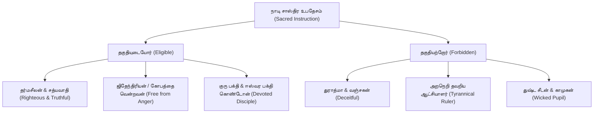
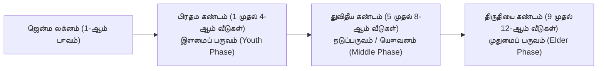

# தேவ கேரளம் (சந்திர கலா நாடி) — 2-ஆம் பாகம் (1-ஆம் தொகுதி) மூல சாஸ்திரத் தொகுப்பு
# Deva Keralam (Chandra Kala Nadi) — Volume II (Part I) Tamil Compendium

---

## 1. நூல் முகவுரை & குரு பரம்பரை (Treatise Metadata & Lineage)

- **மூல நூல்**: *தேவ கேரளம் (சந்திர கலா நாடி) — இரண்டாம் பாகம், முதலாம் தொகுதி (Deva Keralam / Chandra Kala Nadi — Vol II, Part I)*
- **மூல நூலாசிரியர்கள்**: கேரளத்து அச்சுதர் (Achyuta of Kerala) & பண்டித வேங்கடேசர் (Venkatesa)
- **ஆங்கில மொழிபெயர்ப்பாளர் & ஆய்வாளர்**: ஆர். சந்தானம் (R. Santhanam, Sagar Publications, New Delhi)
- **மூல சுவடிகள் பாதுகாப்பு**: சென்னை அரசினர் கீழ்த்திசைச் சுவடிகள் நூலகம் (Government Oriental Manuscripts Library, Madras — சுவடி எண்கள்: R. 3497/48-49, R. 25875/50-51).
- **சாஸ்திர மரபுகள்**: 150 நாடியம்சங்கள் (150 Nadiamsas per sign), ராசி தசா (Rasi Dasa / KCD), கண்ட நிர்ணயம் (Khanda Nirnaya), அஷ்டகவர்க்க தசா-கோச்சாரம் (Ashtakavarga Transit), நித்ய-அநித்ய காரக பாவம் (Permanent vs. Conditional Karakas), மற்றும் கர்ம விபாக பரிகார சாஸ்திரம் (Karma-Vipaka Shastric Remedies).
- **மொழி & பயன்பாடு**: ஜோதிட வாசகர்கள் மற்றும் ஜோதிட மென்பொருளுக்காக தூய ஜோதிடத் தமிழில் (Classical Tamil) முழுமையாக மொழிபெயர்க்கப்பட்டு தொகுக்கப்பட்டுள்ளது.

---

## 2. உபோத்காதம்: நாடி ரகசிய உபதேச விதியும் உபாசனையும் (Prologue & Sacred Ethics)

### 2.1 மங்களாசாசனம் (Invocation — Sloka 1)
```text
அபிவந்த்ய மதங்கஸ்ய ஸ்ரீவேங்கடநாயகப் ।
வக்ஷ்யாமி வேங்கடேஸோऽஹம் தேவகேரளம் அத்புதம் ॥ 1 ॥
```
**தமிழ் விளக்கம்**:
மதங்க முனிவரின் திருவடிகளையும், திருவேங்கடப் பெருமானின் பொற்பாதங்களையும் சிரமேற்கொண்டு வணங்கி, வேங்கடேசன் ஆகிய நான் முன்னோர்கள் அருளிய அதி அற்புத "தேவ கேரளம்" என்னும் சந்திர கலா நாடி சாஸ்திரத்தின் இரண்டாம் பாகத்தை உலக நன்மைக்காக விரிவாக உரைக்கிறேன்.

### 2.2 சாஸ்திர ரகசிய காப்பு நெறி (Confidentiality & Eligibility — Slokas 2–4)
- **யாரெல்லாம் தகுதியற்றவர்கள்**:
  1. துராத்மாக்கள், வஞ்சக எண்ணம் கொண்டவர்கள், மற்றும் பிறருக்கு தீங்கு விளைவிக்கும் மனிதர்களுக்கு இந்த உன்னத நாடி ரகசியத்தை ஒருபோதும் உபதேசிக்கக் கூடாது (*ந வக்தவ்யம் துராத்மனே*).
  2. தர்ம நெறி தவறிய அரசர்களுக்கும், பாவம் செய்ய அஞ்சாத துஷ்ட சீடர்களுக்கும் இதை வழங்கக் கூடாது.
  3. குரோதம், பொறாமை, பொய்மை கொண்டவர்களிடம் இந்த சூட்சும ஞானம் செல்லக் கூடாது.
- **யாரெல்லாம் தகுதியானவர்கள்**:
  1. சத்ய நெறி வழுவாத தர்மசீலன் (*தர்மிஷ்டோ மஹிசூனு*).
  2. கோபத்தை அடக்கிய ஜிதேந்திரியன் (*விஜிதக்ரோத*).
  3. சாதுக்களையும் குருவையும் போற்றும் சாந்த குணமுடையவன் (*சத்யஞானப்ரிய*).
- **பலன் கணிக்கும் முறை**:
  ஏகாந்தமான, அமைதியான புண்ணிய இடத்தில் (மௌனமாக அமர்ந்து) தியானித்து, சகல கிரக நிலைகளையும் ஆராய்ந்து, உள்ளுணர்வை ஒருமுகப்படுத்தி உண்மையான பலன்களை மட்டுமே உரைக்க வேண்டும்.



---

## 3. சக்கர நிர்ணயமும் ராசி தசா கணிதமும் (Chakra & Dasa Foundations)

### 3.1 நான்கு வகை சக்கரங்கள் (Four Types of Chakras — Slokas 5–7)
1. **உதய சக்கரம் (Ayamodayika Chakram)**: ஜென்ம லக்னத்தை முதன்மையாகக் கொண்டு கிரகங்களின் உதய கதியை நிர்ணயிப்பது.
2. **பர சக்கரம் (Para Chakram)**: கால புருஷ தத்துவப்படி மேஷம் முதலான ராசிகளின் உலகளாவிய சுழற்சியைக் குறிப்பது.
3. **கிங்கிருத சக்கரம் (Kinkrita Chakram)**: ஜாதகரின் கர்ம வினையை கிரக சேர்க்கைகள் மூலம் உணர்த்தும் சக்கரம்.
4. **ஆரூட சக்கரம் (Arudha Chakram)**: லக்ன மற்றும் சந்திர ஆரூட பாதங்களை அடிப்படையாகக் கொண்டு உலகியல் மாயை மற்றும் வெளிப்படையான அந்தஸ்தைக் கணிப்பது.

### 3.2 ராசி தசா இயக்கம் (Rasi Dasa Progression — Slokas 8–9)
- **விஷம ராசிகள் (Odd Signs — மேஷம், மிதுனம், சிம்மம், துலாம், தனுசு, கும்பம்)**:
  - தசா வரிசை **வலம்சுழியாக (Pracheeni / Direct)** 1 முதல் 12 ராசிகள் வரை செல்லும்.
- **சம ராசிகள் (Even Signs — ரிஷபம், கடகம், கன்னி, விருச்சிகம், மகரம், மீனம்)**:
  - தசா வரிசை **இடம்சுழியாக (Apradakshina / Reverse)** செல்லும்.
- **தசா கால அளவு**: ஒவ்வொரு ராசி தசையும் **12 ஆண்டுகள் (12 Solar Years)** ஆட்சி செய்யும்.

### 3.3 ஆயுள் நிர்ணய சூத்திரங்கள் (Longevity Determination — Slokas 10–18)
லக்னம், சந்திரன் மற்றும் ஹோரா லக்னம் அமையும் சர, ஸ்திர, உபய ராசி தத்துவங்களின் அடிப்படையில் ஆயுள் மூன்று வகையாகப் பிரிக்கப்படுகிறது:

| லக்ன ராசி (Lagna Sign) | சந்திர ராசி (Moon Sign) | ஆயுள் தரம் (Longevity Category) | எதிர்பார்க்கப்படும் ஆயுள் (Life Span) |
|---|---|---|---|
| **சர ராசி (Movable)** | **சர ராசி (Movable)** | தீர்க்காயுள் (Dirghayu) | 75 முதல் 100+ ஆண்டுகள் |
| **சர ராசி (Movable)** | **ஸ்திர ராசி (Fixed)** | மத்திமாயுள் (Madhyamayu) | 60 முதல் 75 ஆண்டுகள் |
| **சர ராசி (Movable)** | **உபய ராசி (Dual)** | அல்பாயுள் (Alpayu) | 32 முதல் 45 ஆண்டுகள் |
| **ஸ்திர ராசி (Fixed)** | **சர ராசி (Movable)** | மத்திமாயுள் (Madhyamayu) | 60 முதல் 75 ஆண்டுகள் |
| **ஸ்திர ராசி (Fixed)** | **ஸ்திர ராசி (Fixed)** | அல்பாயுள் (Alpayu) | 32 முதல் 40 ஆண்டுகள் |
| **ஸ்திர ராசி (Fixed)** | **உபய ராசி (Dual)** | தீர்க்காயுள் (Dirghayu) | 75 முதல் 90 ஆண்டுகள் |
| **உபய ராசி (Dual)** | **சர ராசி (Movable)** | அல்பாயுள் (Alpayu) | 30 முதல் 40 ஆண்டுகள் |
| **உபய ராசி (Dual)** | **ஸ்திர ராசி (Fixed)** | தீர்க்காயுள் (Dirghayu) | 75 முதல் 85 ஆண்டுகள் |
| **உபய ராசி (Dual)** | **உபய ராசி (Dual)** | மத்திமாயுள் (Madhyamayu) | 50 முதல் 65 ஆண்டுகள் |

> **தர்ம, அர்த்த, காம, மோக்ஷ திரிகோண ஆயுள் தத்துவம் (Slokas 16–17)**:
> - **தர்ம & மோக்ஷ திரிகோணங்கள்** (1, 5, 9 மற்றும் 4, 8, 12): ஆயுளை நீட்டிக்கும் பலம் கொண்டவை (*சிராயுஷ்மான்*).
> - **அர்த்த திரிகோணங்கள்** (2, 6, 10): மத்திம ஆயுளைத் தரும்.
> - **காம திரிகோணங்கள்** (3, 7, 11): அல்பாயுள் அல்லது விபத்து கண்டங்களைத் தரும்.

---

## 4. கண்ட நிர்ணயம்: வாழ்க்கையின் முப்பருவங்கள் (Khanda Nirnaya)

சுலோகம் 22 மனித வாழ்வை ராசி சக்கரத்தின் 12 வீடுகளைக் கொண்டு மூன்று சம கண்டங்களாகப் பிரிக்கிறது:



1. **பிரதம கண்டம் (1, 2, 3, 4-ஆம் பாவங்கள் — பால பருவம்)**:
   - இப்பாவங்களில் உச்ச கிரகங்களோ, சுப கிரகங்களோ அமையப் பெற்றால் குழந்தைப்பருவம் அரசர் போன்று வளமான சூழலில் அமையும்.
   - பாபிகள், நீச கிரகங்கள் நின்றால் பால்யத்தில் தீவிர நோய், வறுமை அல்லது குடும்பப் பிரிவு ஏற்படும்.
2. **துவிதீய கண்டம் (5, 6, 7, 8-ஆம் பாவங்கள் — நடுப்பருவம் / 25–50 வயது)**:
   - இப்பாவங்களில் தர்ம-கர்மாதிபதிகளும் சுப கிரகங்களும் அமைந்தால் நடுப்பருவத்தில் ராஜ்யாபிஷேகம், பதவி உயர்வு, பெருஞ்செல்வம், தொழில் வெற்றி உண்டாகும்.
3. **திருதியை கண்டம் (9, 10, 11, 12-ஆம் பாவங்கள் — முதுமைப் பருவம் / 50+ வயது)**:
   - இப்பாவங்கள் சுப வர்க்கம் பெற்றால் இறுதிக்காலம் சாந்தமாகவும், புண்ணிய யாத்திரைகளுடனும், ஆன்மீக முக்தியுடனும் அமையும்.

---

## 5. மகா ராஜயோகங்களும் சூட்சும விதிகளும் (Grand Classical Yogas)

### 5.1 மாதங்க யோகம் (Mathanga Yoga — Slokas 22–25)
- **சாஸ்திர விதி**: கேந்திராதிபதிகளும் (1, 4, 7, 10) திரிகோணாதிபதிகளும் (1, 5, 9) 7 அல்லது 10-ஆம் இடங்களில் பரிவர்த்தனை பெற்றோ அல்லது கேந்திர-திரிகோணங்களில் பலம் பெற்று நிற்க, லக்னாதிபதி பலமுடன் அமைய வேண்டும்.
- **தமிழ் பலன்**:
  - ஜாதகரின் வாசலில் சதா சர்வ காலமும் மங்கள வாத்தியங்கள் மற்றும் முரசு (பேரிகை) ஒலித்துக் கொண்டே இருக்கும்.
  - யானைப்படை, குதிரைப்படை, ராஜ ரதங்கள், மற்றும் தங்க ஆபரணங்கள் பூண்ட அதிகாரியாக விளங்குவார்.
  - நாடெங்கும் பரவிய நற்புகழும், அளவற்ற நிலபுலன்களும், அரச கௌரவமும் நிலைத்து நிற்கும்.

### 5.2 மாளவ்ய யோக பங்கமும் நீச சமநிலையும் (Malavya Yoga Obstruction — Slokas 26–27)
- **சாஸ்திர விதி**: சுக்கிரன் தனது சொந்த வீடான ரிஷபம், துலாம் அல்லது உச்ச வீடான மீனத்தில் கேந்திரத்தில் நின்று பஞ்ச மகாபுருஷர்களில் ஒன்றான மாளவ்ய யோகத்தை உருவாக்கினாலும்; அச்சுக்கிரனுடன் **சனி அல்லது குரு சேர்ந்தாலோ அல்லது திரிகோணத்தில் பார்த்தாலோ** யோகம் பங்கமடையும் (*மாலவீயோக பங்கவான்*).
- **விளைவு**: ராஜபோகங்கள் உடனடியாகக் கிட்டாது; கடுமையான உழைப்பு, தாமதம், போராட்டங்களுக்குப் பிறகே செல்வம் சேரும்.

### 5.3 பிக்ஷு / திகாம்பர யோகம் vs நீசபங்க ராஜயோகம் (Slokas 28–29)
```text
உச்சே நீசாம்சகே துக்கீ நீசே சோச்சாம்சகே சுகீ ।
ஸ்வாம்சே வர்கோத்தமீ போகீ ராஜப்ரேஷ்யோ பவிஷ்யதி ॥ 29 ॥
```
- **பிக்ஷு / திகாம்பர யோகம்**: ராசிச் சக்கரத்தில் (D1) கிரகம் உச்சம் பெற்றிருந்தாலும், நவாம்சத்தில் (D9) நீசமடைந்தால், அவன் **அரசனின் மகனாகப் பிறந்தாலும் ஆண்டியாகவோ, பிச்சைக்காரனாகவோ அல்லது துறவியாகவோ திரிவான்**.
- **நீசபங்க சாம்ராஜ்யம்**: மாறாக, ராசியில் நீசமடைந்த கிரகம் நவாம்சத்தில் உச்சம் பெற்றால், எளிய குடிலில் பிறந்தாலும் நாளடைவில் சக்ரவர்த்திக்கு நிகரான அதிகாரத்தையும் செல்வத்தையும் அடைவான்!

### 5.4 சந்திர ஆதி யோகம் (Chandra Adhi Yoga — Slokas 37–39)
- சந்திரனுக்கு 6, 7, 8-ஆம் வீடுகளில் சுப கிரகங்களான புதன், குரு, சுக்கிரன் தனித்தோ இணைந்தோ அமைவது ஆதி யோகமாகும்.
- **சூட்சும விதி**: 7-ல் சூரியன் அமைந்தால் யோகத்தின் பலன் மத்திமமாகும். பாபிகள் கூடினால் அல்பாயுள் உண்டாகும். சுப கிரகங்கள் மட்டுமே அமைந்தால் சேனாததிபதி அல்லது மந்திரி பதவி கிட்டும்.

### 5.5 சாமர யோகம் (Chamara Yoga — Slokas 48–51)
- **சாஸ்திர விதி**: லக்னாதிபதி உச்சம் பெற்று 4-ஆம் அதிபதியுடன் கூடி நிற்க, சுக்கிரன் லக்னத்துக்கு 5-ஆம் இடத்தில் அல்லது 9-ஆம் இடத்தில் அமைய சாமர யோகம் உண்டாகிறது.
- **தமிழ் பலன்**: ஜாதகர் 16 வயது முதல் 32 வயதுக்குள் அரசால் போற்றப்படும் முக்கிய தலைவராகவோ அல்லது செல்வந்தராகவோ உயர்வார். வெண்சாமரம் வீசும் அரச மரியாதையைப் பெறுவார்.

### 5.6 ராஜ்ய லக்ஷ்மி யோகம் (Rajya Lakshmi Yoga — Slokas 55–59)
- **சாஸ்திர விதி**: 9-ஆம் அதிபதி (பாக்கியாதிபதி) ஆட்சி அல்லது உச்சம் பெற்று கேந்திர-திரிகோணங்களில் நிற்க, லக்னாதிபதி பலமுடன் திகழ ராஜ்ய லக்ஷ்மி யோகம் அமைகிறது.
- **தமிழ் பலன்**: ஜாதகர் மகா புத்திசாலி, நிலசுவான்தாரர், அரச அவையில் முதன்மை ஆலோசகர். 25 வயது முதல் 50 வயது வரை அளவற்ற பொன், ரத்தினங்களை ஈட்டுவார். 71 வயது வரை ஆரோக்கியமான தீர்க்காயுள் வாழ்வார்.

### 5.7 அகண்ட சாம்ராஜ்ய யோகம் (Akhanda Samrajya Yoga — Slokas 60–62)
- **சாஸ்திர விதி**: லக்னாதிபதி, 2-ஆம் அதிபதி அல்லது 10-ஆம் அதிபதிகளில் ஒருவர் சந்திரனுக்கு கேந்திரத்தில் (1, 4, 7, 10) நிற்க, குரு பகவான் திரிகோணத்திலோ அல்லது கேந்திரத்திலோ பலமுடன் அமர வேண்டும்.
- **பங்க விதி**: 12-ல் பாப கிரகங்கள் (குறிப்பாக கேது அல்லது சனி) நின்றால் யோகம் பங்கமடைந்து மன உளைச்சலைத் தரும்.

### 5.8 சத்ர யோகம் (Chhatra Yoga — Slokas 89–91)
- **சாஸ்திர விதி**: 2-ல் சந்திரன், 9-ல் சுக்கிரன், மற்றும் கேந்திர-திரிகோணங்களில் குரு அல்லது புதன் அமைய சத்ர யோகம் உண்டாகிறது.
- **தமிழ் பலன்**: அரச பாதுகாப்புக் குடை (வெண்கொற்றக்குடை) நிழலில் வாழ்வது போன்ற மேன்மை, சாஸ்திர ஞானம், நாவன்மை, 40 வயதிற்கு மேல் சிவபாத பூஜை செய்து ஆன்மீக மேன்மை அடைதல்.

### 5.9 மணி பிரவாள யோகம் (Mani Pravada Yoga — Slokas 126–127)
- **சாஸ்திர விதி**: 2-ல் உச்ச/சுப கிரகம், 3-ல் பாபி அல்லது நீச கிரகம் (சத்ருக்களை அடக்க), 4 மற்றும் 5-ல் சுப கிரகங்கள் அமைய மணி பிரவாள யோகம் உருவாகிறது.
- **தமிழ் பலன்**: முத்து மற்றும் பவளம் கோர்த்த மாலை போல ஜாதகரின் வாழ்க்கை அலங்கரிக்கப்படும்; வறுமையின்றி தொடர் அரசு செல்வாக்கு கிட்டும்.

### 5.10 பாரிஜாத யோகம் (Parijata Yoga — Slokas 314–315)
- **சாஸ்திர விதி**: 5-ஆம் அதிபதி சுபருடன் கூடி நிற்க, சுக்கிரன் சுப வர்க்கத்தில் அமைய, 9-ஆம் அதிபதியின் பார்வை பெற்றால் பாரிஜாத யோகம்.
- **தமிழ் பலன்**: தேவலோகத்து பாரிஜாத மலர் போல கேட்டதையெல்லாம் ஈன்றெடுக்கும் வாழ்வு; நற்புத்திரர்கள், அரச கௌரவம், தூய ஆத்ம ஞானம் உண்டாகும்.

---

## 6. நித்ய-அநித்ய காரக பாவ தத்துவமும் புத்திர தோஷங்களும் (Karaka Principles & Remedies)

### 6.1 "காரகோ பாவ நாசாய" மறுபரிசீலனை (Slokas 319–324)
- **நித்ய காரகன் (Permanent Natural Significator)**:
  - சூரியன் = தந்தை, ஆத்மா.
  - சந்திரன் = தாய், மனம்.
  - செவ்வாய் = சகோதரன், தைரியம், பூமி.
  - புதன் = கல்வி, வியாபாரம், மாமன்.
  - குரு = புத்திரன், ஞானம், தனம்.
  - சுக்கிரன் = களத்திரம், வாகனம், சுகபோகம்.
  - சனி = ஆயுள், தொழில், கர்மம்.
- **அநித்ய காரகன் (Conditional Bhava Lord Significator)**:
  - அந்தந்த லக்னத்தின் 1 முதல் 12 பாவங்களின் அதிபதிகள்.
- **சாஸ்திர ரகசியம்**:
  காரக கிரகம் காரக ஸ்தானத்தில் அமர்வதால் மட்டுமே பாவம் நாசமடையாது. **காரகன் தனது சொந்த வீட்டிலோ (ஸ்வக்ஷேத்ரம்) அல்லது உச்ச வீட்டிலோ அமர்ந்து சுப திருஷ்டி பெற்றால் அந்த பாவம் நாசமடைவதற்குப் பதிலாக பல மடங்கு விருத்தியடையும்!** பாப சேர்க்கை அல்லது நீச வர்க்கம் பெற்றால் மட்டுமே "காரகோ பாவ நாசாய" விதி செயல்படும்.

### 6.2 புத்திர தோஷங்களும் கர்ம விபாக சாஸ்திர பரிகாரங்களும் (Slokas 335–337)
1. **சுவர்ண நாக தானம் (Gold Serpent Donation)**:
   - ஐந்தாம் வீட்டில் ராகு-சனி சேர்க்கை அல்லது மாந்தியின் தொடர்பால் ஏற்படும் நாக சாப புத்திர தோஷத்திற்கு தங்க நாக விக்கிரகம் செய்து தானம் செய்ய வேண்டும்.
2. **சந்தான கோபால ஹோமம் & பூஜை (Santana Gopala Puja)**:
   - புத்திர ஸ்தானாதிபதி வந்த்யாம்சத்தில் (மலட்டு அம்சத்தில்) நிற்கும் போது சந்தான கோபால மந்திர ஜபமும் ஹோமமும் செய்ய வேண்டும்.
3. **கல்ப தரு / சுவஸ்திக தானம்**:
   - முற்பிறவியில் ஆசாரியர்களையோ பிராமணர்களையோ அவமதித்ததால் ஏற்படும் சாபத்திற்கு சுவர்ண கல்ப விருட்ச தானம் பரிந்துரைக்கப்படுகிறது.

---

## 7. அஷ்டகவர்க்க தசா & கோச்சார பிந்து கணிதம் (Ashtakavarga Dasa & Transit)

சுலோகங்கள் 415–475 அஷ்டகவர்க்க பிந்துக்களின் அடிப்படையில் தசா புத்தி மற்றும் கோச்சாரப் பலன்களை மிகத் துல்லியமாக விவரிக்கின்றன:

| பிந்து எண்ணிக்கை (Bindu Count) | கோச்சாரத்தில் சுப கிரகம் வரும் பலன் | கோச்சாரத்தில் அசுப கிரகம் (சனி/ராகு) வரும் பலன் | தசா நாதனின் பலன் |
|---|---|---|---|
| **30 முதல் 38 பிந்துக்கள்** | விசேஷ தன லாபம், பூமி சேர்க்கை, பதவி உயர்வு, மங்கல காரியங்கள் | கெடுதல்கள் மட்டுப்படும்; புதிய சாதனைகள் | உச்சகட்ட யோக வாழ்க்கை, அரச கௌரவம் |
| **25 முதல் 29 பிந்துக்கள்** | மத்திம சுப பலன்கள், தொழில் சீரான நிலை | சிறு மன உளைச்சல், வீண் அலைச்சல் | சுமாரான நற்பலன்கள், இயல்பான வருமானம் |
| **18 முதல் 24 பிந்துக்கள்** | சுப பலன்கள் குறையும்; காரியத் தடைகள் | சரீர உபாதை, தன விரயம், வம்பு வழக்குகள் | கஷ்டங்கள், நஷ்டங்கள், கடன் சுமை |
| **0 முதல் 17 பிந்துக்கள்** | பலனளிக்க இயலாமை | தீவிர நோய், விபத்து கண்டம், ஸ்தான சலனம் (இடப்பெயர்ச்சி) | கடும் வீழ்ச்சி, பித்ரு பீடை, ராஜ தண்டனை |

---

## 8. லக்ன வாரியாக நாடியம்ச சூட்சுமங்கள் (Ascendant Nadiamsas)

### 8.1 சிம்ம லக்னம் (Leo Ascendant)
- **குடில நாடியம்சம் (Kutilamsa — Slokas 1998–2026, 361–414)**:
  - சூரியன் புதனுடன் இணைந்து சுப பார்வை பெற்றால்: சிறந்த சொல்லாற்றல், கவிதை எழுதும் திறன், வேதாந்த ஞானம், அரச சன்மானம்.
  - சனி அல்லது செவ்வாய் தொடர்பு பெற்றால்: உஷ்ண பித்தம், பித்ரு தோஷம், பால்யத்தில் தந்தை பிரிவு.
  - **பரிகாரம்**: மகேஸ்வர பூஜை, பாற்குட தானம் (க்ஷீர கும்ப தானம்).

### 8.2 கும்ப லக்னம் (Aquarius Ascendant)
- **சம்பகாம்சம் & ஜலாம்சம் (Champakamsa & Jalamsa — Slokas 498–515)**:
  - குரு ஜல ராசிகளில் (கடகம், விருச்சிகம், மீனம்) அல்லது ஜலாம்சத்தில் அமைய, சந்திரன் 2-ல் நிற்க:
    - கடல் கடந்த வியாபாரம், நவரத்தின வர்த்தகம், அழகான குணவதி மனைவி, 32 வயதிற்கு மேல் பெருஞ்செல்வம்.

### 8.3 மிதுன லக்னம் (Gemini Ascendant)
- **இந்திராம்சம் (Indramsa — Slokas 241, 506–529)**:
  - புதனும் குருவும் சுப பலம் பெற: வெளிநாட்டு வாணிபம், கப்பல்/வாகன யோகம், வாக்கு வன்மை, அரச சபையில் கௌரவம்.

### 8.4 ரிஷப லக்னம் (Taurus Ascendant)
- **வசுதாம்சம் (Vasudhamsa — Slokas 530–555)**:
  - சுக்கிரன் ஆட்சி பெற்று 9-ல் சனி அமர: தர்ம-கர்மாதிபதி ராஜயோகம், கோவில் திருப்பணிகள், அன்னதான சத்திரங்கள் அமைத்தல்.

---

## 9. மூல மந்திரங்களும் கர்ம விபாக பரிகாரங்களும் (Sacred Mantras & Remedies)

### 9.1 க்ஷீர கும்ப தான மந்திரம் (Ksheera Kumbha Danam — Slokas 183–185)
தீவிர ஜுரம், பித்த ரோகம் மற்றும் பித்ரு சாப நிவாரணத்திற்கு வெள்ளி அல்லது வெண்கலக் குடத்தில் பசும்பால் நிரப்பி சிவபெருமானை ஆவாஹனம் செய்து உரைக்க வேண்டிய மந்திரம்:

```text
மகேஶதேவதேவேஶ மஹாகஷ்டநிவாரக ।
க்ஷீரகும்பப்ரதானேன ஜ்வரம் சிந்தஹி நமோऽஸ்து தே ॥ 184 ॥
```
**பொருள்**: மகேஸ்வரனே! தேவாதி தேவனே! கொடிய துயரங்களை நீக்குபவனே! இந்த பாற்குட தானத்தின் மூலம் எனது சரீர ஜுரத்தையும், பித்ரு தோஷங்களையும் அகற்றி நலமளிப்பாயாக.

### 9.2 பரசு துர்கா மகா மந்திரம் (Parashu Durga Mantra — Slokas 573–575)
வம்பு வழக்குகள், கொடிய சத்ரு பயம், மற்றும் அரச எதிர்ப்புகளை வேரறுக்க மழு (கோடாரி) விக்கிரகம் செய்து வனதுர்க்கா தேவிக்கு சமர்ப்பிக்கும் மந்திரம்:

```text
ஶத்ருபீஜகுலோச்சேதே குலஶ்ரேஷ்ட ப்ரஸாதய ।
மம ஶத்ருகஷயார்தாய தவ பூஜாம் கரோம்யஹம் ॥ 574 ॥
ஶத்ருவம்ஶக்ஷயார்தாய ஸர்வகாமார்ததாய ச ।
மயார்பிதமிதம் நாத குடாரம் ப்ரததாம்யஹம் ॥ 575 ॥
```
**பொருள்**: சத்ருக்களின் மூலத்தை வேரறுக்கும் பராசக்தியே! எனது எதிரிகளின் தீவினைகளை நாசம் செய்யவும், சகல அபீஷ்டங்களை அருளவும், பக்தியுடன் இந்த மழுவை (குடாரம்) உனக்கு அர்ப்பணிக்கிறேன்.

---

## 10. கணித மற்றும் சாஸ்திர சரிபார்ப்பு அட்டவணை (Implementation Verification Matrix)

| விதி குறியீடு (Rule ID) | யோகம் / சாஸ்திர தலைப்பு | சமஸ்கிருத சுலோகம் | தமிழ் பெயர் | தசா-கோச்சார வெளிப்பாடு |
|---|---|---|---|---|
| `RULE-DK-MATHANGA-YOGA-01` | Mathanga Yoga | Slokas 22–25 | தேவ கேரளம் மாதங்க யோகம் | தசா புத்தியில் யானை, குதிரை, வாகன யோகம் & பேரிகை முழக்கம் |
| `RULE-DK-MALAVYA-BHA-01` | Malavya Cancellation | Slokas 26–27 | மாளவ்ய யோக பங்க விதி | சனி/குருவின் தொடர்பால் கடும் தாமதத்திற்குப் பிறகே செல்வம் |
| `RULE-DK-BHIKSHU-NEECHA-01` | Bhikshu vs Neechabhanga | Slokas 28–29 | பிக்ஷு யோகமும் நீசபங்க உன்னதமும் | நவாம்ச நீசத்தால் வீழ்ச்சி; நவாம்ச உச்சத்தால் சாம்ராஜ்யம் |
| `RULE-DK-CHHATRA-YOGA-01` | Chhatra Yoga | Slokas 89–91 | சத்ர யோகம் (வெண்கொற்றக்குடை) | அரச பாதுகாப்புக் குடை, மந்திரி அந்தஸ்து, சாஸ்திர பாண்டித்யம் |
| `RULE-DK-MANI-PRAVADA-01` | Mani Pravada Yoga | Slokas 126–127 | மணி பிரவாள யோகம் | 2-ல் உச்சன், 3-ல் நீசன், 4/5-ல் சுபர்கள் அமைய தொடர் தன யோகம் |
| `RULE-DK-MAHA-PANDITA-01` | Maha Pandita Yoga | Slokas 70–72 | மகா பண்டித யோகம் | லக்னத்தில் குரு அல்லது ரவி-புதன் வர்க்கத்தால் சர்வ வித்யா பாண்டித்யம் |
| `RULE-DK-PARIJATA-YOGA-01` | Parijata Yoga | Slokas 314–315 | பாரிஜாத யோகம் | 5-ஆம் அதிபதியும் சுக்கிரனும் 9-ஆம் அதிபதி பார்வை பெற அஷ்ட ஐஸ்வர்யம் |
| `RULE-DK-NITYANITYA-01` | Nityanitya Karaka | Slokas 319–324 | நித்ய-அநித்ய காரக பாவ கோட்பாடு | காரகன் ஸ்வக்ஷேத்திரத்தில் நிற்க பாவ நாசம் இன்றி பாவ விருத்தி |
| `RULE-DK-KHANDA-NIRNAYA-01` | Khanda Nirnaya | Sloka 22 | கண்ட நிர்ணய விதி | 1-4 பால பருவம், 5-8 யௌவனம், 9-12 முதுமைப் பருவ ராஜயோகம் |
| `RULE-DK-KSHEERA-KUMBHA-01` | Ksheera Kumbha Remedy | Slokas 182–185 | க்ஷீர கும்ப தான பரிகாரம் | சுரம், பித்த ரோகம் மற்றும் பித்ரு சாபத்திற்கு பாற்குட தானம் |
| `RULE-DK-PARASHU-DURGA-01` | Parashu Durga Remedy | Slokas 573–575 | பரசு துர்கா மகா பரிகாரம் | சத்ரு நாசம், அரச பயம் & வழக்கு வெற்றிக்கான மழு தானம் |

---
*தொகுக்கப்பட்ட நாள்*: 2026-11-06  
*மூல நூல் ஆதாரம்*: Deva Keralam (Chandra Kala Nadi) Volume II, Part I (Slokas 1 to 579+)  
*ஜோதிட ஆய்வு நெறி*: Jokuls Astrological Insights — Thirukanitha & Nadi Classical Engine
