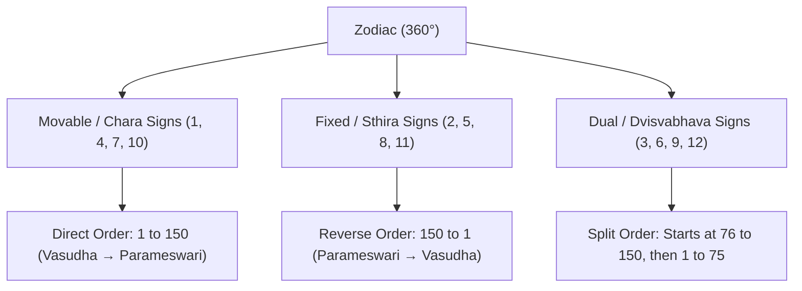
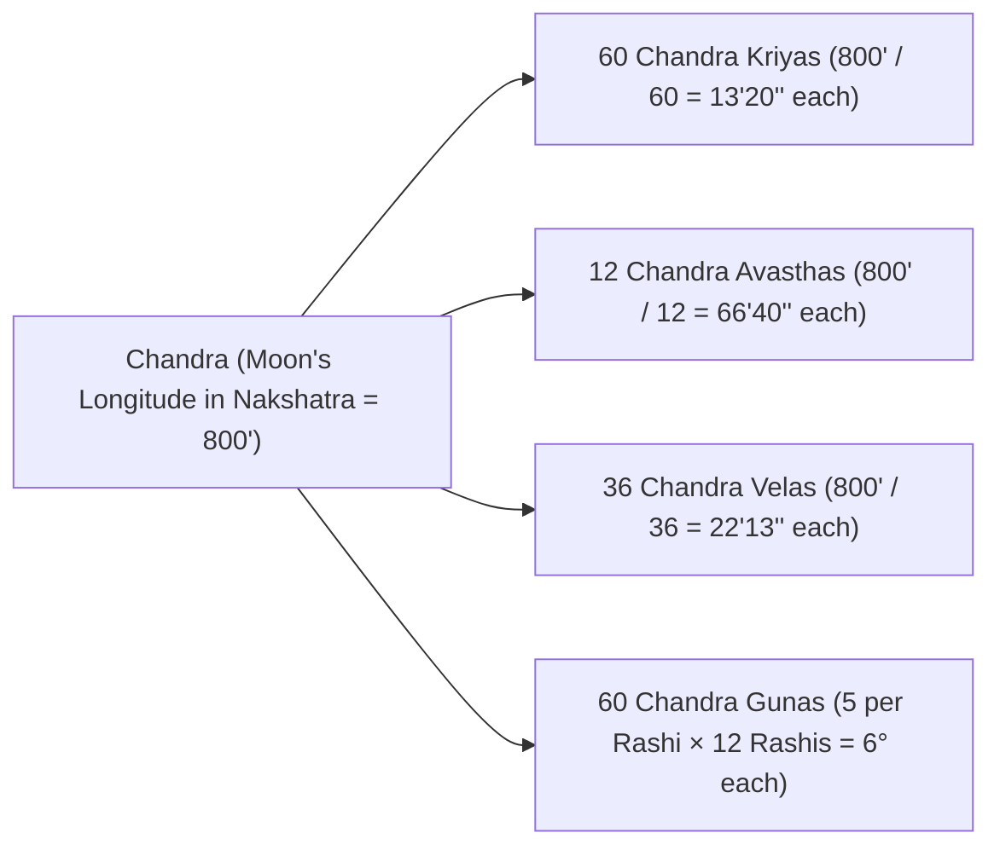

# Deva Keralam (Chandra Kala Nadi) — Volume 3 Compendium

## System Metadata & Lineage
- **Treatise Title**: *Deva Keralam (Chandra Kala Nadi)* — Book III (Slokas 1998 to 5774)
- **Primary Authors**: Achyuta of Kerala & Venkatesa (Part 3 compiled exclusively by Venkatesa)
- **Translator & Commentator**: R. Santhanam (Sagar Publications, New Delhi)
- **Astrological Traditions**: Nadi Astrology (150 Nadiamsas per sign), Vimsottari Dasa, Kala Chakra Dasa (KCD), Gochara (Transit via Navamsa Dispositor), Ashtakavarga (Prastara & Samudaya), Shashtiamsa (D60), Chandra Kriyas, Chandra Avasthas, and Vedic Karma-Vipaka Remedies.
- **Scope**: Subtle micro-zodiac divisions (Nadiamsas), planetary karakatwas across ascendants, past-life curses and specific Shastric remedies, royal yogas, dasha-transit intersections, and the philosophical essence of *Kaala* (Time).

---

## 1. Architectural Foundation of the 150 Nadiamsas

### 1.1 Mathematical Definition & Arc Length
In classical Nadi horoscopy, every sign of 30° is divided into **150 unequal or equal micro-arcs** called *Nadiamsas*.
- **Arc of 1 Nadiamsa**: $30^\circ / 150 = 0^\circ 12' 00''$ (12 minutes of arc = 720 seconds of arc).
- **Sub-Division (Halves)**:
  - **First Half (Purvardha)**: $0^\circ 00' 00'' \text{ to } 0^\circ 06' 00''$ (6 minutes of arc).
  - **Second Half (Uttarardha)**: $0^\circ 06' 00'' \text{ to } 0^\circ 12' 00''$ (6 minutes of arc).
- **Zodiac Total**: $150 \times 12 = 1800 \text{ Nadiamsas}$ across the 360° zodiac.

### 1.2 Sign Classification & Progression Direction (Slokas 5729–5730)
The sequence of the 150 Nadiamsas varies strictly based on Rashi mobility (*Chara*, *Sthira*, *Dvisvabhava*):
1. **Movable Signs (Chara Rashis — Aries, Cancer, Libra, Capricorn)**:
   - Order runs **direct** from 1 to 150 (Vasudha to Parameswari).
2. **Fixed Signs (Sthira Rashis — Taurus, Leo, Scorpio, Aquarius)**:
   - Order runs in **reverse** from 150 to 1 (Parameswari down to Vasudha).
3. **Dual Signs (Dvisvabhava Rashis — Gemini, Virgo, Sagittarius, Pisces)**:
   - Order commences from the **76th Nadiamsa** (Mahamaya) through 150 (Parameswari), and then wraps around from 1 (Vasudha) through 75 (Trailokyamohana).

---

## 2. Master Catalogue of the 150 Nadiamsas (Slokas 5729–5731)

| No. | Nadiamsa Name | No. | Nadiamsa Name | No. | Nadiamsa Name | No. | Nadiamsa Name | No. | Nadiamsa Name |
|---|---|---|---|---|---|---|---|---|---|
| 1 | Vasudha | 31 | Kanthaa | 61 | Chitraa | 91 | Maya | 121 | Haarini |
| 2 | Vaishnavi | 32 | Kaalaa | 62 | Vichitra | 92 | Mohana | 122 | Maruthaa |
| 3 | Brahmi | 33 | Karikaraa | 63 | Chirajivini | 93 | Mila | 123 | Dhananjaya |
| 4 | Kalakoota | 34 | Kshama | 64 | Bhoopa | 94 | Kamala | 124 | Dhanakari |
| 5 | Sankari | 35 | Durdharaa | 65 | Gadaaharaa | 95 | Melaa | 125 | Dhanada |
| 6 | Sudhakarasama | 36 | Durbhagaa | 66 | Naalaa | 96 | Apavarga | 126 | Kachchapa |
| 7 | Saumya | 37 | Viswaa | 67 | Gaalavee | 97 | Pasyathaa | 127 | Ambuja |
| 8 | Suraa | 38 | Visirnaa | 68 | Nirmalaa | 98 | Navaneetha | 128 | Isaani |
| 9 | Maaya | 39 | Vihvalaa | 69 | Nadi | 99 | Nisakari | 129 | Soolini |
| 10 | Manoharaa | 40 | Anilaa | 70 | Sudha | 100 | Nivrithi | 130 | Raudri |
| 11 | Madhvi / Madhavi | 41 | Bhima | 71 | Amritamsuga | 101 | Nirgathaa | 131 | Sivaasivakari |
| 12 | Manjusvana | 42 | Sukapradaa | 72 | Kaali | 102 | Saaraa | 132 | Kalaa |
| 13 | Ghoraa | 43 | Snigdha | 73 | Kaalikaa | 103 | Samagaa | 133 | Kundaa |
| 14 | Kumbhini | 44 | Sodharaa | 74 | Kalushankura | 104 | Samadaa | 134 | Mukundaa |
| 15 | Kutilaa | 45 | Surasundari | 75 | Trailokyamohana | 105 | Samaa | 135 | Bharatha |
| 16 | Prabhaa | 46 | Amritaplaavita | 76 | Mahaamaaya | 106 | Visvambhara | 136 | Kadali |
| 17 | Paraa | 47 | Kaamadhuk | 77 | Suseethala | 107 | Kumari | 137 | Smaraa |
| 18 | Payaswini | 48 | Karaveerani | 78 | Sukhada | 108 | Kokila | 138 | Basitha |
| 19 | Maalaa / Dhaata | 49 | Gahvara | 79 | Suprabha | 109 | Kunjarakriti | 139 | Kodala |
| 20 | Jagathi | 50 | Kundini | 80 | Sobha | 110 | Indra | 140 | Kokilamsa |
| 21 | Jarjari | 51 | Kanthaa | 81 | Sobhana | 111 | Swaahaa | 141 | Kaamini |
| 22 | Dhruvaa | 52 | Visha | 82 | Vardhani | 112 | Swadha | 142 | Kalasodbhava |
| 23 | Musalaa | 53 | Vishanasini | 83 | Maya | 113 | Vahni | 143 | Viraprasoo |
| 24 | Mudgara | 54 | Nirmada | 84 | Shanta | 114 | Peetha | 144 | Sangaraa |
| 25 | Pasaa | 55 | Seethala | 85 | Bhrantashuba | 115 | Yaksha | 145 | Satayagna |
| 26 | Champaka | 56 | Nimnaa | 86 | Bhikshuki | 116 | Achalaprabha | 146 | Sataavari |
| 27 | Daamini | 57 | Preeta | 87 | Mahamari | 117 | Saarini | 147 | Sragvi |
| 28 | Mahi | 58 | Priyavardhani | 88 | Shoolini | 118 | Madhuraa | 148 | Paatalini |
| 29 | Kalushaa | 59 | Manada | 89 | Samyuta | 119 | Maitri | 149 | Nagapankaja |
| 30 | Kamalaa | 60 | Durbhaga | 90 | Sampada | 120 | Harini | 150 | Parameswari |

---

## 3. Core Nadiamsa Delineations in Book III

### 3.1 Leo Ascendant (Simha Lagna)
- **Kutila Nadiamsa — 1st Half (Slokas 1998–2014)**:
  - Eldest child or 2nd child with no elder surviving brother; born in a town surrounded by forests, street running south-north or east-west, west/east-facing house.
  - Physique: Dark-bluish hue, stout medium build, eloquent speech, poetic capability in native tongue, generous giver, fond of flesh, devoted to Vishnu and Siva.
  - If Sun is with benefics: Native becomes purely *Sattvic*.
  - If Mars aspects Sun: Irascible, courageous, inheritance from paternal grandfather.
  - Arudha Pada in dual sign with Virgo Navamsa: Attached to spouse but also entangled with a courtesan; 1 son born after difficulties; men-borne conveyances and royal honors.
- **Kutila Nadiamsa — 2nd Half (Slokas 2015–2026)**:
  - 5th child of family; elder co-born destroyed; lives by agriculture in a village; serves royal authorities; wealthy, famous, devoted to virtuous wife; paternal grandfather passed away before native's birth.
  - Sins against Siva lead to dental decay in old age; subject to windy disorders (*Vata roga*).
- **Mudgara (Sarva) Nadiamsa (Slokas 2312–2327)**:
  - Sun in Taurus in Sarva Nadiamsa with Rahu aspected by Mars: Paternal illnesses.
  - Sun aspected by Mars: Father builds public water reservoirs, tanks, and sacred gardens.
  - Mars in own sign with benefic divisions: Native has no surviving brothers.
  - Father prospers after native's 30th year; father dies in a holy shrine during 4th dasa when Saturn transits late Sagittarius/Capricorn.

### 3.2 Scorpio Ascendant (Vrischika Lagna)
- **Sama Nadiamsa — 1st Half (Slokas 2104–2135)**:
  - Auspicious blood-red complexion; born in a famous Siva pilgrimage shrine; street east-west, house facing south.
  - 3 brothers, 2 sisters; 1 brother dies instantly at birth, 1 long-lived, middle brother suffers mental derangement (*Unmada*).
  - Ketu in 3rd (Capricorn): Brother's wife is crafty but blessed with sons; native addicted to courtesans if Venus aspected by Mars.
  - Mars in 10th and Rahu in 9th: Sacred dips in Mother Ganga, Vedic sacrifices (*Yagnas*).
  - Saturn + Venus in 5th (Pisces): Eminent astrologer, deep knowledge of horoscopy and philosophy, wide renown.
- **Sama Nadiamsa — 2nd Half (Slokas 2136–2186)**:
  - 5th, 7th, or 9th issue with no after-born; brother learned in Vedas; brother's second wife is unchaste.
  - Rahu in 9th (Cancer): Native has extensive knowledge of Puranas, Vedanta, Nyaya; devoted to Siva, generous, celebrated, but plagued by physical emaciation.
  - Saturn in 2nd (Sagittarius): Crooked, untruthful, fond of eating indiscriminately; if with Jupiter, learned in astrology, secret sensualist, acquires wealth after childhood poverty.

### 3.3 Gemini Ascendant (Mithuna Lagna)
- **Indra Nadiamsa — 1st Half (Slokas 2237–2255)**:
  - 3rd issue of family; born in forest/river precinct near temple; marriage at age 12 to a bride from the northern direction.
  - Saturn in Kendra/Trikona in Moon's Navamsa: Enjoys dazzling Raja Yoga after age 30; serves as judge, minister, or high official; houses full of cattle and wealth.
- **Indra Nadiamsa — 2nd Half (Slokas 2256–2311)**:
  - Soodra class, 6th, 7th, or 8th issue; father lost in early childhood; mother long-lived.
  - Wealth accumulated via commerce and trade; sudden financial rise after 2nd marriage.
  - Venus in 3rd (Leo) aspected by Saturn: First wife is virtuous, bears 2 sons, suffers severe illness, and passes away during 4th dasa.
  - Rahu in 5th: Daughter suffers ordeals; long-living husband only if childless, or widowhood upon giving birth.

### 3.4 Aries Ascendant (Mesha Lagna)
- **Kutila Nadiamsa (Slokas 2397–2433)**:
  - Valorours, learned in Vedas, 2nd issue; Mars exalted in 10th (Capricorn) with Sun aspected by Moon: Dips in Ganges, royal patronage, high courage.
  - Moon in 4th (Cancer) aspected jointly by Saturn and Mars: Indolent, clever, prone to urinary complaints, associates with ministers, wanders to foreign lands.
  - Rahu in 8th/9th and Saturn in 3rd: Father dies in distant land; initial obstruction in performing father's obsequies (*Shraddha*), fulfilled later in a sacred shrine.

### 3.5 Cancer Ascendant (Karka Lagna)
- **Dhananjaya & Kubera Nadiamsas (Slokas 2275–2285)**:
  - Mars exalted in 7th (Capricorn) with Jupiter in Kendra/Trikona forms an unshakeable *Kesari Yoga*. Boundless wealth, trade prosperity, royal elevation.
  - Saturn aspecting Moon: Grandfather involved in mystical Tantrik rites; native accumulates indestructible wealth.

### 3.6 Libra Ascendant (Tula Lagna)
- **Indava & Nirmala Nadiamsas (Slokas 2210–2225)**:
  - Mercury, Jupiter, and Venus in Kendras/Trikonas produce *Indra Yoga* and *Vishnu Yoga*.
  - Native holds high royal authority; Rahu in 2nd produces speech power but requires remedial propitiation when Saturn enters 8th.
- **Manohara Nadiamsa (Slokas 5410–5435)**:
  - Sun + Mercury in Lagna produces eminent Raja Yoga; father fond of youth and luxuries.
  - Hari Hara Brahma Yoga, Avatara Yoga, and Kubera Yoga manifest effortlessly.

---

## 4. Lunar Metric Science: Kriyas, Avasthas, Gunas & Velas

### 4.1 The 60 Chandra Kriyas (Slokas 2570–2578)
Calculated by dividing the Moon's 800' Nakshatra arc into 60 equal segments ($13'20''$ each):

| Segment | Kriya Name / Effect | Segment | Kriya Name / Effect | Segment | Kriya Name / Effect | Segment | Kriya Name / Effect |
|---|---|---|---|---|---|---|---|
| 1 | Sthanabhrashta (Fall from position) | 16 | Nashta (Loss / Ruin) | 31 | Preshya (Servant / Menial) | 46 | Vivaha (Marriage celebration) |
| 2 | Tapasvi (Engaged in penance) | 17 | Nripa (King / High office) | 32 | Dhana-heena (Loss of wealth) | 47 | Kanduka-dhari (Holding play ball) |
| 3 | Parastri-rata (Fond of others' wives) | 18 | Veda-pathaka (Scholar of Vedas) | 33 | Sabha-sad (King's counselor) | 48 | Dyuta (Gambling) |
| 4 | Lubdha (Covetous / Greedy) | 19 | Sushupti (Deep slumber) | 34 | Mantri (Prime minister / Advisor) | 49 | Sachiva (Trusted counselor) |
| 5 | Dyuta (Gambler) | 20 | Sad-charitra (Noble conduct) | 35 | Bhoomi-pala (Land owner / ruler) | 50 | Duhkha (Grieved / Afflicted) |
| 6 | Gajarudha (Mounted on elephant) | 21 | Smriti-vid (Scriptural scholar) | 36 | Kalatra-sampanna (Blessed with spouse) | 51 | Shayana (Resting on bed) |
| 7 | Simhasana (Occupying throne) | 22 | Danashila (Charitable nature) | 37 | Gaja-bheeti (Fear of elephants/beasts) | 52 | Shatru-poojita (Honored by rivals) |
| 8 | Raja (Royal sovereignty) | 23 | Kula-pujita (Born in elite family) | 38 | Rana-bheeti (Cowardice in battle) | 53 | Mitra-yukta (Endowed with friends) |
| 9 | Shatru-ghna (Destroyer of foes) | 24 | Dhana-dhanya (Wealth & grains) | 39 | Kripana (Miserly / Timid) | 54 | Rogi (Afflicted by illness) |
| 10 | Dandadhinatha (Lord of justice) | 25 | Kirti-vardhana (Ever-growing fame) | 40 | Vilasi (Sportive / Playful) | 55 | Bharyayukta (Devoted to wife) |
| 11 | Gunadhya (Virtuous & cultured) | 26 | Acharya (Preceptor / Teacher) | 41 | Anna-daata (Bestower of food) | 56 | Mishtanna-bhokta (Eater of sweets) |
| 12 | Pranarahita (Bereft of vitality) | 27 | Ari-mardan (Subduer of rivals) | 42 | Agni-rakshaka (Maintainer of sacred fires) | 57 | Ksheera-pana (Drinker of milk) |
| 13 | Shirorohita (Injured head/neck) | 28 | Rogi (Chronic ailments) | 43 | Kshudhart (Tormented by hunger) | 58 | Punya-karta (Performer of good deeds) |
| 14 | Kara-pada-hina (Injured limbs) | 29 | Parajita (Defeated by enemies) | 44 | Anna-chintaka (Obsessed with food) | 59 | Arogya (Robust health) |
| 15 | Bandhana (Confinement / Prison) | 30 | Deshantara (Exile / Migrant) | 45 | Mamsa-bhakshaka (Meat consumer) | 60 | Sukha (Pure unalloyed bliss) |

### 4.2 The 12 Chandra Avasthas (Slokas 2592–2608)
Calculated by dividing the 800' Nakshatra arc into 12 segments ($66'40''$ each):
1. **Pravasa (Going Abroad / Wandering)**: Moon in malefic sign with dispositor; triggers destruction of ongoing ventures and aimless travel.
2. **Nashta (Loss / Destruction)**: Heavy losses, depletion of inherited capital.
3. **Mrita (Death-like Torment)**: Extreme physical danger, critical exhaustion of prana.
4. **Jaya (Triumphant Victory)**: Moon in own sign (Cancer), movable sign with benefics, or in Aries/Scorpio/Taurus; grants victory in enterprise, litigations, and queries.
5. **Haasya (Ridicule / Mirth)**: Moon in exaltation (Taurus); bestows progeny to the childless, wealth to seekers, and success.
6. **Rathi (Sensual Bliss)**: Deep exaltation degree; romantic harmony and marital happiness.
7. **Kreeda (Sportive / Joyous)**: Moon in Venusian signs (Taurus/Libra) with Venus aspected by benefics; grants happiness and arts.
8. **Supta (Deep Slumber / Paralysis)**: Moon in Mercury's sign conjoined Mars; causes loss of enterprise, inertia, and grief.
9. **Bhukta (Feasting / Enjoyment)**: Moon in Jupiter's sign with Jupiter's aspect/conjunction; yields delicious feasts, sacred dips, and virtuous wife.
10. **Jvara (Fever / Agony)**: Moon in malefic sign conjoined Mars; causes severe billious heat and fever; if aspected by another malefic, secretive death threatens.
11. **Kampita (Trembling / Panic)**: Moon in Sun's sign (Leo) conjoined Saturn and Mars; produces terror, panic attacks, and captivity.
12. **Susthira (Rock-Firm Stability)**: Moon in fixed sign with Lagna lord aspected by planet in Gemini, or in dual sign aspected by Venus and Mars; bestows unshakeable stability and success.

### 4.3 Sign-Based Chandra Gunas (5 per Rashi = 60 Gunas, Slokas 2579–2591)
Every sign has 5 distinct six-degree zones ($30^\circ / 5 = 6^\circ$ each):
- **Aries (Mesha)**: (1) Fall from status, (2) Penance, (3) Craving other women, (4) Valor, (5) Riding royal elephant.
- **Taurus (Vrishabha)**: (1) Ascending throne, (2) Sovereign, (3) Court counselor, (4) Slayer of enemies, (5) Army commander.
- **Gemini (Mithuna)**: (1) Life danger, (2) Head wound, (3) Limb injury, (4) Incarceration, (5) Broken body.
- **Cancer (Karkata)**: (1) Royalty, (2) Vedic mastery, (3) Liquor infamy, (4) Sacred charities, (5) Virtuous duty.
- **Leo (Simha)**: (1) Aristocratic birth, (2) Great treasury, (3) World fame, (4) Master commentator, (5) Enemy conqueror.
- **Virgo (Kanya)**: (1) Fever attacks, (2) Loss of residence, (3) Subdued by rivals, (4) Servitude, (5) Obsession with maidens.
- **Libra (Tula)**: (1) Parliament leader, (2) Sagacious advisor, (3) Acquisition of foreign lands, (4) Virtuous marriage, (5) Commander on elephant.
- **Scorpio (Vrischika)**: (1) Prime minister, (2) Intrepid warrior, (3) Fear of war, (4) Sloth, (5) Domestic Agnihotra rites.
- **Sagittarius (Dhanus)**: (1) Ravaged by hunger, (2) Food craving, (3) Meat consumer, (4) Weapon injury, (5) Alien residency.
- **Capricorn (Makara)**: (1) Playing ball with spouse, (2) Holding spouse's hands, (3) Gambler, (4) Wandering traveler, (5) Regional ruler.
- **Aquarius (Kumbha)**: (1) Tranquil nature, (2) Meritorious deeds, (3) Circle of noble friends, (4) Vishnu devotee, (5) Kingly wealth.
- **Pisces (Meena)**: (1) Sweet dishes, (2) Drinking milk, (3) Pure merits, (4) Flawless health, (5) Radiant happiness.

---

## 5. Advanced Gochara (Transit Science) & Navamsa Interlinks

### 5.1 Saturn's Transit over Navamsa Positions (Slokas 2477–2481, 2510–2511, 5707)
*Deva Keralam* pioneers the revolutionary technique of applying transits of slow planets (Saturn, Jupiter, Rahu) directly to the **Navamsa signs** held by natal planets:
1. **Saturn over 8th Lord's Navamsa Rashi (or its Trines)**:
   - When transiting Saturn enters the sign identical to the natal Navamsa of the 8th lord, acute longevity danger, sudden accidents, or severe physical disease strikes.
2. **Saturn over 5th Lord's Navamsa Rashi (or its Trines)**:
   - Triggers bereavement or danger to children, family discord, and mental distress.
3. **Saturn over Navamsa of the Sun / Moon**:
   - Transiting the Navamsa sign of the Sun brings mortal danger to the father or paternal grandfather; transiting the Navamsa sign of the Moon endangers the mother.
4. **Destruction of Bhava (Sloka 5707)**:
   - *"Saturn moving in a trine either from a Bhava or a trine to the 8th from the Bhava will destroy the Bhava."*

### 5.2 Transit through Kakshas & Arudha Padas
- **Arudha Lagna (AL) Transit**: Benefics transiting the AL or its 11th house bring sudden wealth, royal recognition, and title elevation. Malefics transiting the 8th or 12th from AL trigger bankruptcy, exile, and slander.
- **Transit of Dasa Lord in Natal Sign (Sloka 2512)**:
   - When a planet at the commencement of its major period returns to its natal sign in transit, that Dasa unfailingly yields peak auspiciousness (*Maha Shubha Phala*).

---

## 6. Dasa Synthesis: Vimsottari & Kala Chakra Dasa (KCD)

### 6.1 Deha & Jeeva Rasi Dynamics (Slokas 4828–4830, 2393–2395)
In Kala Chakra Dasa (KCD), every Nakshatra pada has an assigned **Deha (Body)** and **Jeeva (Life/Soul)** sign:
- **Affliction Matrix**:
  - Malefic transiting **Deha Rasi**: Acute physical illnesses, surgery, fractures, bodily burning.
  - Malefic transiting **Jeeva Rasi**: Mortal danger to life-span, soul trauma, extreme mental collapse.
  - Both **Deha and Jeeva** transited simultaneously by malefics (Saturn/Mars/Rahu): Catastrophic crisis or death (*Maha Mrityu*).
  - Mars transiting Jeeva Rasi in 1st year of life: Dysentery, eye ailments, gastric ulcers.

### 6.2 Dasa Sandhi (Junction Periods, Slokas 2483–2485)
- The overlapping transition between two major Dasas (especially Vimsottari/KCD transitions like Moon-Mars, Mars-Rahu, or Jupiter-Saturn) creates **Dasa Sandhi Chidra**.
- Critical vulnerabilities: Sudden career collapse, family bereavement, or illness. Shastric remedies must be performed *prior* to entering the sandhi.

---

## 7. Classical Yogas & Exceptions in Book III

### 7.1 Sage Garga's Kali Yuga Exaltation-Debilitation Balance Rule (Slokas 2187–2188)
> [!IMPORTANT]
> **The Sacred Law of Kali Yuga Raja Yoga**:
> *"According to Sage Garga, one born (even) with three exalted planets will NOT beget Raja Yoga effects unless there is a planet in simultaneous debility (Neecha). In the Kali Yuga, without a debilitated planet, an exalted planet becomes ineffective. Only with the simultaneous presence of exalted and debilitated planets will Raja Yogas truly fructify. Without a debilitated planet, one with only an exalted planet will incur poverty."*

### 7.2 The Great S-Tier Yogas of Book III
1. **Koorma Yoga (Three Classical Types, Slokas 5518–5524)**:
   - **Type A**: Strong Jupiter in own sign in 3rd or 11th, while Lagna lord is in 11th (e.g., Libra Lagna: Jupiter in Sagittarius in 3rd, Venus in Leo in 11th).
   - **Type B**: Movable sign ascending, Lagna lord placed in a fixed sign with fixed Navamsa, aspected or conjoined by Jupiter and Venus.
   - **Effects**: Stable, unshakeable sovereign power, broad virtuous philanthropy, profound patience, universal renown.
2. **Matsya Yoga (Slokas 5460–5465)**:
   - Benefics in 9th and 5th, malefics in 4th and 8th, or Ketu in Lagna with benefics in trines.
   - **Effects**: Master of religious philosophy, oceanic intellect, oceanic spiritual fame, intuitive psychic vision.
3. **Akhanda Samrajya Yoga (Slokas 5495–5505)**:
   - One of the lords of the 11th, 9th, or 2nd is in a Kendra from the Moon, and Jupiter is the lord of 2nd, 5th, or 11th endowed with strength.
   - **Effects**: Unbroken royal supremacy, monumental accumulation of liquid assets, lifelong sovereignty.
4. **Rudrasana Yoga (Slokas 5475–5480, 5530)**:
   - Venus conjoined Rahu, or Mars in Lagna while 8th lord conjoins Rahu/Ketu, or 10th lord in 8th aspected by Saturn.
   - **Effects**: Aggressive political leadership, sudden upheaval, trial by fire, followed by fierce spiritual elevation.
5. **Hari Hara Brahma Yoga (Slokas 5420–5425)**:
   - Benefics posited in 2nd, 8th, and 12th from Lagna lord or from 7th lord.
   - **Effects**: Virtuous scholarship, mastery of Vedas, truthfulness, profound divine favor.
6. **Avatara Yoga (Slokas 5415–5419)**:
   - Jupiter and Venus in Kendras, Saturn exalted or in own sign, Lagna lord powerful.
   - **Effects**: Born with divine aura (*Amsavatara*), religious reformer, philosopher, revered by masses.
7. **Kubera Yoga (Slokas 5430–5435)**:
   - Jupiter in 11th, Venus in 2nd, or lords of 2nd and 11th exchanging houses in full dignity.
   - **Effects**: Vaults of wealth, gold and jewels matching Lord Kubera.
8. **Kemadruma Yoga & Cancellation via Arudha Lagna (Slokas 2166–2169)**:
   - Moon in Arudha Lagna conjoined/aspected by Rahu with malefics in 8th from AL forms severe Kemadruma.
   - **Cancellation**: If AL is Taurus with exalted Moon and Jupiter in 8th (Sagittarius), the native cancels the curse and becomes immensely wealthy with elephants, horses, and lands.

---

## 8. Astrological Remedies, Mantras & Danas

### 8.1 Progeny Curse Remedy (Slokas 2073–2083)
- **Diagnosis**: Jupiter in Libra aspected by Saturn and Mars with Pisces Navamsa = Past-life Brahmin's curse (*Brahmana Shapa*) causing childlessness or dead children.
- **Remedy Protocols**:
  1. **Setu Snana**: Sacred dips at Rameswaram (Setu) for 21 days (3 weeks) or 3 months.
  2. **Hari Vamsa Purana**: Recitation or listening to the holy *Harivamsa* from a pious Brahmin.
  3. **Pradosha Siva Vrata**: Worship of Siva Linga on Mondays and Pradosha days for 96 days.
  4. **Brahmopasana**: Offering gifts and feast to over 100 pious Brahmins.

### 8.2 Planetary Affliction & Death-Defeating Rituals (Slokas 2485–2501)
- **Mahamrityunjaya Japa**: Recited with pure discipline for 24 or 48 days (as Markandeya conquered Yama).
- **Golden Sun & Silver Moon Dana**:
  - Image of Sun-God in gold placed in copper vessel filled with rice and jaggery milk.
  - Image of Moon-God in silver (16 Palas) placed in bell-metal vessel (32 to 128 Palas) filled with rice, milk, and plantains.
  - Offered to an astrologer/scholar during malefic transits to destroy untimely death (*Apamrityu*).
- **Siva Pranava Japa**: Chanting OM with Panchakshari (*Om Namah Sivaya*) to eliminate maternal curses and family tragedies.

---

## 9. Mathematical Treatises at the Conclusion (Slokas 5750–5774)

### 9.1 Non-Traditional Drekkana Allocations (Slokas 5750–5753)
Deva Keralam introduces a non-standard Drekkana assignment:
- **Movable Signs**: 1st, 5th, 9th house lords.
- **Fixed Signs**: 9th, 1st, 5th house lords (e.g., in Taurus: Saturn/Capricorn, Venus/Taurus, Mercury/Virgo).
- **Dual Signs**: 5th, 9th, 1st house lords (e.g., in Gemini: Venus/Libra, Saturn/Aquarius, Mercury/Gemini).

### 9.2 Specialized Lagnas (Slokas 5754–5761)
1. **Bhava Lagna**: Progressing from Sun's longitude at sunrise at 5 Ghatikas (120 minutes) per sign.
2. **Chandra Ayur Lagna**: Progressing from Moon's Navamsa at sunrise at 5 Ghatikas per sign to determine life-span.
3. **Hora Lagna**: Progressing from Lagna at $2\frac{1}{2}$ Ghatikas (60 minutes) per sign; odd signs direct, even signs reverse.
4. **Ghatika Lagna**: Progressing from Sun at 1 Ghatika (24 minutes) per sign.
   - *Raja Yoga*: If Lagna, Hora Lagna, and Ghatika Lagna are all occupied by exalted planets, emperor status is guaranteed.

### 9.3 Complete 60 Shashtiamsas (D60, Slokas 5765–5771)
Each Shashtiamsa = $0^\circ 30' 00''$ (half a degree). Order runs direct in odd signs (1 to 60) and reverse in even signs (60 down to 1):
1. Ghora, 2. Rakshasa, 3. Deva, 4. Kubera, 5. Rakshogana, 6. Kinnara, 7. Bhrashta, 8. Kulaghna, 9. Garaala, 10. Agnisandhi, 11. Maaya, 12. Pretapurisa, 13. Apampathi, 14. Deva, 15. Ganesa, 16. Loka, 17. Ahi, 18. Amritamsu, 19. Chandra, 20. Mridu, 21. Komala, 22. Padmanabha, 23. Lakshmisa, 24. Vagisa, 25. Digambara, 26. Deva, 27. Ardra, 28. Kalinasa, 29. Kshiteeswara, 30. Kamalakara, 31. Mandatmaja (Gulika), 32. Mrityu, 33. Kaala, 34. Davagni, 35. Ghora, 36. Yamakantaka, 37. Sudhamrita, 38. Paripoorna Chandra, 39. Visha, 40. Pradigdha, 41. Kulanasa, 42. Vamsakshaya, 43. Utpataka, 44. Kalaroopa, 45. Saumya, 46. Mridu, 47. Susitala, 48. Damshtrakaraala, 49. Indumukhi, 50. Purisri, 51. Kalagni, 52. Dandayudha, 53. Nirmala, 54. Subha, 55. Asubha, 56. Atiseetala, 57. Sudha, 58. Payodhi, 59. Bhramana, 60. Indurekha.

### 9.4 Philosophical Injunction on Kaala (Slokas 5772–5774)
> *"Declaration of astrological effects without considering the Time period (Age and Season of life) will be futile, akin to a lamp sans oil."*
> 
> *"In the word 'Kaala' (काल), the letters and three Laghus denote the Supreme Trinity (Brahma, Vishnu, and Mahesvara). Brahma is Himself Kaala. Knowing Kaala leads to eternal merits. One who knows Kaala is a true Knower of Truth (Tatva-vit) and a revered Rishi."*
