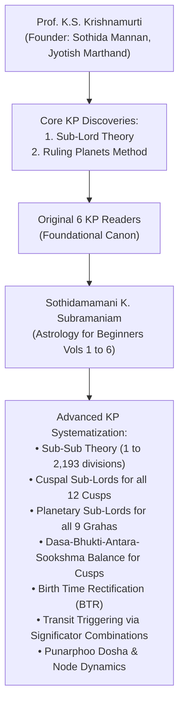
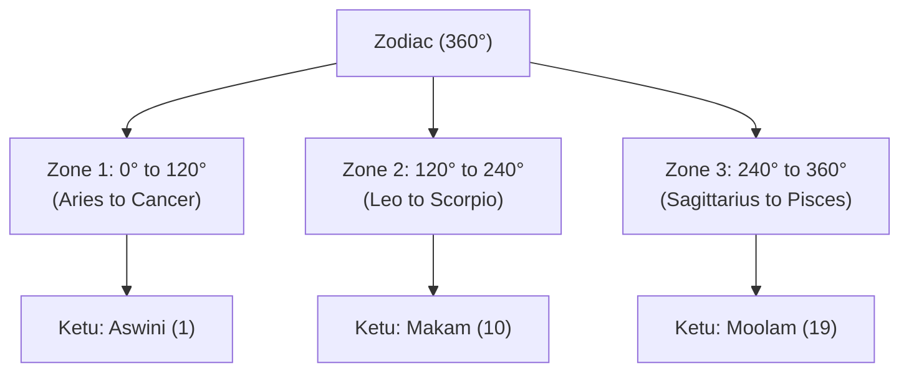
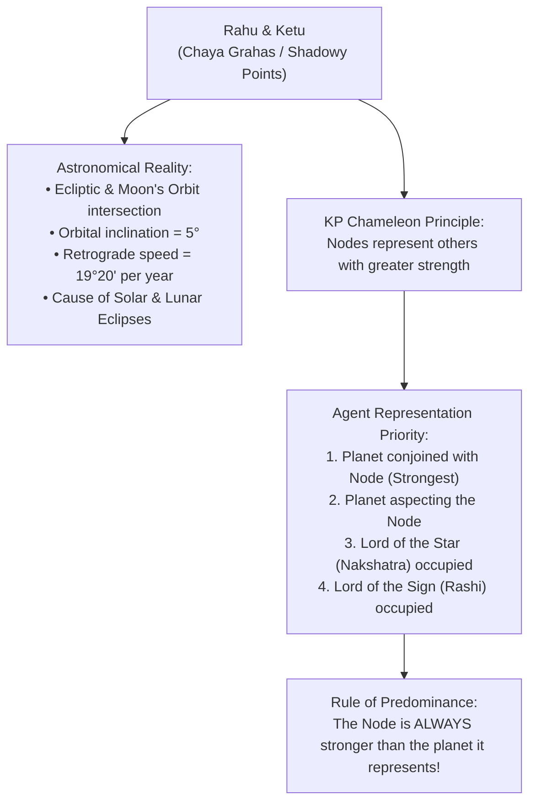
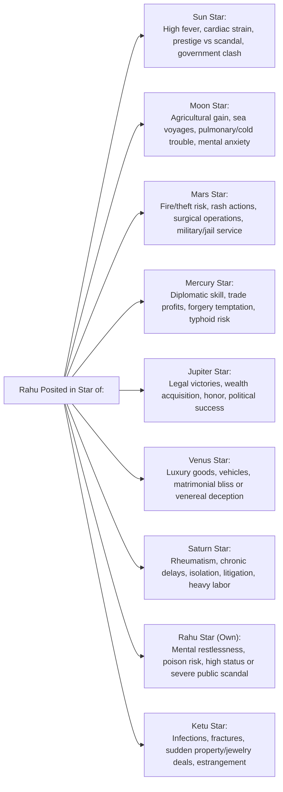
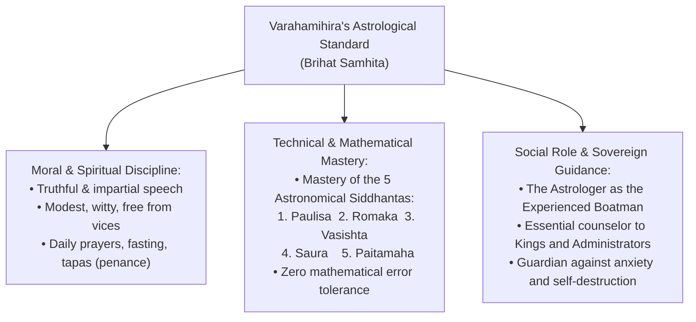
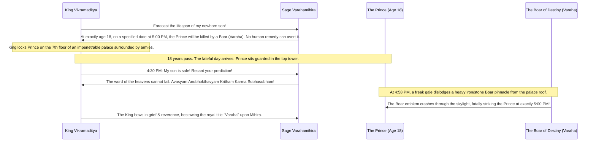

# Krishnamurti Paddhati (KP) Stellar Astrology Knowledge Base
## K.P. Krishman's Astrology for Beginners: Encyclopedia of Astrology (Vols. 1 & 2)
### By Sothidamamani K. Subramaniam (Son of Prof. Late K.S. Krishnamurti)

---

## Document Metadata & Archival Provenance
- **Title**: *K.P. Krishman's Astrology for Beginners — Encyclopedia of Astrology (Vol. 1 & Vol. 2 of 6-Volume Set)*
- **Author**: Sothidamamani K. Subramaniam (Editor & Publisher of *KP & Astrology*; Son of Prof. Late K.S. Krishnamurti, Founder of Krishnamurti Padhdhati & Athrishta Stellar Systems)
- **Publisher**: Krishman & Co., Madras, India
- **Digital Archival Source**: [Internet Archive — KP Readers Collection](https://archive.org/details/kp-readers)
- **Scope**: Comprehensive foundations of Krishnamurti Paddhati (KP), Stellar Astrological Mechanics, Vimshottari Dasa Mathematics, Cuspal Sub-Lord & Sub-Sub-Lord Theories (1 to 2,193 divisions), Mathematical Time Conversions (LMT & Sidereal Time / RAMC), Raphael's Ephemeris Usage, Exhaustive Astrological Glossary, Navamsa Architecture, Aspects & Orbs, Medical Astrology Anatomy, In-Depth Treatise on Lunar Nodes (Rahu & Ketu), Nadi Astrological Reality, Varahamihira's Shastric Qualifications, and the Philosophy of Karma, Destiny, and Fate.

---

## 1. Preface & Core System Architecture of Krishnamurti Padhdhati



### 1.1 The Genesis of Krishnamurti Padhdhati (KP)
Krishnamurti Padhdhati (KP) derives its name from its inventor, **Late Sothida Mannan, Jyotish Marthand Prof. K.S. Krishnamurti**. The system revolutionized predictive astrology by moving beyond crude sign-level and nakshatra-level analysis to discover:
1. **The Sub-Lord Theory**: Dividing each of the 27 nakshatras (constellations) into 9 unequal subdivisions strictly proportional to the span of the Vimshottari Dasa years.
2. **The Ruling Planets (RP) Method**: Utilizing the instantaneous cosmic clock (Ascendant sign lord, Ascendant star lord, Moon sign lord, Moon star lord, and Day lord) to resolve queries and rectify birth charts.

### 1.2 Purpose of the "Astrology for Beginners" Encyclopedia
Authored by Prof. Krishnamurti's son, **Sothidamamani K. Subramaniam**, this encyclopedia synthesizes and condenses the 6 original KP Readers into an accessible, mathematically rigorous reference while expanding upon crucial domains not fully elaborated in the initial volumes:
- **Universal Application of Cuspal Sub-Lords**: Extending sub-lord analysis across all 12 house cusps (Placidus system) and all 9 planets.
- **The Sub-Sub Theory**: Expanding the 249 sub-lord table into **2,193 Sub-Sub subdivisions** for pinpoint timing of events.
- **Birth Time Rectification (BTR)**: Aligning cuspal and planetary sub-sub periods with historical life milestones and transits.
- **Punarphoo Dosha**: Detailed rules governing Saturn-Moon interlinks causing impediments and delays in marriage and career.
- **Vastu Shastra and Astro-Pathology**: Integrating stellar mechanics with directional energies and diagnostic medical astrology.

---

## 2. Astronomical & Mathematical Foundations of Time

Accurate KP prediction is impossible without rigorous calculation of the **Local Mean Time (LMT)** and **Sidereal Time at Birth (RAMC)**. The earth rotates $360^\circ$ in approximately 24 hours, meaning $1^\circ$ of longitude corresponds to exactly 4 minutes of time ($1' = 4 \text{ seconds}$).

```mermaid
flowchart LR
    ClockTime["Standard Clock Time<br/>(e.g., IST, EST, GMT)"] --> GMT["Greenwich Mean Time (GMT)"]
    GMT --> LMT["Local Mean Time (LMT)<br/>(Adjusted by Longitude: ±4m per degree)"]
    LMT --> STPreviousNoon["Sidereal Time at Previous Noon<br/>(from Ephemeris)"]
    STPreviousNoon --> LongCorr["Longitude Correction<br/>(±2/3 sec per degree)"]
    LongCorr --> ElapsedInterval["Elapsed Time Interval<br/>(LMT - Previous Noon)"]
    ElapsedInterval --> AccelCorr["Acceleration Correction<br/>(+10 sec per hour of interval)"]
    AccelCorr --> RAMC["Sidereal Time at Birth (RAMC)<br/>Used to erect 12 Placidus Cusps"]
```



### 2.1 The Four-Step Sidereal Time (RAMC) Calculation Protocol

To erect an authentic Nirayana KP Chart using Raphael's Astronomical Ephemeris:

#### Step 1: Compute Local Mean Time (LMT)
$$\text{LMT} = \text{Standard Time} \pm (\Delta\lambda \times 4 \text{ minutes per degree})$$
- Where $\Delta\lambda$ is the difference between the local longitude and the standard time meridian.
- For India: Standard Meridian is $82^\circ 30' \text{ E}$ (IST is $\text{GMT} + 5\text{h } 30\text{m}$).
  - East of $82^\circ 30'$: Add 4 minutes per degree.
  - West of $82^\circ 30'$: Subtract 4 minutes per degree.

#### Step 2: Note Sidereal Time at Previous Noon at Greenwich
- If birth LMT is in **P.M.** (between 12:00 Noon and 11:59:59 P.M.): Take Greenwich Sidereal Time for the **same calendar date**.
- If birth LMT is in **A.M.** (between 12:00 Midnight and 11:59:59 A.M.): Take Greenwich Sidereal Time for the **previous calendar date**.

#### Step 3: Apply Longitude Correction to Sidereal Time
Because Sidereal Time gains 3 minutes 56.555 seconds (~240 seconds) over 24 hours ($360^\circ$), the correction rate is:
$$\text{Correction Rate} = \frac{240 \text{ seconds}}{360^\circ} = \frac{2}{3} \text{ second per degree of longitude}$$
- **East Longitude**: **Deduct** $\left(\lambda^\circ \times \frac{2}{3}\right)$ seconds from Greenwich Noon Sidereal Time.
- **West Longitude**: **Add** $\left(\lambda^\circ \times \frac{2}{3}\right)$ seconds to Greenwich Noon Sidereal Time.

#### Step 4: Add Elapsed Interval & Acceleration Correction
- Add the elapsed time interval between the previous noon and the birth LMT.
- Add the **Acceleration Correction** for the elapsed interval at the rate of:
  $$\text{Acceleration} = 10 \text{ seconds per elapsed hour} \quad \left(1 \text{ second per } 6 \text{ minutes}\right)$$
- If the resultant Sidereal Time exceeds 24 hours, subtract 24 hours ($24\text{h } 00\text{m } 00\text{s}$).

---

### 2.2 Worked Practical Calculation Examples

#### Example 1: Birth in Eastern Longitude (Agra, India)
- **Birth Details**: 15th May 1963, 6:30 P.M. IST at Agra ($78^\circ 05' \text{ E}$).
- **Step 1 — LMT Calculation**:
  - $\text{GMT} = 6:30 \text{ P.M.} - 5:30 = 1:00 \text{ P.M. GMT}$.
  - Longitude $78^\circ 05' \text{ E} \times 4 \text{ min/deg} = 312\text{m } 20\text{s} = 5\text{h } 12\text{m } 20\text{s}$.
  - $\text{LMT} = 1:00 \text{ P.M.} + 5\text{h } 12\text{m } 20\text{s} = 6:12:20 \text{ P.M. LMT}$ (15-05-1963).
- **Step 2 — Sidereal Time at Greenwich Noon (15-05-1963)**: $03\text{h } 29\text{m } 59\text{s}$.
- **Step 3 — Longitude Correction (East)**:
  - $78.083^\circ \times \frac{2}{3} \approx 52 \text{ seconds (deduct)}$.
  - Local Sidereal Time at Noon = $03\text{h } 29\text{m } 59\text{s} - 00\text{h } 00\text{m } 52\text{s} = 03\text{h } 29\text{m } 07\text{s}$.
- **Step 4 — Interval & Acceleration**:
  - Elapsed interval from noon = $06\text{h } 12\text{m } 20\text{s}$.
  - Acceleration ($6.205\text{h} \times 10\text{s}$) = $00\text{h } 01\text{m } 02\text{s}$.
- **Final RAMC / Sidereal Time at Birth**:
  $$03\text{h } 29\text{m } 07\text{s} + 06\text{h } 12\text{m } 20\text{s} + 00\text{h } 01\text{m } 02\text{s} = \mathbf{09\text{h } 42\text{m } 29\text{s}}$$

#### Example 2: Birth in Early Morning A.M. (Allahabad, India)
- **Birth Details**: 15th May 1963, 3:30 A.M. IST at Allahabad ($81^\circ 54' \text{ E}$).
- **Step 1 — LMT Calculation**:
  - Difference from standard meridian $82^\circ 30' - 81^\circ 54' = 0^\circ 36' \text{ West of IST line}$.
  - Time correction $= 36' \times 4\text{s} = 2\text{m } 24\text{s}$ (deduct from IST).
  - $\text{LMT} = 03\text{h } 30\text{m } 00\text{s} - 00\text{h } 02\text{m } 24\text{s} = 03:27:36 \text{ A.M. LMT}$ (15-05-1963).
- **Step 2 — Sidereal Time at Greenwich Previous Noon (14-05-1963)**: $03\text{h } 26\text{m } 02\text{s}$.
- **Step 3 — Longitude Correction (East)**:
  - $81.9^\circ \times \frac{2}{3} \approx 55 \text{ seconds (deduct)}$.
  - Sidereal Time at local noon on 14th = $03\text{h } 26\text{m } 02\text{s} - 00\text{h } 00\text{m } 55\text{s} = 03\text{h } 25\text{m } 07\text{s}$.
- **Step 4 — Interval & Acceleration**:
  - Elapsed interval from 14th noon to 15th 3:27:36 A.M. = $12\text{h} + 03\text{h } 27\text{m } 36\text{s} = 15\text{h } 27\text{m } 36\text{s}$.
  - Acceleration ($15.46\text{h} \times 10\text{s}$) = $00\text{h } 02\text{m } 35\text{s}$.
- **Final RAMC / Sidereal Time at Birth**:
  $$03\text{h } 25\text{m } 07\text{s} + 15\text{h } 27\text{m } 36\text{s} + 00\text{h } 02\text{m } 35\text{s} = \mathbf{18\text{h } 55\text{m } 18\text{s}}$$

#### Example 3: Birth in Western Longitude (Boston, USA)
- **Birth Details**: 15th May 1963, 9:00 P.M. Standard Time (EST) at Boston ($71^\circ 02' \text{ W}$).
- **Step 1 — LMT Calculation**:
  - $\text{EST} = \text{GMT} - 5\text{h}$. Hence 9:00 P.M. EST = 2:00 A.M. GMT (16-05-1963).
  - Boston is $71^\circ 02' \text{ W} \times 4\text{m} = 4\text{h } 44\text{m } 08\text{s}$ West of Greenwich.
  - $\text{LMT} = 2:00 \text{ A.M.} (16\text{th}) - 4\text{h } 44\text{m } 08\text{s} = 09:15:52 \text{ P.M. LMT}$ (15-05-1963).
- **Step 2 — Sidereal Time at Greenwich Previous Noon (15-05-1963)**: $03\text{h } 29\text{m } 59\text{s}$.
- **Step 3 — Longitude Correction (West)**:
  - $71.03^\circ \times \frac{2}{3} \approx 47 \text{ seconds (add for West longitude)}$.
  - Local Sidereal Time at Noon = $03\text{h } 29\text{m } 59\text{s} + 00\text{h } 00\text{m } 47\text{s} = 03\text{h } 30\text{m } 46\text{s}$.
- **Step 4 — Interval & Acceleration**:
  - Elapsed interval from noon = $09\text{h } 15\text{m } 52\text{s}$.
  - Acceleration ($9.26\text{h} \times 10\text{s}$) = $00\text{h } 01\text{m } 33\text{s}$.
- **Final RAMC / Sidereal Time at Birth**:
  $$03\text{h } 30\text{m } 46\text{s} + 09\text{h } 15\text{m } 52\text{s} + 00\text{h } 01\text{m } 33\text{s} = \mathbf{12\text{h } 48\text{m } 11\text{s}}$$

---

### 2.3 Historical Standard Time Adoption Register

When preparing charts for births across historical periods, astrologers must account for the exact date each country adopted Standard Time:

| Country / Region | Date of Adoption | Standard Meridian / Offset from GMT |
|---|---|---|
| **United States & Canada** | 18-11-1883 | Eastern (75°W / -5h), Central (90°W / -6h), Mountain (105°W / -7h), Pacific (120°W / -8h) |
| **Japan** | 02-07-1886 | 135°E (+9h 00m) |
| **Germany, Prussia, Austria-Hungary** | 01-04-1893 | 15°E (+1h 00m CET) |
| **Italy, Switzerland, Denmark, Norway** | 01-01-1895 | 15°E (+1h 00m CET) |
| **Australia (NSW, Queensland, Victoria)** | 01-02-1895 | 150°E (+10h 00m AEST) |
| **South Australia** | 01-02-1895 | 142°30'E (+9h 30m ACST) |
| **Philippines & Manila** | 01-01-1899 | 120°E (+8h 00m) |
| **Spain & Balearic Islands** | 01-01-1901 | 0° (Greenwich Meridian) |
| **India** | **01-01-1906** | **82°30'E (+5h 30m IST)** |
| **Indian War Time (WWII)** | **01-09-1942 to 15-10-1945** | **Advanced by exactly 1 hour (+6h 30m from GMT)** |
| **France & Belgium** | 10-03-1911 | 0° (Greenwich Mean Time adopted) |

---

## 3. The 27 Nakshatras & Vimshottari Lordship Triads

The $360^\circ$ zodiac is divided into 27 equal Nakshatras of $13^\circ 20'$ ($800'$) each. In the Vimshottari system, the 9 planets each rule exactly 3 constellations spaced $120^\circ$ apart across the three $120^\circ$ zones of the zodiac:



### 3.1 Complete 27 Nakshatra Master Reference Table

| S.No. | Nakshatra Name | Tamil Name | Vimshottari Lord | Span in Zodiac (From — To) | Signs Traversed | Pada Longitudes (3°20' each) |
|---|---|---|---|---|---|---|
| 1 | **Aswini** | அஸ்வினி | **Ketu** (7y) | $000^\circ 00' - 013^\circ 20'$ | Aries | Pada 1 (0°-3°20'), Pada 2 (3°20'-6°40'), Pada 3 (6°40'-10°), Pada 4 (10°-13°20') |
| 2 | **Bharani** | பரணி | **Venus** (20y) | $013^\circ 20' - 026^\circ 40'$ | Aries | Pada 1 (13°20'-16°40'), Pada 2 (16°40'-20°), Pada 3 (20°-23°20'), Pada 4 (23°20'-26°40') |
| 3 | **Krittika** | கார்த்திகை | **Sun** (6y) | $026^\circ 40' - 040^\circ 00'$ | Aries ($3^\circ 20'$) & Taurus ($10^\circ 00'$) | Pada 1 in Aries ($26^\circ 40'-30^\circ$); Padas 2, 3, 4 in Taurus ($0^\circ-10^\circ$) |
| 4 | **Rohini** | ரோகிணி | **Moon** (10y) | $040^\circ 00' - 053^\circ 20'$ | Taurus | Pada 1 ($10^\circ-13^\circ 20'$), Pada 2 ($13^\circ 20'-16^\circ 40'$), Pada 3 ($16^\circ 40'-20^\circ$), Pada 4 ($20^\circ-23^\circ 20'$) |
| 5 | **Mrigasira** | மிருகசீரிஷம் | **Mars** (7y) | $053^\circ 20' - 066^\circ 40'$ | Taurus ($6^\circ 40'$) & Gemini ($6^\circ 40'$) | Padas 1, 2 in Taurus ($23^\circ 20'-30^\circ$); Padas 3, 4 in Gemini ($0^\circ-6^\circ 40'$) |
| 6 | **Arudra** | திருவாதிரை | **Rahu** (18y) | $066^\circ 40' - 080^\circ 00'$ | Gemini | Pada 1 ($6^\circ 40'-10^\circ$), Pada 2 ($10^\circ-13^\circ 20'$), Pada 3 ($13^\circ 20'-16^\circ 40'$), Pada 4 ($16^\circ 40'-20^\circ$) |
| 7 | **Punarvasu** | புனர்பூசம் | **Jupiter** (16y) | $080^\circ 00' - 093^\circ 20'$ | Gemini ($10^\circ 00'$) & Cancer ($3^\circ 20'$) | Padas 1, 2, 3 in Gemini ($20^\circ-30^\circ$); Pada 4 in Cancer ($0^\circ-3^\circ 20'$) |
| 8 | **Pushya** | பூசம் | **Saturn** (19y) | $093^\circ 20' - 106^\circ 40'$ | Cancer | Pada 1 ($3^\circ 20'-6^\circ 40'$), Pada 2 ($6^\circ 40'-10^\circ$), Pada 3 ($10^\circ-13^\circ 20'$), Pada 4 ($13^\circ 20'-16^\circ 40'$) |
| 9 | **Ashlesha** | ஆயில்யம் | **Mercury** (17y) | $106^\circ 40' - 120^\circ 00'$ | Cancer | Pada 1 ($16^\circ 40'-20^\circ$), Pada 2 ($20^\circ-23^\circ 20'$), Pada 3 ($23^\circ 20'-26^\circ 40'$), Pada 4 ($26^\circ 40'-30^\circ$) |
| 10 | **Magha** | மகம் | **Ketu** (7y) | $120^\circ 00' - 133^\circ 20'$ | Leo | Pada 1 ($0^\circ-3^\circ 20'$), Pada 2 ($3^\circ 20'-6^\circ 40'$), Pada 3 ($6^\circ 40'-10^\circ$), Pada 4 ($10^\circ-13^\circ 20'$) |
| 11 | **Purva Phalguni** | பூரம் | **Venus** (20y) | $133^\circ 20' - 146^\circ 40'$ | Leo | Pada 1 ($13^\circ 20'-16^\circ 40'$), Pada 2 ($16^\circ 40'-20^\circ$), Pada 3 ($20^\circ-23^\circ 20'$), Pada 4 ($23^\circ 20'-26^\circ 40'$) |
| 12 | **Uttara Phalguni** | உத்திரம் | **Sun** (6y) | $146^\circ 40' - 160^\circ 00'$ | Leo ($3^\circ 20'$) & Virgo ($10^\circ 00'$) | Pada 1 in Leo ($26^\circ 40'-30^\circ$); Padas 2, 3, 4 in Virgo ($0^\circ-10^\circ$) |
| 13 | **Hasta** | அஸ்தம் | **Moon** (10y) | $160^\circ 00' - 173^\circ 20'$ | Virgo | Pada 1 ($10^\circ-13^\circ 20'$), Pada 2 ($13^\circ 20'-16^\circ 40'$), Pada 3 ($16^\circ 40'-20^\circ$), Pada 4 ($20^\circ-23^\circ 20'$) |
| 14 | **Chitra** | சித்திரை | **Mars** (7y) | $173^\circ 20' - 186^\circ 40'$ | Virgo ($6^\circ 40'$) & Libra ($6^\circ 40'$) | Padas 1, 2 in Virgo ($23^\circ 20'-30^\circ$); Padas 3, 4 in Libra ($0^\circ-6^\circ 40'$) |
| 15 | **Swati** | சுவாதி | **Rahu** (18y) | $186^\circ 40' - 200^\circ 00'$ | Libra | Pada 1 ($6^\circ 40'-10^\circ$), Pada 2 ($10^\circ-13^\circ 20'$), Pada 3 ($13^\circ 20'-16^\circ 40'$), Pada 4 ($16^\circ 40'-20^\circ$) |
| 16 | **Vishakha** | விசாகம் | **Jupiter** (16y) | $200^\circ 00' - 213^\circ 20'$ | Libra ($10^\circ 00'$) & Scorpio ($3^\circ 20'$) | Padas 1, 2, 3 in Libra ($20^\circ-30^\circ$); Pada 4 in Scorpio ($0^\circ-3^\circ 20'$) |
| 17 | **Anuradha** | அனுஷம் | **Saturn** (19y) | $213^\circ 20' - 226^\circ 40'$ | Scorpio | Pada 1 ($3^\circ 20'-6^\circ 40'$), Pada 2 ($6^\circ 40'-10^\circ$), Pada 3 ($10^\circ-13^\circ 20'$), Pada 4 ($13^\circ 20'-16^\circ 40'$) |
| 18 | **Jyeshtha** | கேட்டை | **Mercury** (17y) | $226^\circ 40' - 240^\circ 00'$ | Scorpio | Pada 1 ($16^\circ 40'-20^\circ$), Pada 2 ($20^\circ-23^\circ 20'$), Pada 3 ($23^\circ 20'-26^\circ 40'$), Pada 4 ($26^\circ 40'-30^\circ$) |
| 19 | **Mula** | மூலம் | **Ketu** (7y) | $240^\circ 00' - 253^\circ 20'$ | Sagittarius | Pada 1 ($0^\circ-3^\circ 20'$), Pada 2 ($3^\circ 20'-6^\circ 40'$), Pada 3 ($6^\circ 40'-10^\circ$), Pada 4 ($10^\circ-13^\circ 20'$) |
| 20 | **Purva Ashadha** | பூராடம் | **Venus** (20y) | $253^\circ 20' - 266^\circ 40'$ | Sagittarius | Pada 1 ($13^\circ 20'-16^\circ 40'$), Pada 2 ($16^\circ 40'-20^\circ$), Pada 3 ($20^\circ-23^\circ 20'$), Pada 4 ($23^\circ 20'-26^\circ 40'$) |
| 21 | **Uttara Ashadha** | உத்திராடம் | **Sun** (6y) | $266^\circ 40' - 280^\circ 00'$ | Sag ($3^\circ 20'$) & Cap ($10^\circ 00'$) | Pada 1 in Sag ($26^\circ 40'-30^\circ$); Padas 2, 3, 4 in Cap ($0^\circ-10^\circ$) |
| 22 | **Shravana** | திருவோணம் | **Moon** (10y) | $280^\circ 00' - 293^\circ 20'$ | Capricorn | Pada 1 ($10^\circ-13^\circ 20'$), Pada 2 ($13^\circ 20'-16^\circ 40'$), Pada 3 ($16^\circ 40'-20^\circ$), Pada 4 ($20^\circ-23^\circ 20'$) |
| 23 | **Dhanishta** | அவிட்டம் | **Mars** (7y) | $293^\circ 20' - 306^\circ 40'$ | Cap ($6^\circ 40'$) & Aqu ($6^\circ 40'$) | Padas 1, 2 in Cap ($23^\circ 20'-30^\circ$); Padas 3, 4 in Aqu ($0^\circ-6^\circ 40'$) |
| 24 | **Shatabhisha** | சதயம் | **Rahu** (18y) | $306^\circ 40' - 320^\circ 00'$ | Aquarius | Pada 1 ($6^\circ 40'-10^\circ$), Pada 2 ($10^\circ-13^\circ 20'$), Pada 3 ($13^\circ 20'-16^\circ 40'$), Pada 4 ($16^\circ 40'-20^\circ$) |
| 25 | **Purva Bhadrapada** | பூரட்டாதி | **Jupiter** (16y) | $320^\circ 00' - 333^\circ 20'$ | Aqu ($10^\circ 00'$) & Pisces ($3^\circ 20'$) | Padas 1, 2, 3 in Aqu ($20^\circ-30^\circ$); Pada 4 in Pisces ($0^\circ-3^\circ 20'$) |
| 26 | **Uttara Bhadrapada** | உத்திரட்டாதி | **Saturn** (19y) | $333^\circ 20' - 346^\circ 40'$ | Pisces | Pada 1 ($3^\circ 20'-6^\circ 40'$), Pada 2 ($6^\circ 40'-10^\circ$), Pada 3 ($10^\circ-13^\circ 20'$), Pada 4 ($13^\circ 20'-16^\circ 40'$) |
| 27 | **Revati** | ரேவதி | **Mercury** (17y) | $346^\circ 40' - 360^\circ 00'$ | Pisces | Pada 1 ($16^\circ 40'-20^\circ$), Pada 2 ($20^\circ-23^\circ 20'$), Pada 3 ($23^\circ 20'-26^\circ 40'$), Pada 4 ($26^\circ 40'-30^\circ$) |

---

## 4. The Sub-Lord & Sub-Sub-Lord Doctrine

### 4.1 Mathematical Derivation of the 9 Subs
In Krishnamurti Paddhati, a star is not treated as a monolithic $13^\circ 20'$ arc. It is subdivided into 9 unequal parts called **Subs**. The extent of each Sub is strictly proportional to the planet's Vimshottari Dasa years:

$$\text{Extent of Sub} = \frac{\text{Dasa Years of Planet}}{120} \times 13^\circ 20' = \frac{\text{Dasa Years of Planet}}{120} \times 800'$$

```
Ketu Sub:    (7  / 120) * 800' =  46' 40" = 0° 46' 40"
Venus Sub:   (20 / 120) * 800' = 133' 20" = 2° 13' 20"
Sun Sub:     (6  / 120) * 800' =  40' 00" = 0° 40' 00"
Moon Sub:    (10 / 120) * 800' =  66' 40" = 1° 06' 40"
Mars Sub:    (7  / 120) * 800' =  46' 40" = 0° 46' 40"
Rahu Sub:    (18 / 120) * 800' = 120' 00" = 2° 00' 00"
Jupiter Sub: (16 / 120) * 800' = 106' 40" = 1° 46' 40"
Saturn Sub:  (19 / 120) * 800' = 126' 40" = 2° 06' 40"
Mercury Sub: (17 / 120) * 800' = 113' 20" = 1° 53' 20"
------------------------------------------------------
Total Span of 9 Subs:                      13° 20' 00"
```

> [!IMPORTANT]
> The order of the 9 Sub-Lords inside any nakshatra begins with the **Lord of the Nakshatra itself** and follows the cyclic Vimshottari sequence thereafter.

### 4.2 The Hierarchical Relationship Between KP and Vimshottari
The fourfold cosmic hierarchy in KP corresponds identically to the Vimshottari time lords:

| KP Hierarchy | Astrological Role | Vimshottari Equivalent | Architectural Analogy |
|---|---|---|---|
| **Sign Lord** | Rashi Adhipathi | Source Environment | Country / State |
| **Star Lord** | Nakshatra Adhipathi | **Dasa Lord** | City / Town |
| **Sub Lord** | Sub-Division Ruler | **Bukthi (Bhukti) Lord** | Neighborhood / Street |
| **Sub-Sub Lord** | Micro-Division Ruler | **Anthra (Antara) Lord** | House / Building |
| **Sub-Sub-Sub Lord** | Nano-Division Ruler | **Sookshma Lord** | Exact Door Number |

> *"A transit of a sign and star by a planet is like saying that Mr. X is in Madras, India. When the sub-division is introduced, it is like saying he is in Royapettah. When the sub-sub is introduced, he is in Sri Ram Street. With the sub-sub-sub, you can fix the door number and reach the person exactly."*  
> — **Sothidamamani K. Subramaniam** (*Astrology for Beginners, Vol. 1*, p. 89)

### 4.3 Universal Cuspal & Planetary Dasa Balance
Traditional astrology calculates Dasa balance solely based on the Moon's natal longitude. In advanced KP:
1. **Dasa Balance is calculated for ALL 12 Placidus Cusps**.
2. **Dasa Balance is calculated for ALL 9 Grahas**.
3. When analyzing an event (e.g., Marriage, Promotion, Childbirth, Purchase of Property, Surgery, Death of Parents), the astrologer calculates the running **Cuspal Dasa-Bhukti-Antara-Sookshma** and **Planetary Dasa-Bhukti-Antara-Sookshma**. A precise, deterministic synchronicity between cuspal significators and operating planetary periods must exist.

### 4.4 Birth Time Rectification (BTR) via Sub-Sub Theory
If the operating Dasa, Bhukti, Antara, and Sookshma on the verified date of a major life event do not link to the significators of the relevant house cusp, **the recorded birth time is incorrect**:
- The astrologer adjusts the birth time backward or forward by seconds or minutes until the cuspal sub-sub lord and planetary sub-sub periods perfectly align with the event.
- The rectification is cross-verified by checking that the **transit of Dasa and Bhukti lords** on that momentous date passed through the exact combined coordinates (Sign-Star-Sub) of the event significators.

---

## 5. Comprehensive Rashi Architecture & Classification

```mermaid
classDiagram
    class ZodiacSign {
        +String SanskritName
        +String EnglishName
        +String RulingPlanet
        +String Element (Tatva)
        +String Mobility (Gati)
        +String Fertility
        +String Ascension
        +String BodyPartsRuled
    }
    class Aries {
        Mesha | Mars | Fire | Movable | Semi-Barren | Short | Head & Brain
    }
    class Taurus {
        Rishaba | Venus | Earth | Fixed | Semi-Fruitful | Short | Throat, Neck, Vocal Cords
    }
    class Gemini {
        Mithuna | Mercury | Air | Common | Barren | Short | Shoulders, Arms, Windpipe
    }
    class Cancer {
        Kataka | Moon | Water | Movable | Fruitful | Long | Breast, Stomach, Chest
    }
    class Leo {
        Simha | Sun | Fire | Fixed | Barren | Long | Heart, Spine, Arteries
    }
    class Virgo {
        Kanni | Mercury | Earth | Common | Barren | Long | Bowels, Abdomen, Disks
    }
    class Libra {
        Thulam | Venus | Air | Movable | Semi-Fruitful | Long | Kidneys, Lower Abdomen
    }
    class Scorpio {
        Vrischika | Mars | Water | Fixed | Fruitful | Long | Genitals, Excretory, Pelvis
    }
    class Sagittarius {
        Dhanus | Jupiter | Fire | Common | Semi-Fruitful | Long | Hips, Thighs, Hepatic System
    }
    class Capricorn {
        Makara | Saturn | Earth | Movable | Semi-Fruitful | Short | Knees, Bones, Skeleton
    }
    class Aquarius {
        Kumbham | Saturn | Air | Fixed | Semi-Fruitful | Short | Calves, Ankles, Nervous System
    }
    class Pisces {
        Meenam | Jupiter | Water | Common | Fruitful | Short | Feet, Toes, Lymphatics
    }
    ZodiacSign <|-- Aries
    ZodiacSign <|-- Taurus
    ZodiacSign <|-- Gemini
    ZodiacSign <|-- Cancer
    ZodiacSign <|-- Leo
    ZodiacSign <|-- Virgo
    ZodiacSign <|-- Libra
    ZodiacSign <|-- Scorpio
    ZodiacSign <|-- Sagittarius
    ZodiacSign <|-- Capricorn
    ZodiacSign <|-- Aquarius
    ZodiacSign <|-- Pisces
```



### 5.1 Anatomical Rulership of the 12 Signs (Medical KP)
1. **Aries (Mesha)**: Head, cranium, facial bones, cerebrum, organs of the brain.
2. **Taurus (Rishaba)**: Neck, throat, larynx, vocal cords, pharynx, thyroid, carotid arteries.
3. **Gemini (Mithuna)**: Arms, shoulders, hands, collar bones, bronchial tubes, windpipe, respiratory lungs.
4. **Cancer (Kataka)**: Breast, epigastric region, stomach, chest, alimentary canal, lacteal vessels.
5. **Leo (Simha)**: Heart, cardiac system, aorta, spine, dorsal muscles, arterial system.
6. **Virgo (Kanni)**: Abdomen, bowels, intestinal tract, spleen, pancreas, spinal cord and lumbar disks.
7. **Libra (Thula)**: Kidneys, lumbar region, adrenals, vasomotor system, skin, buttocks.
8. **Scorpio (Vrischika)**: Genital organs, bladder, prostate, rectum, excretory channels, pelvic bones.
9. **Sagittarius (Dhanus)**: Hips, thighs, iliac bones, sacral region, hepatic system, sciatic nerves.
10. **Capricorn (Makara)**: Skeleton, joints, knees, patella, teeth, skin tissue.
11. **Aquarius (Kumbha)**: Calves, shins, ankles, circulatory flow, peripheral nervous system.
12. **Pisces (Meena)**: Feet, toes, tarsus, metatarsus, lymphatic fluid, glandular secretions.

---

### 5.2 Multi-Dimensional Sign Classifications

| Rashi | Mobility | Element | Polarity | Fertility | Voice / Body | Ascension (North) | Tamil Month |
|---|---|---|---|---|---|---|---|
| **Aries** | Movable (Chara) | Fire | Positive (Male) | Semi-Barren | Quadruped / Bestial | Short Ascension | Chitrai (சித்திரை) |
| **Taurus** | Fixed (Sthira) | Earth | Negative (Female) | Semi-Fruitful | Quadruped / Bestial | Short Ascension | Vaikasi (வைகாசி) |
| **Gemini** | Common (Dwiswabhava) | Air | Positive (Male) | Barren | Human / Voice / Double | Short Ascension | Aani (ஆனி) |
| **Cancer** | Movable (Chara) | Water | Negative (Female) | **Fruitful** | Mute / Watery | Long Ascension | Aadi (ஆடி) |
| **Leo** | Fixed (Sthira) | Fire | Positive (Male) | **Barren** | Bestial / Wild | Long Ascension | Avani (ஆவணி) |
| **Virgo** | Common (Dwiswabhava) | Earth | Negative (Female) | **Barren** | Human / Voice | Long Ascension | Purattasi (புரட்டாசி) |
| **Libra** | Movable (Chara) | Air | Positive (Male) | Semi-Fruitful | Human / Voice | Long Ascension | Aippasi (ஐப்பசி) |
| **Scorpio** | Fixed (Sthira) | Water | Negative (Female) | **Fruitful** | Mute / Insect | Long Ascension | Karthikai (கார்த்திகை) |
| **Sagittarius** | Common (Dwiswabhava) | Fire | Positive (Male) | Semi-Fruitful | Human (1st half) / Bestial (2nd) | Long Ascension | Margazhi (மார்கழி) |
| **Capricorn** | Movable (Chara) | Earth | Negative (Female) | Semi-Fruitful | Bestial (1st) / Watery (2nd) | Short Ascension | Thai (தை) |
| **Aquarius** | Fixed (Sthira) | Air | Positive (Male) | Semi-Fruitful | Human / Voice | Short Ascension | Masi (மாசி) |
| **Pisces** | Common (Dwiswabhava) | Water | Negative (Female) | **Fruitful** | Mute / Double-bodied | Short Ascension | Panguni (பங்குனி) |

---

## 6. The Complete 108 Navamsa Table

Each Rashi ($30^\circ$) is divided into 9 equal parts of $3^\circ 20'$ ($200'$), yielding the 108 Navamsas of the zodiac.

```
Navamsa Division Starting Points:
• Fiery Signs (Aries, Leo, Sagittarius): Navamsa begins in Aries (Mars).
• Earthy Signs (Taurus, Virgo, Capricorn): Navamsa begins in Capricorn (Saturn).
• Airy Signs (Gemini, Libra, Aquarius): Navamsa begins in Libra (Venus).
• Watery Signs (Cancer, Scorpio, Pisces): Navamsa begins in Cancer (Moon).
```

### 6.1 Complete Navamsa Grid (Signs 1 to 12)

| Degree Span | Aries (1) | Taurus (2) | Gemini (3) | Cancer (4) | Leo (5) | Virgo (6) |
|---|---|---|---|---|---|---|
| **0°00' - 3°20'** | Aries (Mars) | Cap (Sat) | Libra (Ven) | Cancer (Moon) | Aries (Mars) | Cap (Sat) |
| **3°20' - 6°40'** | Taurus (Ven) | Aqu (Sat) | Scorpio (Mars) | Leo (Sun) | Taurus (Ven) | Aqu (Sat) |
| **6°40' - 10°00'** | Gemini (Merc) | Pisces (Jup) | Sag (Jup) | Virgo (Merc) | Gemini (Merc) | Pisces (Jup) |
| **10°00' - 13°20'** | Cancer (Moon) | Aries (Mars) | Cap (Sat) | Libra (Ven) | Cancer (Moon) | Aries (Mars) |
| **13°20' - 16°40'** | Leo (Sun) | Taurus (Ven) | Aqu (Sat) | Scorpio (Mars) | Leo (Sun) | Taurus (Ven) |
| **16°40' - 20°00'** | Virgo (Merc) | Gemini (Merc) | Pisces (Jup) | Sag (Jup) | Virgo (Merc) | Gemini (Merc) |
| **20°00' - 23°20'** | Libra (Ven) | Cancer (Moon) | Aries (Mars) | Cap (Sat) | Libra (Ven) | Cancer (Moon) |
| **23°20' - 26°40'** | Scorpio (Mars) | Leo (Sun) | Taurus (Ven) | Aqu (Sat) | Scorpio (Mars) | Leo (Sun) |
| **26°40' - 30°00'** | Sag (Jup) | Virgo (Merc) | Gemini (Merc) | Pisces (Jup) | Sag (Jup) | Virgo (Merc) |

| Degree Span | Libra (7) | Scorpio (8) | Sagittarius (9) | Capricorn (10) | Aquarius (11) | Pisces (12) |
|---|---|---|---|---|---|---|
| **0°00' - 3°20'** | Libra (Ven) | Cancer (Moon) | Aries (Mars) | Cap (Sat) | Libra (Ven) | Cancer (Moon) |
| **3°20' - 6°40'** | Scorpio (Mars) | Leo (Sun) | Taurus (Ven) | Aqu (Sat) | Scorpio (Mars) | Leo (Sun) |
| **6°40' - 10°00'** | Sag (Jup) | Virgo (Merc) | Gemini (Merc) | Pisces (Jup) | Sag (Jup) | Virgo (Merc) |
| **10°00' - 13°20'** | Cap (Sat) | Libra (Ven) | Cancer (Moon) | Aries (Mars) | Cap (Sat) | Libra (Ven) |
| **13°20' - 16°40'** | Aqu (Sat) | Scorpio (Mars) | Leo (Sun) | Taurus (Ven) | Aqu (Sat) | Scorpio (Mars) |
| **16°40' - 20°00'** | Pisces (Jup) | Sag (Jup) | Virgo (Merc) | Gemini (Merc) | Pisces (Jup) | Sag (Jup) |
| **20°00' - 23°20'** | Aries (Mars) | Cap (Sat) | Libra (Ven) | Cancer (Moon) | Aries (Mars) | Cap (Sat) |
| **23°20' - 26°40'** | Taurus (Ven) | Aqu (Sat) | Scorpio (Mars) | Leo (Sun) | Taurus (Ven) | Aqu (Sat) |
| **26°40' - 30°00'** | Gemini (Merc) | Pisces (Jup) | Sag (Jup) | Virgo (Merc) | Gemini (Merc) | Pisces (Jup) |

> [!NOTE]
> **Vargottama**: When a planet occupies the exact same sign in both Rashi and Navamsa (e.g., $0^\circ-3^\circ 20'$ in Movable signs, $13^\circ 20'-16^\circ 40'$ in Fixed signs, or $26^\circ 40'-30^\circ 00'$ in Common signs), it attains Vargottama dignity and yields intensely potent results.

---

## 7. Aspects, Orbs & Configurations in KP Astrology

Prof. K.S. Krishnamurti integrated Western angular aspects into Nirayana stellar astrology, evaluating them using exact mathematical orbs rather than whole-sign Vedic drishti:

| Aspect Name | Exact Angle | Nature / Quality | Applying Orb | Separating Orb | Astrological Influence |
|---|---|---|---|---|---|
| **Conjunction** | $0^\circ$ | Variable (Depends on planets) | $6^\circ$ to $8^\circ$ | $6^\circ$ to $8^\circ$ | Unifying; intense synthesis of planetary forces. |
| **Semi-Sextile** | $30^\circ$ | Minor Benefic | $2^\circ$ | $2^\circ$ | Slight opportunity, mild harmony. |
| **Decile (Semi-Quintile)** | $36^\circ$ | Minor Benefic | $1^\circ$ | $1^\circ$ | Mildly favorable, subtle mental acuity. |
| **Semi-Square** | $45^\circ$ | Moderately Malefic | $2^\circ$ to $4^\circ$ | $2^\circ$ to $4^\circ$ | Friction, agitation, small obstacles. |
| **Sextile** | $60^\circ$ | Benefic | $6^\circ$ | $6^\circ$ | Harmony, active opportunities, easy cooperation. |
| **Quintile** | $72^\circ$ | Benefic (5th House Effect) | $2^\circ$ | $2^\circ$ | Creative intellect, talent, artistic success. |
| **Square (Quartile)** | $90^\circ$ | Strongly Malefic | $6^\circ$ to $8^\circ$ | $6^\circ$ to $8^\circ$ | Conflict, acute crisis, forceful resistance. |
| **Trine** | $120^\circ$ | **Most Powerful Benefic** | $6^\circ$ to $8^\circ$ | $6^\circ$ to $8^\circ$ | Supreme fortune, smooth expansion, effortless gain. |
| **Sesquiquadrate** | $135^\circ$ | Moderately Malefic | $2^\circ$ to $4^\circ$ | $2^\circ$ to $4^\circ$ | Persistent irritation, lingering disputes. |
| **Biquintile** | $144^\circ$ | Benefic (Equal to Trine) | $2^\circ$ | $2^\circ$ | High intellectual skill, fortune through merit. |
| **Quincunx (Inconjunct)**| $150^\circ$ | Adverse (6th/8th House Effect)| $2^\circ$ to $3^\circ$ | $2^\circ$ to $3^\circ$ | Disease, strain, adjustment requirement, hidden loss. |
| **Opposition** | $180^\circ$ | Strongly Malefic / Adverse | $6^\circ$ to $8^\circ$ | $6^\circ$ to $8^\circ$ | Direct confrontation, separation, polar tension. |

- **Orb for Luminaries (Sun & Moon)**: The orb may be extended up to $12^\circ$ when aspecting each other, and up to $10^\circ$ with major planets.
- **Applying vs. Separating**: An applying aspect (faster planet approaching exact degree of slower planet) is dynamic and fructifies in the near future; a separating aspect represents fading past influence.

---

## 8. In-Depth Treatise on Rahu & Ketu (The Chaya Grahas)



### 8.1 Astronomical Mechanism & Puranic Symbolism
- **Astronomical Definition**: Rahu and Ketu are not physical bodies with mass or gravitational center. They are the **mathematical nodes** where the plane of the Moon's orbit (inclined at $5^\circ 08'$ to the ecliptic) intersects the path of the Sun (ecliptic).
  - **Ascending Node (Rahu / Caput Draconis / Dragon's Head)**: Moon crosses from South to North celestial latitude.
  - **Descending Node (Ketu / Cauda Draconis / Dragon's Tail)**: Moon crosses from North to South celestial latitude.
  - The nodes possess a mean retrograde motion of $19^\circ 20'$ per year (~$3' 11''$ per day).
- **The Churning of the Ocean (Samudra Manthan)**: Symbolizes the clash between Devas (forces of light/good) and Asuras (forces of darkness/ego). When the Asura Swarbhanu drank Amrita disguised among the Devas, the Sun and Moon exposed him. Lord Vishnu severed him with the Sudarshana Chakra; having tasted immortality, both parts lived—the head became Rahu, the body Ketu. Their perpetual war manifests astronomically as eclipses.

---

### 8.2 The Revolutionary KP Node Principle
In classical texts, sages contradict each other regarding the exaltation and rulership of Rahu and Ketu (some claim Taurus/Scorpio, others Gemini/Sagittarius). Prof. K.S. Krishnamurti resolved this completely:
1. **Nodes Own No Houses**: Because the 12 signs are owned by the 7 physical planets, Rahu and Ketu act as **chameleon agents**.
2. **Hierarchy of Representation**:
   $$\text{Conjunction} \succ \text{Aspect} \succ \text{Star Lord} \succ \text{Sign Lord}$$
3. **The Law of Predominance**:
   > [!IMPORTANT]
   > In KP, **Rahu and Ketu are ALWAYS stronger than the planets they represent**.  
   > If Venus is in Pisces (exalted) conjunct Rahu, Rahu will deliver the results of Venus far more powerfully and abundantly than Venus itself!

---

### 8.3 House-by-House Indications for Rahu & Ketu

#### Rahu in the 12 Bhavas:
- **1st House**: Moles/scars on head; restless, unconventional temperament; sharp intellect; danger of head injury or giddiness.
- **2nd House**: Financial instability followed by sudden windfalls; mole near chin; sharp or contentious speech; eye strain.
- **3rd House**: Highly courageous, victorious over adversaries, prosperous, interest in transport/agriculture, enterprising.
- **4th House**: Suspicious nature, domestic instability, living in rented quarters, owning vehicles through loans, maternal health delicate.
- **5th House**: Obstacles in progeny, Putradosha, stammering in childhood, sharp speculative mind, unconventional romantic affairs.
- **6th House**: Supreme courage, annihilator of enemies, victory in litigation, immune resistance; if Moon is conjunct, attraction to high-status career women.
- **7th House**: Marital friction, unconventional marriage, partner may be proud or of dark complexion; delayed union; dual attachments if afflicted.
- **8th House**: Chronic ailments, latent fears, psychic sensitivity, sudden unexpected windfalls or sudden setbacks, legacy or insurance gains.
- **9th House**: Unorthodox philosophy, pilgrimage to remote sanctuaries, strained relations with father, foreign travels, fame in foreign lands.
- **10th House**: Bold professional climb, unconventional career, dealing with foreigners or working in unhygienic/chemical environments, eventual public recognition.
- **11th House**: Immense wealth, influential foreign contacts, fulfillment of ambitions, long-living elder siblings, multiple revenue streams.
- **12th House**: Foreign relocation, hospital/institutional service, sleep disturbances, expenditure on unusual pursuits, spiritual detachment in later life.

#### Ketu in the 12 Bhavas:
- **1st House**: Marks on face; introverted, ascetic tendencies; spiritual insight; susceptible to allergies and giddiness.
- **2nd House**: Frugal, expenditure exceeds savings; harsh or blunt truth-teller; mole on chin; separation from family wealth.
- **3rd House**: Great valor, skillful hands, successful contractor/messenger, good nature, strained relations with younger co-borns.
- **4th House**: Detached from maternal property, frequent changes of abode, interest in occult/spiritual architecture, spiritual mother.
- **5th House**: Delays in childbirth, ectopic issues or abortions, sharp intuitive mind, philosophical wisdom, attraction to mantra shastra.
- **6th House**: Fearless, defeats opponents, deep medical/healing insight; if afflicted, undiagnosable ailments or abdominal distress.
- **7th House**: Partner has ascetic or detached temperament; second marriage possibilities if afflicted; spiritualized marital bonding.
- **8th House**: Chronic illness, piles, rectal issues, interest in mysticism, sudden legacies, danger of insect/reptile bites.
- **9th House**: Philosophical depth, charitable nature, estrangement from orthodoxy, foreign pilgrimages, critical of pretenders.
- **10th House**: Unstable professional tenure, shifts in vocation, skill in engraving/fine arts/stonework, philosophical detachment from worldly status.
- **11th House**: Modest desires, selective circle of friends, financial windfalls through spiritual/research fields, virtuous deeds.
- **12th House**: Supreme Mokshakaraka! Detachment from material pleasures, intuitive visions, expenses on charity, liberation from rebirth.

---

### 8.4 Effects of Rahu in the 9 Planetary Nakshatras



1. **Rahu in Sun's Star (Krittika, Uttara Phalguni, Uttara Ashadha)**: High fever, cardiac tension, giddiness, friction with superiors and government. If Sun is a functional benefic (Rajayogadhipathi), grants promotions, massive public fame, and cessation of enmity.
2. **Rahu in Moon's Star (Rohini, Hasta, Shravana)**: Gain through dairy, agriculture, maritime ventures, and maternal happiness. If afflicted, manifests as pulmonary congestion, pleurisy, urinary disorders, and severe mental depression.
3. **Rahu in Mars's Star (Mrigasira, Chitra, Dhanishta)**: Rash impetuosity, danger from fire, electrical burns, litigation, surgical interventions. If Mars owns beneficial houses, grants leadership in engineering, military, police, or correctional departments.
4. **Rahu in Mercury's Star (Ashlesha, Jyeshtha, Revati)**: Wide circle of acquaintances, immense wealth through commerce, agency, publishing. If Mercury is afflicted, inclines toward forgery, deceit, vitamin B deficiency, and nervous disorders.
5. **Rahu in Jupiter's Star (Punarvasu, Vishakha, Purva Bhadrapada)**: End of legal disputes, election victories, birth of noble children, patronage from bankers and judiciary, dips in holy rivers.
6. **Rahu in Venus's Star (Bharani, Purva Phalguni, Purva Ashadha)**: Acquisition of luxurious automobiles, fine furniture, high fashion, matrimonial bliss. If Venus is afflicted, denotes venereal disease, financial betrayal by partners, and scandalous romances.
7. **Rahu in Saturn's Star (Pushya, Anuradha, Uttara Bhadrapada)**: Chronic rheumatics, bile imbalances, domestic friction, relocation to desolate areas, isolation, depression through gloomy correspondence.
8. **Rahu in Its Own Star (Arudra, Swati, Shatabhisha)**: Restlessness of mind, danger from bites or toxic chemicals, public controversy. If in a benefic sub, elevates the native to community leadership and foreign travel.
9. **Rahu in Ketu's Star (Aswini, Magha, Mula)**: Infectious disorders, fistula, sudden disputes with family, loss of cattle/pets. If well-posited, confers sudden acquisition of inherited assets and occult insights.

---

### 8.5 Effects of Ketu in the 9 Planetary Nakshatras
1. **Ketu in Sun's Star**: Bodily discomfort, cardiac strain, obstacles in career, disputes with father or authorities, loss in speculative ventures.
2. **Ketu in Moon's Star**: Deep mental despondency, respiratory vulnerability (bronchitis, pneumonia), strained female relationships; when well-aspected, yields profound meditative calm and creative writing.
3. **Ketu in Mars's Star**: Surgical wounds, hemorrhage, property partitioning disputes, brothers' friction. If Mars is well-aspected, yields property acquisition and bold surgical acumen.
4. **Ketu in Mercury's Star**: Cease of disputes, intellectual illumination, training, contract signing, release from anxiety.
5. **Ketu in Jupiter's Star**: Freedom from debt and disease, banking expansion, religious initiations, legal triumphs, curing of chronic allergies.
6. **Ketu in Venus's Star**: Luxurious residence, refined artistic taste, redemption of pledged valuables; wife's health may remain delicate.
7. **Ketu in Saturn's Star**: Severe trials, cutaneous diseases, loss of ancestral holdings, litigation with landlords, mental anguish.
8. **Ketu in Rahu's Star**: Legal entanglements, loss of reputation, sudden reversals in service, fraudulent associates.
9. **Ketu in Its Own Star**: Deep philosophical detachment, emotional estrangement, chronic blood cleansing issues; if favorably posited, grants spiritual awakening and divine grace.

---

## 9. Exhaustive Astrological Glossary (A to Z)

| Term | Classical & KP Definition |
|---|---|
| **Affliction** | Adverse angular aspect between planets/cusps, or debilitation, combust condition, or conjunction with natural/functional malefics. |
| **Angles (Kendras)** | Houses 1, 4, 7, and 10. Centers of dynamic physical and worldly manifestation. |
| **Anthra (Antara)** | The third sub-division level in the Vimshottari Dasa hierarchy, ruled in KP by the **Sub-Sub Lord**. |
| **Aphelion** | The orbital point in a planet's elliptical path farthest from the Sun. |
| **Application** | The approach of a faster planet toward the exact degree of an aspect with a slower planet or house cusp. |
| **Barren Signs** | Gemini, Leo, and Virgo. When occupying 5th or 11th cusps, they indicate biological difficulty in progeny. |
| **Benefics** | Natural benefics: Jupiter, Venus, Waxing Moon, unafflicted Mercury. In KP, beneficence is determined by cuspal significations ($2, 7, 11$ vs $1, 6, 10$). |
| **Bicorporeal (Dual) Signs** | Gemini, Sagittarius, and Pisces (Double-bodied signs). Signify duality, twins, multiple experiences. |
| **Biquintile** | A favorable $144^\circ$ aspect; exhibits harmony and mental luck equivalent to a Trine. |
| **Cadent (Apoklima)** | Houses 3, 6, 9, and 12. Traditional houses of mental adjustment and decline. |
| **Cardinal (Chara)** | Aries, Cancer, Libra, and Capricorn. Movable signs initiating change and new seasons. |
| **Chaya Grahas** | Shadowy points without physical mass (Rahu and Ketu) that exert profound psychological and karmic effects. |
| **Combust (Asta)** | A planet posited within $8^\circ 30'$ of the Sun, suffering scorched significations unless protected by stellar dignity. |
| **Common (Dwiswabhava)** | Gemini, Virgo, Sagittarius, and Pisces. Signs of mutability, intellectual balancing, and adaptability. |
| **Cusp** | The exact degree and minute marking the boundary/beginning of an astrological house (Bhava). In KP, Placidus cusps are foundational. |
| **Dasa** | Major planetary periods governing human life span in Hindu astrology, spanning 120 years in the Vimshottari system. |
| **Debilitation (Neecha)** | The zodiacal sign and degree of planetary weakness, exactly $180^\circ$ opposite its exaltation point. |
| **Decile** | A $36^\circ$ aspect (semi-quintile) denoting mild fortune and artistic inclinations. |
| **Descendant** | The western horizon point ($7\text{th}$ cusp), representing partners, marriage, and public relations. |
| **Detriment** | A sign opposite to that which a planet naturally rules; traditional condition of disharmony. |
| **Dexter Aspect** | An aspect cast from an earlier sign toward a later sign in the direction of the zodiac. |
| **Dragon's Head / Tail** | Medieval Western names for the Lunar Nodes: Dragon's Head = Rahu (Caput Draconis), Dragon's Tail = Ketu (Cauda Draconis). |
| **Ecliptic** | The apparent annual pathway of the Sun across the celestial sphere; plane of the Earth's orbit around the Sun. |
| **Ephemeris** | Astronomical almanac detailing daily positions, declination, latitude, and sidereal times of celestial bodies. |
| **Equinoctial Points** | The two intersections of the Celestial Equator and Ecliptic (Vernal Equinox $0^\circ$ Aries, Autumnal Equinox $180^\circ$ Libra). |
| **Exaltation (Uccha)** | The zodiacal sign and degree where a planet operates with supreme dignity and maximum radiance. |
| **Fixed (Sthira)** | Taurus, Leo, Scorpio, and Aquarius. Signs of endurance, stability, determination, and persistence. |
| **Fruitful Signs** | Cancer, Scorpio, and Pisces (Watery triplicity). Strongly supportive of conception, childbearing, and abundant crops. |
| **Herschel** | Traditional astrological name for the planet **Uranus**, discovered by Sir William Herschel on March 13, 1781. |
| **Horary Astrology (Prashna)**| Divination answering specific questions based on a chart erected for the exact moment of query (KP Horary uses numbers 1 to 249). |
| **Inconjunct (Quincunx)** | A $150^\circ$ aspect linking signs of completely incompatible element, modality, and polarity ($6\text{th}/8\text{th}$ relationship). |
| **Intercepted Sign** | A zodiac sign completely enclosed within a single house without forming a cusp on either boundary (occurs in Placidus high latitudes). |
| **LMT (Local Mean Time)** | Solar time adjusted for the exact geographical longitude of a specific locality relative to Greenwich Mean Time. |
| **Medium Coeli (MC)** | The Midheaven ($10\text{th}$ Cusp), representing the meridian of the locality, career, social standing, and authority. |
| **Mute Signs** | Cancer, Scorpio, and Pisces. Watery creatures possessing no vocal cords; signify introversion, secrecy, and speech defects if afflicted. |
| **Nadir (Imum Coeli / IC)** | The $4\text{th}$ Cusp, diametrically opposite the MC; represents domestic roots, home, private life, and mother. |
| **Navamsa** | The ninth harmonic division ($D9$) of the zodiac, each segment measuring $3^\circ 20'$; critical for assessing planetary inner strength. |
| **Occultation** | The complete visual obscuration of one celestial body by another passing directly across the line of sight. |
| **Orbs** | The allowable angular distance in longitude within which an aspect remains operational and influential. |
| **Parallel of Declination** | Two planets occupying identical north or south declination from the Celestial Equator; functions identically to a powerful conjunction. |
| **Pars Fortuna** | The Part of Fortune; sensitive point calculated as $\text{Ascendant} + \text{Moon} - \text{Sun}$ (day births) or $\text{Ascendant} + \text{Sun} - \text{Moon}$ (night births). |
| **Placidus System** | The semi-arc house system based on time-division of diurnal and nocturnal arcs, rigorously adopted by KP astrology. |
| **Punarphoo Dosha** | Inauspicious connection between Saturn and Moon (conjunction, mutual aspect, or occupancy of each other's star/sub), causing delay and distress in marriage. |
| **Quartile (Square)** | A $90^\circ$ harsh angular aspect generating friction, active stress, and developmental crises. |
| **Quintile** | A $72^\circ$ aspect conferring creative brilliance and merit. |
| **RAMC (Right Ascension of MC)**| The sidereal time of the meridian converted into degrees ($1\text{ hour} = 15^\circ$); foundational for computing Placidus cusps. |
| **Rectification** | The scientific mathematical adjustment of an uncertain birth time using verified life milestones and astrological significators. |
| **Retrograde Motion** | The apparent backward movement of a planet across the zodiac caused by the relative orbital speeds of Earth and the planet. |
| **Ruling Planets (RP)** | Instantaneous cosmic significators (Lagna Lord, Lagna Star Lord, Moon Lord, Moon Star Lord, Day Lord) guiding Prashna and BTR. |
| **Semi-Square** | A $45^\circ$ aspect denoting minor friction, delays, and irritable obstacles. |
| **Sesquiquadrate** | A $135^\circ$ aspect (Square + Semi-Square) signifying chronic complications. |
| **Short Ascension Signs** | Aries, Taurus, Gemini, Capricorn, Aquarius, Pisces (in Northern Hemisphere). Signs that require shorter duration to rise across the eastern horizon. |
| **Significator (Karaka)** | A planet or cusp that represents a specific house matter. In KP, ABCD significators govern all predictions. |
| **Sookshma** | The fourth sub-division level in the Vimshottari Dasa hierarchy, ruled in KP by the **Sub-Sub-Sub Lord**. |
| **Sub-Lord** | The ruler of a $1/9\text{th}$ proportional segment of a Nakshatra; the primary decision-maker in KP predictive rules. |
| **Sub-Sub-Lord** | The ruler of a further subdivision of a Sub; expands the 249 table to 2,193 divisions for fine-grained timing. |
| **Trine** | A $120^\circ$ aspect connecting signs of the same triplicity; supreme benefic harmony and effortless fortune. |
| **Vargottama** | A planet occupying identical zodiacal signs in both the Rashi ($D1$) and Navamsa ($D9$) charts, bestowing steadfast strength. |
| **Vimshottari Dasa** | The canonical 120-year planetary cycle based on the Moon's nakshatra longitude at birth. |
| **Zenith** | The astronomical point directly overhead in the celestial sphere (distinct from the ecliptic MC). |

---

## 10. Astrological Numerology & Gemstone Science

```
Planetary Numbers:
1 = Sun        2 = Moon       3 = Jupiter
4 = Rahu       5 = Mercury    6 = Venus
7 = Ketu       8 = Saturn     9 = Mars

Alphabetical Chaldean-Stellar Values:
1 = A, J, S           (Sun / Fire)
2 = B, K, T           (Moon / Cancer)
3 = C, L, U           (Jupiter / Sagittarius)
4 = D, M, V           (Rahu / Aquarius)
5 = E, N, W           (Mercury / Gemini, Virgo)
6 = F, O, X           (Venus / Taurus, Libra)
7 = G, P, Y           (Ketu / Pisces)
8 = H, Q, Z           (Saturn / Capricorn)
9 = I, R              (Mars / Aries, Scorpio)
```

### 10.1 Planetary Gemstone Therapeutics

| Planet | Gemstone | Metal | Primary Metaphysical & Therapeutic Benefits | Testing Period |
|---|---|---|---|---|
| **Sun** | **Ruby (Manikyam)** | Gold / Copper | Bestows regal authority, vitality, executive charisma, cardiac vigor, high status. | Wear directly |
| **Moon** | **Natural Pearl (Mukta)** | Silver | Calms emotional turbulence, fortifies memory, strengthens psychic resilience. | Wear directly |
| **Mars** | **Red Coral (Moonga)** | Copper / Gold | Infuses courage, athletic vigor, cures blood disorders, aids property acquisition. | Wear directly |
| **Mercury** | **Emerald (Marakatham)** | Gold / Silver | Sharpens business intellect, aids mathematics, grants eloquence, cures speech issues. | Wear directly |
| **Jupiter** | **Yellow Sapphire (Pushparagam)**| Gold | Expands financial abundance, wisdom, spiritual merit, matrimonial fulfillment. | Wear directly |
| **Venus** | **Diamond (Vajram)** | Platinum / White Gold | Promotes luxury, marital ecstasy, artistic genius, reproductive health. | Wear directly |
| **Saturn** | **Blue Sapphire (Neelam)** | Iron / White Gold | Alleviates chronic poverty and malice; confers sudden mass elevation. | **Mandatory 7-day trial test** |
| **Rahu** | **Hessonite (Gomedhak)** | Silver / Ashtadhatu | Dispels mysterious delays, cures phobias, clears political conspiracies. | Wear with caution |
| **Ketu** | **Cat's Eye (Vaidooryam)** | Silver / Gold | Shields against psychic attacks, evil eye, venomous bites; aids Moksha. | **Test before final wearing** |

---

## 11. Shastric Qualifications of an Astrologer (Varahamihira)

In Volume 2, Sothidamamani K. Subramaniam cites the classical authority **Sage Varahamihira** (*Brihat Samhita*), laying down the indispensable moral, physical, and intellectual requirements for any genuine astrologer:



### 11.1 The Royal Admonition
- A king without an astrologer is like a blind traveler stumbling through a treacherous jungle at night.
- The state that fails to maintain virtuous, versatile, and mathematically adept astrologers falls into internal decay.
- Quacks and pretenders are like deceptive, deep rivers that lure drowning swimmers into the abyss; only authentic masters who understand the spirit of the Shastras can steer souls safely across the ocean of worldly existence.

---

## 12. Philosophy of Karma, Destiny & the Inevitability of Fate

### 12.1 The Cosmic Cinema Analogy
Life is not an arbitrary series of accidental events. It is governed entirely by the immutable **Law of Causation** (*Karma*, from the Sanskrit root *Kri*, meaning "action"):

$$\text{Action (Karma)} \longrightarrow \text{Reaction (Phala)}$$

1. **The Pre-Recorded Film Roll**: Every individual's past, present, and future are recorded on the cosmic reel of film. As time rolls forward, each frame is projected onto the screen of mortal life without the omission or alteration of a single pixel.
2. **God as Pure Rainwater**: Rain falling from the sky is pure, sweet, and unbiased. When it falls upon the earth, it nurtures whatever seeds have been sown in the soil. A seed of bitter neem produces a bitter tree; a seed of sugarcane produces sweet cane. God does not manufacture human happiness or grief; the harvest is determined entirely by the individual's prior deeds (*Prarabdha Karma*).

---

### 12.2 The Prophecy of Varahamihira & The Boar of Fate

To demonstrate that human free will cannot thwart karmic destiny when an event is firmly decreed, Volume 2 recounts the historic event in the royal court of **King Vikramaditya**:



The prophecy demonstrates the cardinal doctrine of Krishnamurti Paddhati: **Astrology does not alter destiny; it reveals destiny.** Like an experienced boatman, the astrologer provides travelers with accurate charts of deep rapids and shallow shoals, equipping the soul with mental fortitude, solace, and spiritual clarity to navigate mortal existence.

---

## 13. System Integration with the GAI Platform

The principles codified in this compendium serve as the foundational benchmarks for the deterministic calculation engines in **Gokul's Astrological Insights**:

1. **`backend/app/services/kp_engine`**:
   - Implements exact Placidus house cusps, the 249 sub-lord table, and the 2,193 sub-sub-lord divisions.
   - Enforces the classical ABCD significator hierarchy without generative AI or stochastic heuristics.
2. **`backend/app/services/unified_prediction/kp_rules.py`**:
   - Executes the deterministic K1–K9 truth table for marriage, career, and medical event fulfillment.
3. **`backend/app/services/marriage_engine/kp_adapter.py`**:
   - Analyzes the 7th cuspal sub-lord, Punarphoo Dosha, and supportive house combinations ($2, 7, 11$).
4. **`frontend/src/components/advanced-kp`**:
   - Visualizes multi-tier cuspal significators, planetary sub-lords, Dasa timelines, and planetary transits across publication-grade SVG charts.

---
*Document compiled and preserved under the Krishnamurti Paddhati (KP) Knowledge Architecture for Gokul's Astrological Insights (GAI).*
