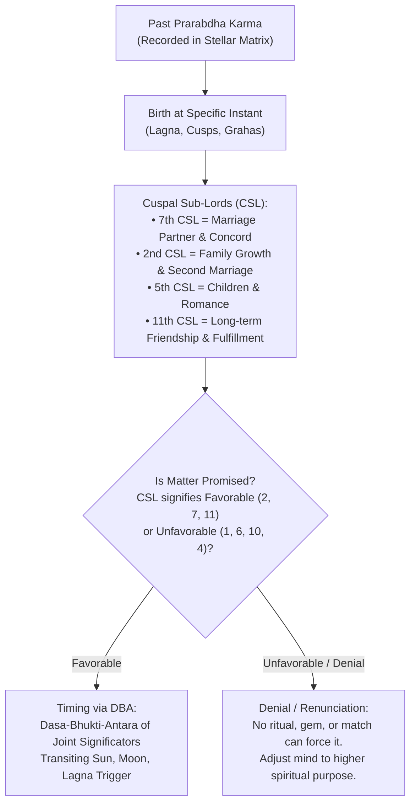
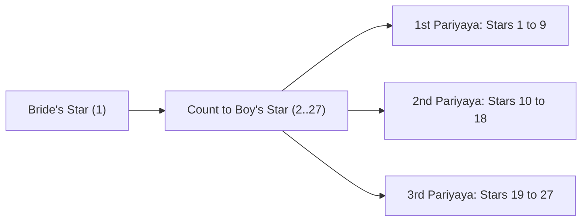
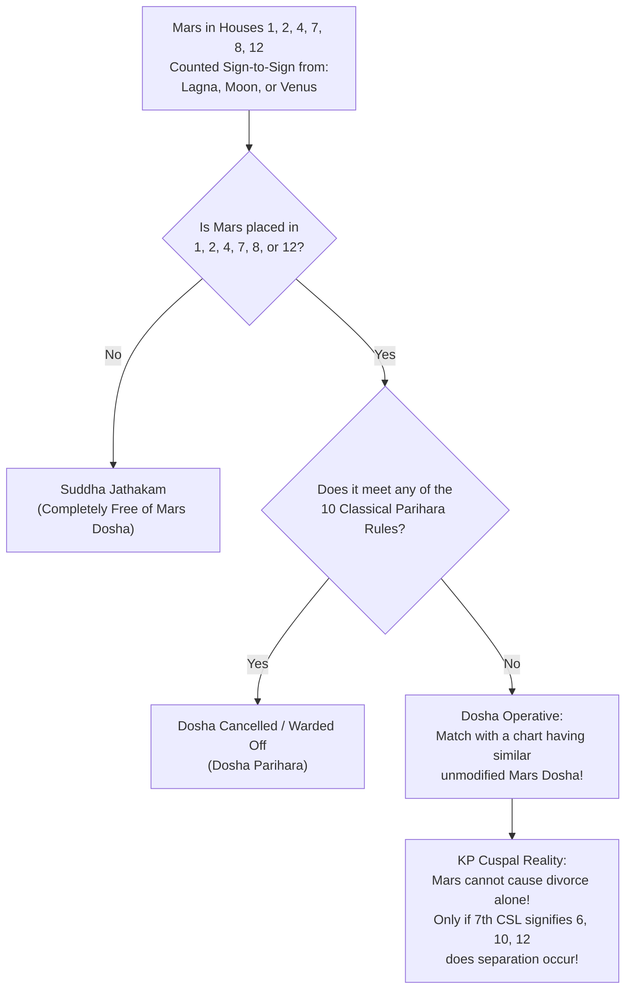
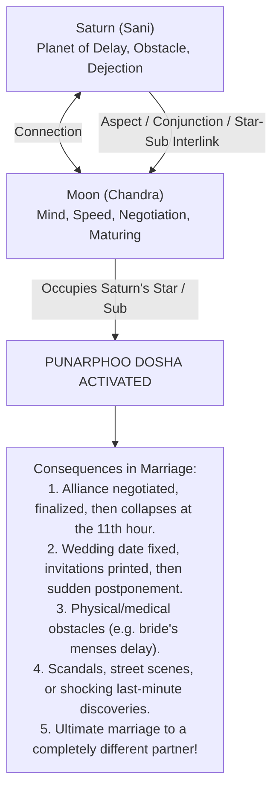
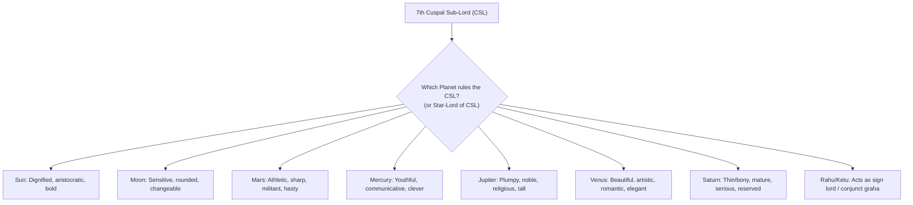
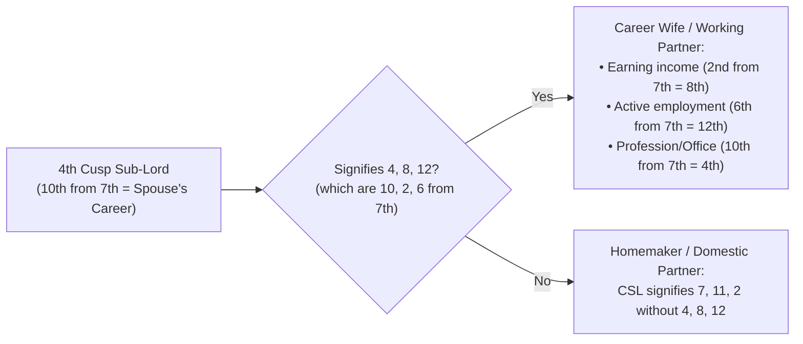
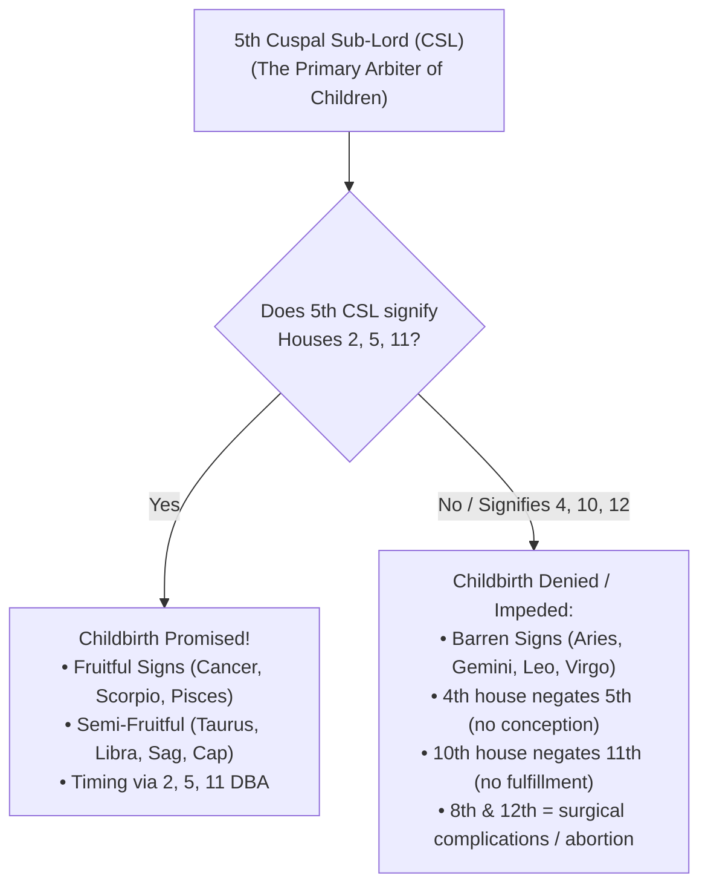

# Krishnamurti Paddhati (KP) Stellar Astrology Knowledge Base
## Stellar Astrological Reader No. IV: Marriage, Married Life & Children
### By Sothida Mannan, Jyotish Marthand Prof. K. S. Krishnamurti

---

## Document Metadata & Archival Provenance
- **Title**: *Stellar Astrological Reader No. IV: Marriage, Married Life & Children*
- **Author**: Sothida Mannan, Jyotish Marthand Prof. K. S. Krishnamurti (Founder of Krishnamurti Padhdhati)
- **Publisher**: Krishman & Co., Madras / Stellar Astrological Research Institute, India
- **Digital Archival Source**: [Internet Archive — KP Readers Collection (Complete 6 Readers)](https://archive.org/details/kp-readers) | [Full Text djvu.txt](https://archive.org/stream/kp-readers/J_KP%20reader_4_Marriage-married-Life-Children_djvu.txt#maincontent)
- **Core Scope**: Comprehensive canonical treatise on Marriage, Conjugal Harmony, Mars Dosha (Kuja Dosha), Punarphoo (Saturn-Moon affliction), 7th Cuspal Sub-Lord (CSL) mechanics, Physical features and characteristics of spouse by 7th Cusp Sub-Lord across all 12 signs, Career wife combinations, Timing of marriage, Denial and separation, Plurality of partners / second marriage, Progeny & Childbirth (5th Cusp Sub-Lord), Twins, Eunuchs, Adoption, Traditional Dasa Porutham deconstruction, and KP Karma/Remedy Philosophy.

---

## Master Table of Contents (All 77 Chapters)

1. **Introduction** (Domestic harmony vs worldly fortune; limitation of prayer, gems, and gurus)
2. **Astrology: Is it Pseudo Science?** (Scientific refutation of critics; magnetism, celestial correspondences, Kepler, Newton, Tycho Brahe, Dr. Carl Jung)
3. **Marriage** (Sacred institution, Prajapatya form, Vedic significance, types of wives: real wife vs mistress vs lady)
4. **Dasa Porutham** (Traditional 10 agreements; the flower without a tuft fallacy)
5. **Which Panchang to Follow?** (Astronomical superiority of Drik system & Krishnamurti Ayanamsa)
6. **Dhina Porutham** (Health and longevity; 3 pariyayas; 1st to 27th star rules; 7th star Kasyapa Maharishi findings)
7. **Gana Porutham** (Gunas: Deva, Manushya, Rakshasa; temperament matching and exceptions)
8. **Mahendra Porutham** (Progeny expansion vs short life paradox)
9. **Sthree Dheerga Porutham** (Financial accumulation & bank position)
10. **Yoni Porutham** (Conjugal attraction, psychological affinity, and sexual concord)
11. **Rasi Porutham** (Progeny and lineage; Shashta-Ashtama 6/8 positions and its cancellation exceptions)
12. **Rasyadhipadhi Porutham** (Planetary friendship of Moon sign lords)
13. **Vasya Porutham** (Mutual magnetic attraction and natural subjugation)
14. **Rajju Porutham** (Duration of married life: Siro, Kazhuthu, Nabhi, Thodai, Pada; Aroha/Avaroha and cancellation)
15. **Vedhai Porutham** (Inimical star pairs causing discord and affliction)
16. **Gothram** (Saptha Rishis lineage matching across 28 nakshatras including Abhijit)
17. **Sakunam (Omens)** (Divine natural signs and instantaneous guidance)
18. **Nimitham** (Instantaneous symbolic events: well-rope incident, twin delivery bag drop, elephant sighting)
19. **Mars and Marriage** (Exaggerations vs reality; 20 fundamental questions)
20. **Mars Dosha** (Houses 1, 2, 4, 7, 8, 12 from Lagna, Moon, Venus; all 10 cancellation / parihara conditions)
21. **Time of Marriage** (Houses 2, 7, 11 for marriage vs 1, 6, 10 for denial/delay; Dasa-Bhukti-Antara significators)
22. **Marriage-Punarphoo** (Saturn-Moon connection; delay, impediment, and cancellation; 4 detailed case histories)
23. **Happy Married Life** (Benefic sub-lords of 7th cusp signifying 2 & 11)
24. **Pleasure with Plurality of Persons** (Venus-Uranus, Moon-Venus, Rahu in 7, multiple connections)
25. **Two Wives / Second Marriage** (Dual signs on 2nd and 7th cusps; Mercury influence; 2nd house sub-lord)
26. **Direction and Locality of Partner** (Houses 3, 4, 9, 10, 11 denoting distance, town, or stranger)
27. **Profession of Partner** (Houses 4, 8, 12 indicating partner's livelihood: 10th from 7th is 4th)
28. **Who Survives Whom?** (Maraka and Badhaka sub-lords on 7th cusp)
29. **To Find Out Physical Features & Characteristics of Partner** (Exhaustive lookup: Sun, Moon, Mars, Mercury, Jupiter, Venus, Saturn, Rahu/Ketu across all 12 signs)
30. **Sub Lord of the 7th Cusp** (The decisive arbiter of marriage)
31. **Height of My Husband** (The limits of astrology and physical dimensions)
32. **Will I Marry a Career Girl?** (Sub-lord of 4th cusp signifying 4, 8, 12: 10th, 2nd, 6th from 7th)
33. **Chaste Wife** (Sub-lord of 7th free from Mars, Venus, Saturn adverse connections)
34. **Marriage (Western Astrological Perspective)** (Positive vs Negative temperaments)
35. **Marriage Denial — Grapes are Sour** (7th cusp sub-lord signifying 4, 6, 10; permanent bachelorhood)
36. **Will the Wedding Bell Ring?** (Worked horary and natal analysis)
37. **Will I Marry?** (Analysis of natal promise)
38. **When Will I Marry?** (Timing through Dasa-Bhukti-Antara and Transits)
39. **Time of Marriage** (Worked practical examples)
40. **Marriage, A Problem** (Overcoming psychological and astrological bottlenecks)
41. **My Marriage When? Letter to the Author** (Real consultant cases resolved)
42. **Separation from Partner** (Signification of 6th and 12th houses from 7th)
43. **Daughter’s Wedding When?** (9th house derived chart analysis)
44. **Son’s Wedding When?** (5th house derived chart analysis)
45. **Life with Wife** (Domestic peace vs perpetual strife)
46. **Married Life** (Delineation of marital longevity)
47. **Love and Life** (Romance vs legal wedlock: 5th vs 7th house)
48. **Can I Marry One Whom I Love?** (5th cusp and 7th cusp sub-lord harmony)
49. **Will My Love Affairs Materialise?** (Connection of 5th sub-lord to 7th and 11th vs 6th and 12th)
50. **Wife Brings Luck** (Signification of 9th and 11th from 7th: 3rd and 5th from Lagna)
51. **Will My Son-in-Law Contribute Peace to Me and Pleasure to My Daughter?**
52. **Is Second Marriage Promised?** (Sub-lord of 7th cusp in dual signs or signifying 2nd house)
53. **Two Marriages** (Detailed chart illustrations)
54. **Divorce** (7th sub-lord connected to 6th and 12th with Mars, Saturn, Uranus)
55. **Kidnapping** (Affliction to Lagna, 7th, and 4th houses)
56. **Re-Union with Husband — Domestic Facility** (Transit of significators of 2, 7, 11)
57. **Family Life or Sanyasi** (Kevala Sanyasa vs Grihastha yogas)
58. **Return and Reunion** (Horary analysis of departed spouse)
59. **Child Birth** (5th cusp, 2nd house [family growth], 11th house [fulfillment])
60. **Is There at Least One Child?** (5th cusp sub-lord in fruitful sign and signifying 2, 5, 11)
61. **Adoption** (5th cusp sub-lord connected to 8th and 12th / Saturn or Mercury)
62. **Pregnancy** (Timing fertilization and gestation through Moon and Mars)
63. **Eunuchs** (Afflictions to Mercury, Saturn, and the 5th/7th houses)
64. **Marriage is Made in Heavens** (Karmic pre-determination)
65. **Remedy Suggested** (Correcting one's conduct vs futile external rituals)
66. **Any Child at All?** (Barren signs on 5th cusp and sub-lord signifying 4, 10)
67. **When Will I Have a Child?** (Timing childbirth through Dasa-Bhukti-Antara)
68. **When Will My Daughter Deliver?**
69. **When Delivery?** (Medical astrology and KP transit triggers)
70. **Second Delivery?** (2nd child from 7th house [3rd from 5th])
71. **What is Wrong with My Child?** (Astro-pathology of progeny)
72. **Your Son is Not Robert Clive** (Debunking astrological wishful thinking)
73. **Traditional Astrology Meaningless** (Contradictions of ancient slokas without sub-lord precision)
74. **Dasa-Sandhi** (Refutation of the myth that same Dasa operating in both charts brings disaster)
75. **Eka Dasa** (Clarification on single Dasa running for both husband and wife)
76. **How to Lead a Successful Life?** (Psychological adjustment, self-mastery, and spiritual surrender)
77. **Which Gem Can I Use?** (Authentic KP rules: Gem must strengthen significators of favorable houses, not evil lords)

---

## 1. Foundational Philosophy: Marriage, Destiny & Karma

### 1.1 The Tuft and Flower Analogy (The Fallacy of Isolated Porutham)
Prof. Krishnamurti presents one of his most celebrated metaphors:
> *"If the beautiful tuft of a lady can be compared to the longevity, health, and happiness in married life, a flower can be compared to Dasa Porutham. The flower can add beauty only when there is the tuft! When there is no tuft, how can you make use of the flower? Similarly, Dasa Porutham alone cannot give happy life for a long period if the individual horoscopes are not fundamentally sound in longevity, health, finance, and mutual temperament."*

### 1.2 The Individual Chart Foundation: Six Non-Negotiable Pillars
Before ever looking at compatibility agreements or Mars Dosha, the astrologer must rigorously verify:
1. **Longevity (Ayush)**: Are both the native and the proposed partner blessed with long life? Matching a short-lived person brings early widowhood regardless of 10/10 Porutham.
2. **Health (Arogya)**: Does either suffer from chronic diseases, reproductive incapacity, or psychiatric imbalance?
3. **Finance (Dhana & Bhagya)**: Is there financial stability to maintain a home without degrading poverty?
4. **Future (Bhagya Vriddhi)**: Will prosperity ascend after marriage?
5. **Children (Santhana Prapthi)**: Is progeny promised in the 5th and 11th cusps?
6. **Harmony (Sowmanasya)**: Do the ascendants, Moon signs, and 7th sub-lords promise mutual affection, or will they live like "cat and rat"?

---

## 2. Deconstruction of Traditional Dasa Porutham (Ten Agreements)

The classical 10 Poruthams are evaluated from the Janma Nakshatras (Moon constellations) of the bride and bridegroom:

| No. | Porutham | Primary Shastric Signification | Classical Sanskrit Aphorism | KP Stellar Reality |
|---|---|---|---|---|
| 1 | **Dhina Porutham** | Health, physical vitality, long life | *Dhinath Ayushyam Arogyam* | Indicates daily health agreement. Star 2 (Sampath), 4 (Kshemam), 6 (Sadhakam), 8 (Maithram), 9 (Parama Maithram) are auspicious. Stars 3 (Vipath), 5 (Pratyaram), 7 (Vatham) are malefic in 1st pariyaya. |
| 2 | **Gana Porutham** | Mental temperament, social compatibility | *Sobhanam Ganamevacha* | Deva (Sathvic/gentle), Manushya (Thamasic/worldly), Rakshasa (Rajasic/militant). Same gana = excellent. Deva male + Manushya female = good. Rakshasa + Manushya = violent clashes unless star count > 14. |
| 3 | **Mahendra Porutham** | Progeny expansion, lineage continuity | *Mahendrath Puthra Vridhisyath* | Boy's star is 4th, 7th, 10th, 13th, 16th, 19th, 22nd, 25th from girl's. Promises children even if short-lived. |
| 4 | **Sthree Dheerga** | Financial accumulation, wealth after wedding | *Sthree Dheergath Sama Sampath* | Boy's star is > 13 stars away from girl's (some say > 7). Expands bank balance. |
| 5 | **Yoni Porutham** | Conjugal attraction, physical satisfaction | *Yoni tho Dhampath Sneham* | Animals associated with stars. Same yoni = supreme bliss. Inimical yonis (Horse/Buffalo, Elephant/Lion, Cat/Rat, Snake/Mongoose, Dog/Deer, Monkey/Goat, Cow/Tiger) create subconscious physical repulsion. |
| 6 | **Rasi Porutham** | Vamsa Vriddhi, family propagation | *Raseenam Vamsa Vriddhi* | Boy's Moon sign from girl's. 2nd = danger; 3rd = sorrow; 4th = loss; 5th = danger to spouse; 6th = Shashta-Ashtama (loss of children/conflict). **Cancelled if Moon sign lords are identical or mutual friends.** |
| 7 | **Rasyadhipadhi** | Harmony of governing planets | *Santhanam Rasi Adhipathi* | Friends = peace; Neutral = medium; Inimical = suspicion and resentment. |
| 8 | **Vasya Porutham** | Magnetic subjugation, devoted attachment | *Vasyath Anyonya Vasyakam* | Inseparable mutual attraction (e.g. Aries attracts Leo & Scorpio; Taurus attracts Cancer & Libra). |
| 9 | **Rajju Porutham** | Mangalya longevity, life of husband | *Rajjur Mangalya Vridhisyath* | Five Rajjus: Siro (Head), Kazhuthu (Neck), Nabhi (Navel), Thodai (Thigh), Pada (Foot). **Same Rajju causes distress, with Siro Rajju being the only critical one.** Cancelled by Sama-Sapthama or friendly sign lords! |
| 10 | **Vedhai Porutham** | Affliction and mutual repulsion | *Vedhaya Soka Nasanam* | Prohibited pairs: Aswini-Jyeshta, Bharani-Anuradha, Krittika-Vishakha, Rohini-Swathi, Arudra-Sravana, Punarvasu-Uttarashadha, Pushya-Purvashadha, Ashlesha-Moola, Magha-Revati. |

### 2.1 Sage Kasyapa's Special Findings on the 7th Star (Vatham / Vainasikam)
Traditionalists blindly reject the 7th star from the bride's star. Prof. Krishnamurti reveals Sage Kasyapa's precise empirical observations:
- **Krittika, Ashlesha, Chitra, Anuradha, Dhanishta, Satabhisha girls** marrying the 7th star suffer early bereavement.
- **Arudra, Purva Phalguni, and Pushya girls** marrying the 7th star are **blessed and approved!**
- **Punarvasu girl + Hasta boy**: Great happiness and abundant children.
- **Rohini girl + Magha boy**: Blessed with many noble children.
- **Purva Bhadrapada girl + Rohini boy**: Mother of many issues.
- **Jyeshta girl + Satabhisha boy**: Disaster and misery.
- **Mrigasira girl + Purva Phalguni boy**: Early loss of husband.
- **Hasta girl + Moola boy**: Strict prohibition.
- **Aswini girl + Punarvasu boy**: Successive birth of daughters causing dejection.
- **Swathi girl + Uttarashadha boy**: Successive birth of daughters.
- **Revati girl + Arudra boy**: Incurable discord, mutual hatred, and divorce.
- **Uttara Phalguni girl + Jyeshta boy**: Bitter enmity and separation.

### 2.2 Debunking "Auntie's Proverbs" (Pen Moolam, Aun Moolam, etc.)
The common Tamil folklore declares *"Pen Moolam Nir Moolam"* (a Moola star bride ruins the family) and *"Aun Moolam Arasalum"* (a Moola star groom rules kingdoms). Prof. Krishnamurti categorically refutes this nonsense:
- In reality, thousands of Moola star brides are wealthy, aristocratic, and long-lived with living in-laws, while thousands of Moola men are paupers.
- Only the **1st pada of Moola** (first 3°20') indicates potential affliction to father-in-law **if and only if** the father-in-law's own natal chart indicates end of life at that time!
- **Ashlesha 1st pada**: mother-in-law.
- **Jyeshta 1st pada**: elder brother-in-law.
- **Vishakha 4th pada**: younger brother-in-law.
- Other padas are completely harmless.

---

## 3. Mars and Marriage (The Truth About Manglik / Sevvai Dosha)

### 3.1 Why Mars is Feared
Mars represents blood, bone marrow, courage, ego, surgery, fire, weapons, rash impulses, and violent disputes. If afflicted, it produces:
- Domestic violence, hasty arguments, irreconcilable friction.
- Menstrual hemorrhages, obstetric surgical emergencies, or accidents.
- Premature bereavement or widowhood.

### 3.2 Exact Sign-to-Sign Calculation
Mars Dosha is counted **strictly sign-to-sign** (not Placidus house-to-house) from:
1. **Lagna (Ascendant)**: Health, vitality, and partner's maraka (7th from 7th).
2. **Moon (Chandra)**: Mental peace and emotional durability.
3. **Venus (Shukra)**: Conjugal bliss and legal partnership.
*Severity Hierarchy*: Dosha from Venus > Dosha from Moon > Dosha from Lagna.

### 3.3 The 10 Classical Exceptions (Dosha Parihara)
1. **Mars in Own Sign or Exaltation**: Mars in Aries, Scorpio, or Capricorn in 4 or 7 has no dosha (*Chathush Sapthamako Bhowmo Mesha Karkati Nagraha*).
2. **Mars in Movable Signs**: In Aries, Cancer, Libra, Capricorn in 1, 2, 4, 7, 8, 12, dosha is nullified.
3. **Aspect or Conjunction with Jupiter or Mercury**: (*Budhaena Saha Samsthithya Dhrishtae va naiva sambhaveth*).
4. **Houses Ruled by Luminaries**: Mars in Leo (Sun) or Cancer (Moon) has no dosha.
5. **Mars in 2nd House**: In Aries, Scorpio, Gemini, or Virgo in the 2nd house = No dosha (*Dwitheeya Kuja Doshasyath Mesha Vrischika Yore Vina*).
6. **Mars in 4th House**: In Taurus, Libra, Aries, or Scorpio in the 4th house = No dosha (*Chaturthae Kuja Doshasyath Thula Vrishaba yore Vina*).
7. **Mars in 7th House**: In Aries, Cancer, Scorpio, or Capricorn in the 7th house = No dosha.
8. **Mars in 8th House**: In Sagittarius, Pisces, Cancer, or Capricorn in the 8th house = No dosha (*Ashtamae Bhowma Doshasthu Dhanur Meenadhvayore Vina*).
9. **Mars in 12th House**: In Gemini, Virgo, Taurus, or Libra in the 12th house = No dosha (*Vyayaecha Khuja Doshasyath Kanya Mithunayore Vina*).
10. **Conjunction with Moon or Jupiter**: (*Chandra Mangala Samyogae* / *Guru Mangala Samyogae* cancels Kuja dosha within 8°).

---

## 4. Punarphoo: The Saturn-Moon Impediment in Marriage

### 4.1 Classical Modes of Punarphoo
Punarphoo exists whenever:
1. Saturn and Moon are conjunct in any sign (especially houses 1, 2, 4, 7, 8, 11).
2. Saturn aspects Moon (3rd, 7th, or 10th drishti).
3. Moon is deposited in Saturn's star (Pushya, Anuradha, Uttara Bhadrapada) and in the sub of Moon, or Saturn in Moon's star and Saturn's sub.
4. Saturn or Moon occupy houses 1, 3, 6, 7, 10 while being interlinked.

### 4.2 The Four Remarkable Case Histories of Prof. Krishnamurti
1. **The Kumbakonam 10:35 PM Phone Call**: During a Bharatiya Vidya Bhavan lecture, two brothers worried that their sister's menstrual cycle was overdue by 8 days, threatening to cancel the wedding in 9 days. Prof. Krishnamurti applied KP Horary and declared: *"She will commence her period tonight, and at 10:35 PM sharp you will receive a trunk call from Kumbakonam confirming it."* Exactly at 10:35 PM, the phone rang with the green signal!
2. **The Runaway Bridegroom Dragged in the Street**: A father ignored Prof. Krishnamurti's warning of Punarphoo. On the wedding evening, as the groom walked out for the temple procession in an adorned car, a street man rushed forward, looped his upper cloth around the groom's neck, and dragged him through the dirt, shouting that the groom had seduced and impregnated his maidservant in the railway quarters! The wedding was instantly cancelled, the food discarded, and flowers stripped from the car.
3. **The Heavy Bride (Photo vs Reality)**: An inspector was promised an attractive girl based on a 4-year-old slim photograph. Due to Saturn-Moon Punarphoo in both charts, when the groom visited in person, the bride had put on immense weight, having a short, stout neck merged with the torso. The groom immediately demanded his dowry back and stopped the marriage.
4. **The Fourth Proposal Success**: Proposals 1, 2, and 3 look ideal, excite immense hope, and then collapse unexpectedly. Only the unexpected 4th alliance suddenly materializes into lasting bliss.

---

## 5. Physical Features & Characteristics of Spouse by 7th Cusp Sub-Lord

The definitive, authoritative reference table from KP Reader IV detailing the physical features, stature, face, complexion, and mental temperament of the partner based on the planet governing the Sub-Lord of the 7th Cusp and the Zodiac sign it occupies:

### 5.1 When the 7th Cusp Sub-Lord is SUN
- **Aries**: Middle stature, strong, well-proportioned body, good complexion, full piercing eyes; bold, noble, asserts rights, victorious, proud, socially prominent.
- **Taurus**: Short and well-set, broad face and mouth, darkish complexion; athletic sportsman, over-confident, tenacious debater who wins arguments.
- **Gemini**: Above average height, well-proportioned body, moderate complexion, long nose, piercing eyes; courteous, tactful, accommodative, pleasing manners.
- **Cancer**: Short stature, repulsive or plain face, not handsome/beautiful (avoid consultations between July 15 and Aug 17 when Sun is here!); harmless, cheerful, loves music and dance, lazy.
- **Leo**: Strong, majestic, well-built, moderate complexion, round face, prominent eyes; intensely faithful, punctual, fair, ambitious, commanding leader.
- **Virgo**: Tall with slender, graceful stature, dark hair, attractive complexion; fond of singing, always smiling, pleasant, never provokes anger.
- **Libra**: Tall, upright, beautiful symmetry, big eyes, thinning hair; speaks endlessly of heroism/war but personally timid; fickle affections, evasive with truth.
- **Scorpio**: Square-built, fleshy, full muscular growth, broad face; ingenious, brilliant discoverer, refuses defeat, ambitious, highly fortunate.
- **Sagittarius**: Tall, handsome, oval face, proportional limbs; severe, high ideals, over-estimates ability, generous, dignified.
- **Capricorn**: Thin, wiry, tall, long nose, soft hair; sickly look but pleasing manners, makes numerous friends, commands goodwill.
- **Aquarius**: Tall, well-made, round face, clear complexion; noble, never deceitful, proud, intellectual, fond of society.
- **Pisces**: Short, stout, protruding eyes, round bloated face; fond of sensual pleasures, extravagant, poor financial manager, partial referee.

### 5.2 When the 7th Cusp Sub-Lord is MOON
- **Aries**: Fleshy, plump, round face, fair complexion; adamant, aggressive, ambitious, authoritative, assertive.
- **Taurus**: Strong, well-built, just below average height, fair complexion, strikingly attractive; polite, modest, honest, helpful, peaceful.
- **Gemini**: Tall, upright, attractive complexion; ingenious, restless, lacks firm decision, fluctuating vocational fortunes.
- **Cancer**: Average height, fleshy, rounded face, soft complexion; easily influenced, gentle, fond of travel and company, highly fortunate.
- **Leo**: Well-built, average height, prominent eyes; proud, independent, refuses to serve as a subordinate, ambitious, occasionally unfortunate.
- **Virgo**: Tall, oval face, good complexion; brilliant intellect, reserved, melancholic tendencies, introspective.
- **Libra**: Tall, elegant, beautiful, witty, ever-smiling; loves amusements, craves admiration from the opposite sex, charming companion.
- **Scorpio**: Below average height, stout, dark/dusky complexion; impulsive, moody, difficult to please, turbulent passions.
- **Sagittarius**: Handsome, athletic, oval face, honest; generous, quick-tempered, noble, fortunate.
- **Capricorn**: Thin, weak constitution, poor complexion, bushy hair; lethargic, pessimistic, selfish, ignored by companions.
- **Aquarius**: Moderate height, well-made, pleasant complexion; highly intelligent researcher, polite, never offensive, studious.
- **Pisces**: Below average height, plump, bloated pumpkin-like face, eyes heavy/sleepy; inactive except for sensual pleasures, unsteady.

### 5.3 When the 7th Cusp Sub-Lord is MARS
- **Aries**: Moderate height, muscular, large bones, curling hair, ruddy/dark complexion; bold, rash, proud, quarrelsome, always gains victory.
- **Taurus**: Moderate height, strong, coarse hair, broad mouth and face; sensual, stubborn, arrogant, speculative.
- **Gemini**: Very tall, well-proportioned, darkish skin; restless, cunning, changes residence, evades repaying debts, swindling traits.
- **Cancer**: Short, dusky skin, sparse hair, crooked/defective gait; unreliable, menial, incapable of noble tasks.
- **Leo**: Tall, athletic, oval face, dark complexion, powerful limbs; loves shooting, military, sports; quick to fight, well-dressed.
- **Virgo**: Moderate height, thick nose, dark complexion; hasty, vindictive, ruthless, retaliates without mercy.
- **Libra**: Tall, handsome, oval face, red/ruddy complexion; boastful, proud, vanity in dress, strongly attached to opposite sex.
- **Scorpio**: Stout, bulky, dark complexion, curly hair, broad face; vindictive, revengeful, intelligent, fierce debater.
- **Sagittarius**: Tall, well-proportioned, ruddy skin, oval face, piercing eyes; jovial, optimistic, quick, talkative, bold.
- **Capricorn**: Short, lean, thin face, dark complexion; sharp wit, humorous, highly ambitious, pushy, successful in career.
- **Aquarius**: Well-built, good complexion, fair; talented debater, buoyant, moderate fortune.
- **Pisces**: Below average height, dirty look, dull, idiotic; self-indulgent, careless, blunders in public social situations.

### 5.4 When the 7th Cusp Sub-Lord is MERCURY
- **Aries**: Moderate height, slender body, oval face, brownish hair; quick in speech and thought, inventive, studious writer, disorderly.
- **Taurus**: Stout, strong, dark complexion, short thick hair; leisurely, loves recreation and opposite sex, diplomatic, accumulates wealth.
- **Gemini**: Tall, well-built, brown hair, fair complexion; eloquent orator, clever lawyer/agent, versatile, humorous.
- **Cancer**: Short, stout, dark hair, sharp nose, small eyes; variable, retentive memory, sociable, fond of picnics and parties.
- **Leo**: Robust health, good stature, brown hair, round face, large eyes; kind-hearted, persistent, talented in arts, music, drama.
- **Virgo**: Tall, lean, brown hair; exceedingly intelligent, cautious, practical, profound researcher in occult and sciences.
- **Libra**: Tall, strong, slender, brown hair; dispassionate judge, talented in mathematics and arts, wide social circle.
- **Scorpio**: Short, broad shoulders, dark complexion, brown hair; stubborn, reckless, critical, suspicious, develops hypnotic powers.
- **Sagittarius**: Tall, large thick bones, oval face, long nose; independent, rebellious, prophetic mind, active, authoritative.
- **Capricorn**: Thin, lean face, brown thin hair; irritable, discontented, suspicious, painstaking occult scholar.
- **Aquarius**: Moderate height, attractive appearance, dark hair, fair; original thinker, humanitarian, researcher, expounder of theories.
- **Pisces**: Short, stout, pale, hairy body; intuitive, psychic, analytical mind, finds joy in nursing and aquatic recreations.

### 5.5 When the 7th Cusp Sub-Lord is JUPITER
- **Aries**: Middle stature, expressive eyes, prominent nose, facial pimples; progressive, generous, philosophical, fond of travel and sports.
- **Taurus**: Moderate height, stout, handsome, reserved; steady, gains through marriage and legacy, religious, dutiful.
- **Gemini**: Well-built, slightly stout, dark hair, penetrating eyes; sympathetic, trustworthy, broad outlook, restless.
- **Cancer**: Stout, short, pale/anaemic, plump, disproportionate; charitable, imaginative artist, patriotic, loves occult and home.
- **Leo**: Strong, tall, round face, curling dark hair, big eyes; noble, broad outlook, loyal, majestic, wealthy, diplomatic.
- **Virgo**: Above average height, handsome, black hair, fair complexion; analytical, wise, popular, speculative gains.
- **Libra**: Handsome, robust health, oval face, dark hair; obliging, peaceful, artistic, gains through spouse, happy marriage, noble children.
- **Scorpio**: Well-built, beautiful, strong-willed, deep emotions; ambitious, persevering, research-minded, successful in arbitration.
- **Sagittarius**: Tall, upright, oval face, brown hair, balding or grows beard; courteous, humanitarian, fortunate in sports and investments.
- **Capricorn**: Thin, below average height, small head, sparse beard; constructive, creative, economical, successful in public life.
- **Aquarius**: Below average, tallish, brown hair, deep-set eyes; sympathetic, prophetic, spiritual, independent views.
- **Pisces**: Below average, plump, brown hair; intuitive dreams, unassuming, loves nature, sanatoriums, and charitable work.

### 5.6 When the 7th Cusp Sub-Lord is VENUS
- **Aries**: Average height, slender, thin hair, scar on face; artistic, passionate, fond of music and sculpture, popular.
- **Taurus**: Radiant health, very attractive face, proportionate body, slightly stout; deeply affectionate, faithful, saves money, enjoys luxury.
- **Gemini**: Middle stature, charming appearance, dark hair; multiple romantic interests, versatile writer/musician, unsteady.
- **Cancer**: Short, stout, round face, delicate health; deeply attached to home and family, hypnotic charm, secret attachments.
- **Leo**: Tall, well-built, clear eyes, round face, fair skin; warm-hearted, artistic, gains through shares and speculative markets.
- **Virgo**: Tall, oval face, dark hair; sympathetic, secret romances, gains through medical nursing and gardening.
- **Libra**: Erect, straight, tall, strikingly beautiful, long brown hair; pleasing manners, ever-smiling, ideal companion of lifelong harmony.
- **Scorpio**: Short, stout, robust, dark complexion; passionate, extravagant, gains through dowry/gift, turbulent domestic life.
- **Sagittarius**: Tall, fair long face, brown hair, refined nature; romantic, loves outdoor games, boating, highly intuitive.
- **Capricorn**: Moderate height, pale, thin, looks sickly, dark hair; business-like, banking investor, delayed marriage, cautious.
- **Aquarius**: Beautiful, robust health, fair, large body; humanitarian, romantic, generous spender, most hopes fulfilled.
- **Pisces**: Moderate height, muscular, round face, very fair; charitable, emotional, fond of painting, music, and social prominence.

### 5.7 When the 7th Cusp Sub-Lord is SATURN
- **Aries**: Dark complexion, bony, thin, dull face, sparse hair; boastful, ambitious, obstacles and hardships.
- **Taurus**: Ugly or rough appearance, stout, heavy dark hair, quick-tempered; economical, reserved, loves agriculture, unhappy domestic life.
- **Gemini**: Tall, dark, long face, black hair; deep meditator, fond of mathematics and science, troubled by relatives and litigation.
- **Cancer**: Thin, weak health, sickly look, deep-set eyes; discontented, frequently changes residence, industrious, psychic.
- **Leo**: Tall, broad face and shoulders, sunken eyes, short beard; stubborn, God-fearing, overworks, exhausted in domestic life.
- **Virgo**: Tall, thin, long forehead, black hair; frugal, reserved, suspicious, domestic disharmony, labour problems.
- **Libra**: Tall, long face, prominent nose, broad forehead; respected, scientific, disappointment in love, delayed marriage, separation.
- **Scorpio**: Moderate height, stout, big shoulders, dark hair; violent passions, jealous, domestic misery, addicted to drink.
- **Sagittarius**: Huge body, moderate complexion; helpful, fearless, philosophical, nervous debility, multiple occupations.
- **Capricorn**: Lean, bony, sunken cheeks and eyes, hunch-backed; serious, peevish, inferior companions, unhappy marriage.
- **Aquarius**: Tall, large head, sunken eyes, brown hair; deep thinker, reserved, intellectual, romantic fidelity.
- **Pisces**: Moderate height, average complexion, protruding eyes, irregular teeth; unfaithful friends, secret worries, easily fatigued.

### 5.8 When the 7th Cusp Sub-Lord is RAHU or KETU
- Look to the **planet with which the Node is conjunct**.
- If no planet is conjunct, look to the **planet that aspects the Node**.
- If neither conjunct nor aspected, take the **ruler of the sign** in which the Node is deposited.
- If in a star, evaluate through the **Star Lord of the Node**.

---

## 6. Conjugal Happiness, Plurality of Partners & Second Marriage

### 6.1 Happy Married Life Combinations
- **Jupiter or Venus as 7th Cusp Sub-Lord** signifying houses 2 or 11.
- Benefic planet in 7 aspected by significators of 11.
- Sun or Moon in 7 receiving mutual trine/sextile from 2 or 11.
- Venus in Upachaya houses (3, 6, 10, 11) receiving beneficial aspects and **not in the sub of 6, 10, 12 significators**.

### 6.2 Discord, Separation & Divorce
- **7th Cusp Sub-Lord signifying 6 (separation/litigation), 10 (denial of family), or 12 (loss/hospitalization/bed pleasures destroyed)**.
- Mars in 7 receiving adverse aspect from Uranus = Sudden violent separation.
- Mars + Saturn + Uranus afflicted = Legal divorce.
- Mercury in 7 afflicted by Mars/Uranus = Spouse suffers nervous breakdown.
- Mars in 8th in Moon's sub = Violent, short-tempered, alcoholic partner.

### 6.3 Pleasure with Plurality of Persons
- Venus and Uranus forming hard aspects = Secret affairs with unmarried persons.
- Moon forming square/opposition with Venus = Affairs with other people's partners.
- Moon, Venus, Uranus, Neptune in 1, 2, 5, 7, 11 = Multiple romantic contacts; Saturn keeps it secret; Mars/Mercury makes it brazen and public.
- Mars, Venus, Saturn in mutual aspect = Unnatural, low-bred, or servant attachments.

### 6.4 Two Wives / Second Marriage
- **Sub-Lord of 7th Cusp is Mercury** (planet of duality) OR **occupies a dual sign** (Gemini, Virgo, Sagittarius, Pisces) AND is connected to houses 2 and 11.
- **2nd Cusp Sub-Lord** (representing the 2nd wife / addition to family) signifies 2, 7, 11.

---

## 7. Career Wife & Modern Vocations (Will I Marry a Career Girl?)

### 7.1 The Mathematical Principle
- The spouse's profession is the **10th house counted from the 7th house**, which is the **4th house of the native's chart**!
- The spouse's income is the **2nd house from the 7th**, which is the **8th house of the native**.
- The spouse's daily service/employment is the **6th from the 7th**, which is the **12th house of the native**.
- **Rule**: If the **Sub-Lord of the 4th Cusp** is a significator of **4, 8, or 12**, the native **will marry a career girl / working partner**.
- If Mars is a significator of 4, 8, 12, she will be an independent executive, doctor, captain, or engineer.

---

## 8. Denial of Marriage: "Grapes are Sour"

### 8.1 The Astrological Formula for Permanent Bachelorhood
- Marriage is governed by houses **2 (family expansion), 7 (legal partnership), and 11 (permanent friendship)**.
- The negation of any house is its **12th house**:
  - Negation of 2nd is **1st house**.
  - Negation of 7th is **6th house** (separation, litigation, divorce).
  - Negation of 11th is **10th house** (separation of friends, status without spouse).
- In addition, the **4th house negates the 5th house** (romance, courtship).
- **Rule of Denial**: If the **Sub-Lord of the 7th Cusp is deposited in the constellation of a planet signifying the 4th, 6th, and 10th houses**, marriage is **strictly denied**.
- All proposals will drag on, kindle high hopes, and collapse. The native eventually rationalizes that "grapes are sour" and adopts an ascetic or career-absorbed life.

---

## 9. Progeny, Children & Childbirth (5th Cusp Mechanics)

### 9.1 The Fruitful vs Barren Signs in Progeny
- **Fruitful Signs (Watery)**: Cancer, Scorpio, Pisces.
- **Semi-Fruitful**: Taurus, Libra, Sagittarius, Capricorn.
- **Barren Signs**: Aries, Gemini, Leo, Virgo.

### 9.2 Rules for Progeny Evaluation
1. **Childbirth Promised**: 5th Cusp Sub-Lord signifies 2, 5, or 11 and is placed in a fruitful or semi-fruitful sign.
2. **Denial of Children**: 5th Cusp Sub-Lord signifies 4 (12th from 5th = non-conception) and 10 (12th from 11th = denial of fulfillment), situated in a barren sign.
3. **Adoption**: 5th Cusp Sub-Lord connected to 8th (unexpected legacy) and 12th (expenses/hospitality) through Saturn or Mercury, with 2, 5, 11 weak.
4. **Twin Birth**: 5th Cusp Sub-Lord in a dual sign (Gemini, Sagittarius, Pisces) signifying 2 and 5, with Mercury or Jupiter prominently involved.
5. **The Robert Clive Fallacy (Chapter 72)**: Astrologers often indulge parents by predicting their troubled child will be a world conqueror like Robert Clive. Prof. Krishnamurti severely reprimands such flattery: predict what the stellar sub-lords show with sober truth.

---

## 10. Refutation of Dasa-Sandhi & Eka-Dasa Myths

### 10.1 The Dasa-Sandhi Myth Debunked (Chapter 74)
Traditional pandits routinely reject alliances if the bride and groom change their Vimshottari Mahadashas within 6 to 12 months of each other ("Dasa-Sandhi"). Prof. Krishnamurti reveals:
- There is zero astronomical or astrological validity to this fear.
- If both enter the Dasa of benefic significators of 2 and 11, the period brings **stupendous, simultaneous prosperity!**
- Only if the incoming Dasa lords are individual Marakas or Badhakas in their separate charts does adversity strike — which is judged by individual sub-lords, not by mere coincidence of Dasa endings.

### 10.2 Eka Dasa (Chapter 75)
Running the identical Mahadasha (e.g. both running Rahu Dasa) is neither auspicious nor inauspicious on its own:
- Rahu in one chart may occupy the 11th house in Taurus (superb Rajayoga), while in the partner's chart it occupies the 6th in Scorpio.
- Each chart reacts purely to its own cuspal placements.

---

## 11. Authentic KP Philosophy: Gems, Guru & Karma (Chapters 76 & 77)

Prof. Krishnamurti concludes Reader IV with profound philosophical and remedial counsel:
> *"Neither Gem nor Guru nor God can guarantee the cure. Prayer has a limitation. It depends on you and your karma. We should try to correct ourselves. This book is very valuable. It opens the eyes of the readers. It makes you think, consider, and decide. Scientific treatment will satisfy you all. There will be no confusion; no contradiction; but this is simple, scientific, convincing and correct."*

### 11.1 The Golden Rule for Gem Prescription
1. Never wear a gem merely based on Janma Rasi or Janma Nakshatra!
2. Never wear a gem for a planet that owns or signifies the **6th, 8th, or 12th houses**, as it will supercharge disease, litigation, and financial ruin.
3. Only wear the gemstone of a planet that is a **harmonious significator of the 2nd, 11th, 9th, or 1st houses**, as verified by its Star-Lord and Sub-Lord.
